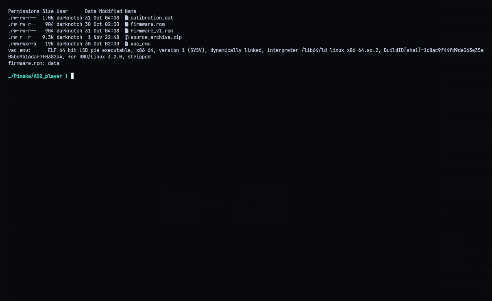
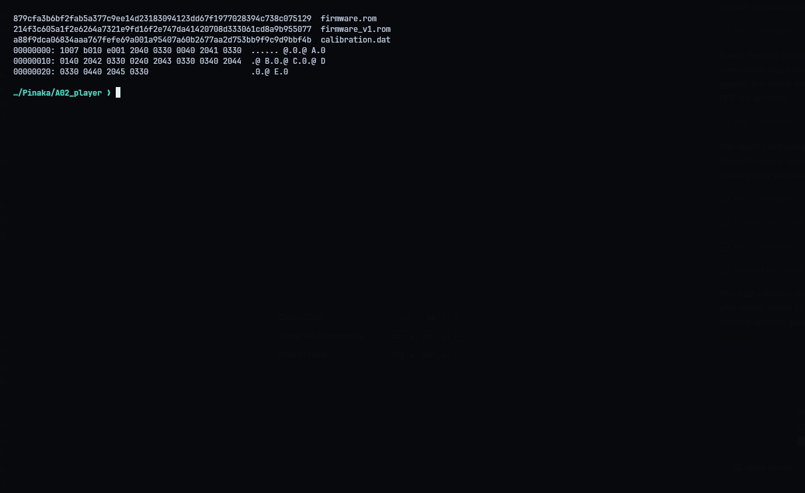
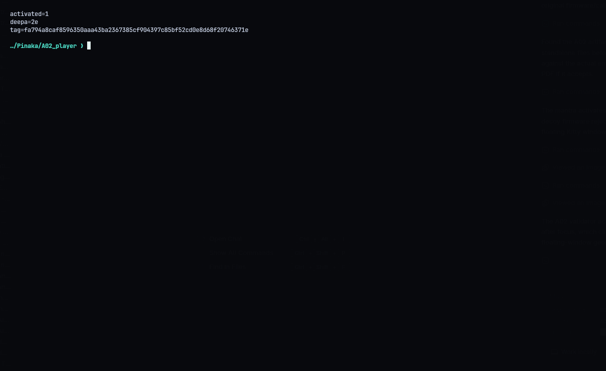
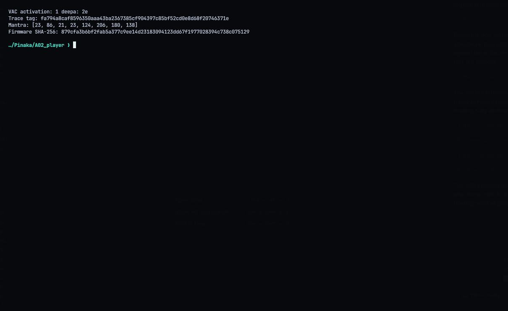
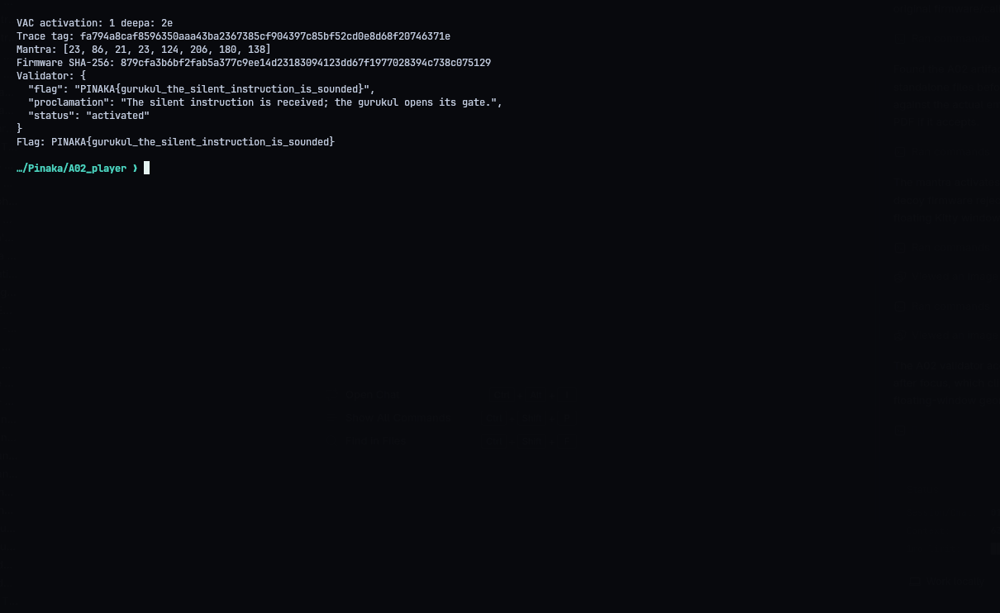

# A02 - Gurukul: The Silent Instruction

**Category:** Reverse Engineering | **Flag:** `PINAKA{gurukul_the_silent_instruction_is_sounded}`

## The challenge

We get a stripped VAC emulator, a firmware ROM, and a service that wants eight decimal "mantra" bytes. The emulator prints whether the instrument activated, the lamp output (`deepa`), and a trace tag computed over the executed instructions. The service checks both the mantra and that tag, so the input has to come from a real run of the binary, not just a guess that looks right.

## Reversing the VM

The annoying part of this VM is that an opcode's meaning depends on the current mode. In the disassembly of the interpreter, the low nibble picks a register, the high nibble gets multiplied by the active mode's multiplier, and the result mod 16 picks the operation. On top of that it has four memory banks, memory-mapped bell/lamp/activation ports, and a timer interrupt that updates a seed with `x² + 29 mod 251`.

The firmware compares each of the eight bytes against a per-position constant mod 251. Each correct byte changes the later control flow and the interrupt timing, so I couldn't solve them all at once. I recovered them one at a time, replaying the real emulator after each one. The mantra is:

`[23, 86, 21, 23, 124, 206, 180, 138]`

With those bytes the binary reports `activated=1`, `deepa=2e` and trace tag `fa794a8caf8596350aaa43ba2367385cf904397c85bf52cd0e8d68f20746371e`. The same bytes do nothing on the decoy `firmware_v1.rom`, which is a good sanity check that the right ROM was used.

## Getting the flag

`solve.py` runs the bundled binary with the mantra, checks the activation and trace, and submits both to the endpoint:

```console
./repro.sh
python3 solve.py --submit
```

The script only replays the final answer. The work is in the VM analysis above.







Flag: `PINAKA{gurukul_the_silent_instruction_is_sounded}`
