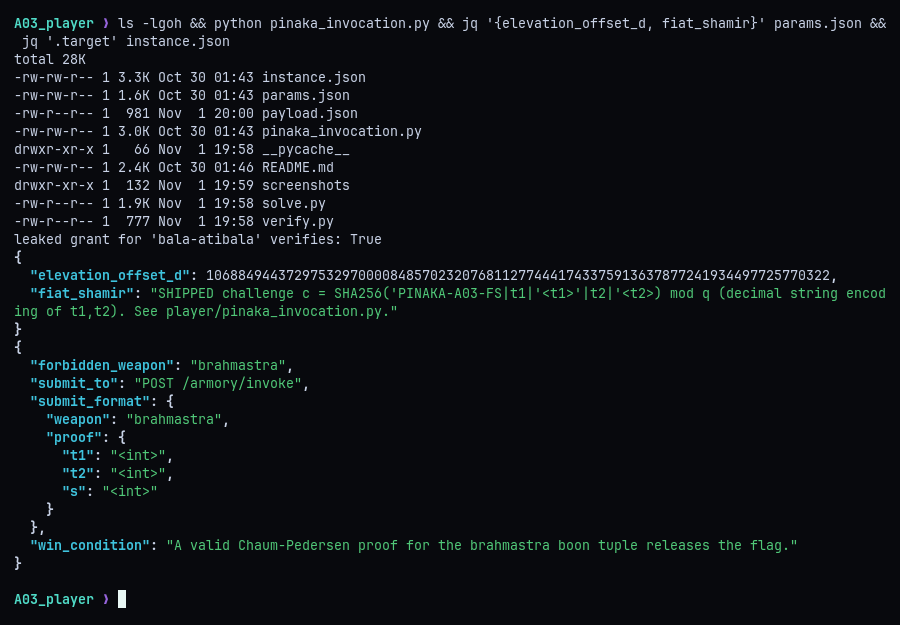
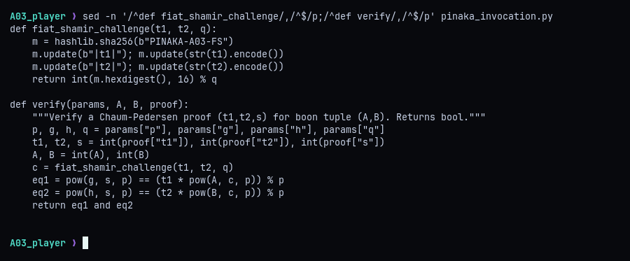
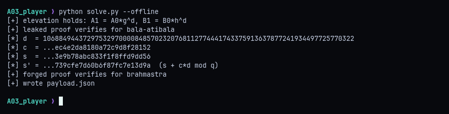
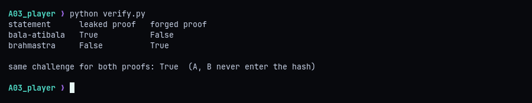
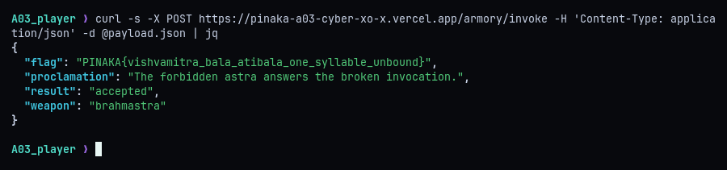

# A03 - Vishvamitra: The Broken Invocation

**Category:** Crypto (Chaum-Pedersen / Fiat-Shamir) | **Flag:** `PINAKA{vishvamitra_bala_atibala_one_syllable_unbound}`

## TL;DR

The armory accepts Chaum-Pedersen proofs made non-interactive with Fiat-Shamir, but the challenge hash covers only the commitments `(t1, t2)` and never the statement `(A, B)`. The forbidden Brahmastra tuple is the public Bala-Atibala tuple shifted by a known offset `d`, so I kept the leaked proof's commitments and moved the response to `s' = s + c*d mod q`. That proof verifies for Brahmastra without knowing any witness.

## Recon

The challenge ships `params.json`, `instance.json`, the public protocol module `pinaka_invocation.py`, and a README. The module's own self-test confirms the leaked grant really verifies for `bala-atibala`. `params.json` gives the elevation offset `d` and states the Fiat-Shamir rule outright: `c = SHA256('PINAKA-A03-FS|t1|<t1>|t2|<t2>') mod q`. The target is a valid proof for `brahmastra`, posted to `/armory/invoke`.



The group is the order-`q` subgroup of `Z_p*` with a 1024-bit safe prime `p = 2q + 1`. A statement `(A, B)` is true when one witness `w` gives `A = g^w` and `B = h^w`, and the verifier accepts `(t1, t2, s)` when `g^s = t1 * A^c` and `h^s = t2 * B^c (mod p)`.

## The unbound challenge

Reading `fiat_shamir_challenge` and `verify` side by side shows the bug. The hash takes `t1` and `t2` only. `A` and `B` are used in the verification equations but never reach the hash, so the challenge `c` is the same no matter which statement a proof is checked against.



That by itself doesn't give a forgery, since I still need a valid `s` for the new statement. The elevation rule supplies it: `A1 = A0 * g^d` and `B1 = B0 * h^d` with the same public `d`, so the Brahmastra witness is `w0 + d`. The honest response is `s = r + c*w0`, so `s + c*d = r + c*(w0 + d)` is exactly the honest response for Brahmastra, and I never need `r` or `w0`.

Checking the `g` side (the `h` side is identical):

```
g^(s + c*d) = g^s * (g^d)^c = t1 * A0^c * (g^d)^c = t1 * (A0 * g^d)^c = t1 * A1^c
```

## Forging

`solve.py` checks the elevation relation, confirms the leaked proof, computes `c` from the unchanged commitments, shifts the response, verifies the result locally against the Brahmastra tuple, and writes `payload.json`. With `--offline` it stops before submitting.



```python
from pinaka_invocation import fiat_shamir_challenge, load_instance, load_params, verify

P, I = load_params(), load_instance()
p, q, g, h, d = P["p"], P["q"], P["g"], P["h"], P["elevation_offset_d"]
lo = I["weapons"]["bala-atibala"]["boon_tuple"]
hi = I["weapons"]["brahmastra"]["boon_tuple"]
pf = I["leaked_grant"]["proof"]

assert hi["A"] == lo["A"] * pow(g, d, p) % p
assert hi["B"] == lo["B"] * pow(h, d, p) % p
assert verify(P, lo["A"], lo["B"], pf)

c = fiat_shamir_challenge(pf["t1"], pf["t2"], q)
forged = {"t1": pf["t1"], "t2": pf["t2"], "s": (pf["s"] + c * d) % q}
assert verify(P, hi["A"], hi["B"], forged)
```

## Sanity check

`verify.py` runs both proofs through the armory's own `verify()`. The leaked proof only verifies for Bala-Atibala and the forged one only verifies for Brahmastra, and both share the same challenge because `A` and `B` never enter the hash.



## Flag

Posting `payload.json` to the validator returns the flag.



**Fix:** use strong Fiat-Shamir and hash the full transcript, including the group parameters and the statement, so `c = H(domain, p, q, g, h, A, B, t1, t2)`. With `A1` in the hash, Brahmastra gets a different challenge and the `s + c*d` shift no longer verifies.

```
PINAKA{vishvamitra_bala_atibala_one_syllable_unbound}
```
