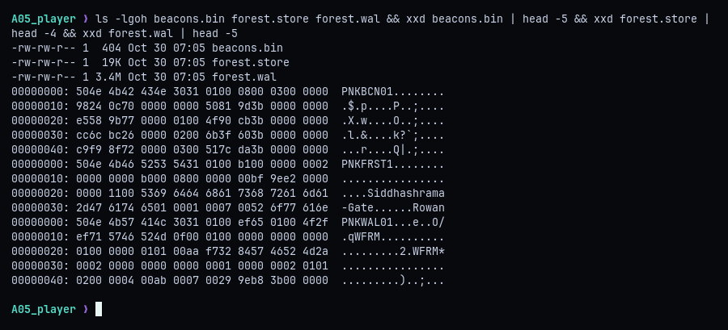
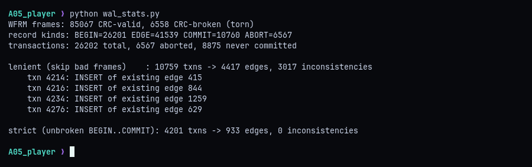
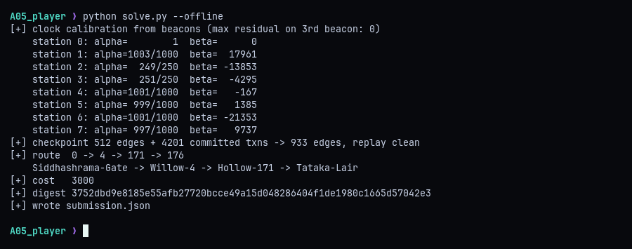
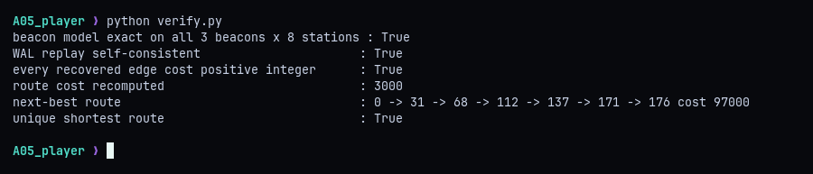
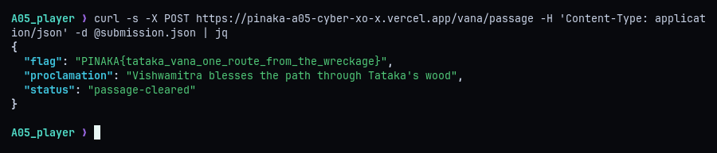

# A05 - Tataka Vana: The Corrupted Forest

**Category:** Reversing / Forensics | **Flag:** `PINAKA{tataka_vana_one_route_from_the_wreckage}`

## Summary

Three undocumented binary files describe a trail network: a checkpoint graph, a damaged write-ahead log of later changes, and a log of shared beacons between eight drifting station clocks. I reversed all three formats, fitted each station's clock exactly from the beacons, replayed only the transactions that were truly committed, and ran an exact-rational Dijkstra. The key point is the replay rule. A transaction counts only if it is one unbroken, CRC-clean BEGIN..COMMIT run. Skipping torn frames inside a transaction looks harmless but commits garbage.

## Recon

The three artifacts each start with an 8-byte magic: `PNKBCN01`, `PNKFRST1` and `PNKWAL01`. No schema is given, and the README says the flag isn't in any file. The validator wants the route, its exact cost, the recovered edge count, a SHA-256 digest of the recovered graph, and the per-station clock calibration.



From the hex dumps and some trial parsing, the formats are:

- **beacons.bin**: magic, `u16` version, `u16` stations (8), `u32` beacons (3), then 24 records of `(u32 tag, u16 beacon, u16 station, u64 local_ts)`, then a CRC.
- **forest.store**: magic, `u16` version, `u32` nodes (177), `u32` edges (512), `u16` source (0), `u16` target (176), `u16` stations, `u16` reference station, `u32` CRC. Then the nodes as `(u16 id, u16 kind, u16 len, name)`, then 32-byte edges `(u32 eid, u16 src, u16 dst, u16 station_a, u64 ts_a, u16 station_b, u64 ts_b, u32 crc32)`.
- **forest.wal**: frames of `"WFRM" + u16 len + payload + u32 crc32`. The payload is `(u64 seq, u32 txn, u8 kind, body)`, where kind is 1 BEGIN, 2 EDGE op, 3 COMMIT or 4 ABORT. An EDGE body is `u8 op` (1 INSERT, 2 UPDATE, 3 DELETE) followed by the same fields as a store edge.

An edge's traversal cost is the elapsed time on the shared reference clock, `ref(station_b, ts_b) - ref(station_a, ts_a)`. Every cost therefore depends on the calibration, so the beacons have to be solved first.

## Clocks and the damaged log

Each station's clock is linear in reference time: `local_s = alpha_s * ref + beta_s`. Station 0 is the reference, so the beacons' station-0 timestamps are the reference times. Two beacons give `alpha` and `beta` for every station as exact fractions, and the third beacon checks the fit with zero residual.

The WAL is the hard part. Scanning it for `WFRM` frames and checking each CRC gives this picture:



About 6.5k frames are torn, about 6.5k transactions abort, and nearly 9k never reach a COMMIT. The obvious approach is to drop the broken frames and keep every transaction with a valid BEGIN and COMMIT. That accepts 10,759 transactions and produces 3,017 contradictions, mostly INSERTs of edge IDs that already exist. That is the trap: a torn frame inside an open transaction means the transaction was half-written, even if a valid COMMIT follows later.

The correct rule is strict. A transaction is committed only if its records form one unbroken run, BEGIN, then EDGE ops, then COMMIT, with consecutive sequence numbers. A torn or foreign record inside the run leaves a gap in `seq`, which disqualifies it. That keeps 4,201 transactions, and replaying them over the checkpoint is perfectly self-consistent: no INSERT hits an existing edge and no UPDATE or DELETE misses one. That clean replay is what convinced me the rule was right.

## Route

`solve.py` does everything from the raw files: calibrates the clocks, parses the checkpoint (checking each edge's CRC), replays the strictly committed transactions, converts every edge to an exact `Fraction` cost, runs Dijkstra from the store's source to its target, and writes `submission.json`.



The core of it:

```python
cal, resid = forest.calibrate(forest.read_beacons())
st = forest.read_store()
recs, bad = forest.read_wal()
txns = forest.committed_txns(recs)              # strict BEGIN..COMMIT runs only
graph, problems = forest.replay(st["edges"], txns)
assert not problems

cost = forest.costs(graph, cal)                 # (ts - beta) / alpha on each end
digest = hashlib.sha256(";".join(
    f"{e}:{s}>{d}:{c.numerator}/{c.denominator}"
    for e, (s, d, c) in sorted(cost.items())).encode()).hexdigest()
route, total = dijkstra(cost, st["src"], st["tgt"])
```

The strict replay check in `forest.py`:

```python
clean = (kinds[0] == BEGIN and kinds[-1] == COMMIT
         and set(kinds[1:-1]) == {EDGE}
         and all(b[1] == a[1] + 1 for a, b in zip(rs, rs[1:])))
```

The answer is the route `0 -> 4 -> 171 -> 176` (Siddhashrama-Gate, Willow-4, Hollow-171, Tataka-Lair), with cost 3000 over a 933-edge graph.

## Double-checking

Before submitting, `verify.py` re-checks the pieces independently. The beacon model is exact on all 24 observations, the replay has no contradictions, and every edge cost comes out a positive integer, which is a strong sign the calibration is right. It then removes each edge of the route in turn and re-runs Dijkstra to find the cheapest alternative. That costs 97000, so the 3000 route is the unique shortest one.



## Flag

Posting `submission.json` to `/vana/passage` returns the flag. Running `python solve.py` without `--offline` does the same submission itself.



```
PINAKA{tataka_vana_one_route_from_the_wreckage}
```
