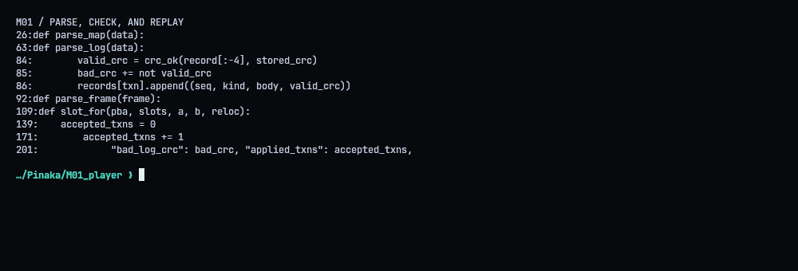
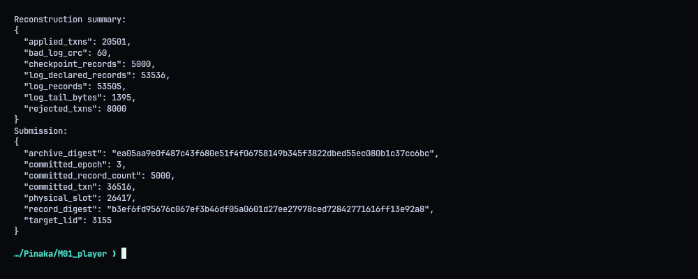
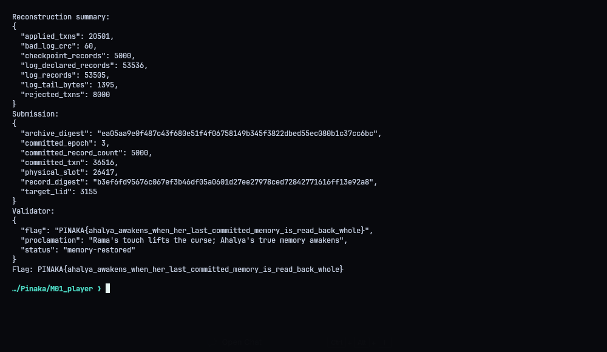
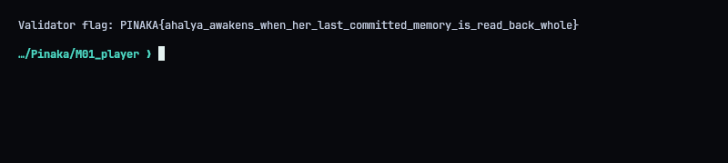

# M01 - Ahalya: The Petrified Memory

**Flag:** `PINAKA{ahalya_awakens_when_her_last_committed_memory_is_read_back_whole}`
Validator: `https://pinaka-m01-cyber-xo-x.vercel.app/ahalya/awaken`

## The goal

The archive is a dump of NVM storage with a checkpoint and a write-ahead log. Mixed in with the real data are stale, aborted, torn and uncommitted versions of records. The task is to rebuild the last durable state and find the latest *committed* Ahalya record. The later versions sitting in the dump are traps.

## Replay

I check every CRC there is (map, relocation table, log records, frame headers, frame bodies). The old-epoch chain in the log can't be trusted on its own because aborted and uncommitted transactions show up in it too. For each update I invert `pba = (A * slot + B) mod N` to get the physical slot, unless the relocation table remaps it. I only apply the update if the frame there agrees on identity, epoch, transaction, seal marker and CRCs.



Numbers after replay: 5,000 live records. The log physically holds 53,505 records, 60 of them with bad CRCs. The header says 53,536 because the tail got overwritten. 20,501 transactions are durable and 8,000 get rejected.



## The record

Target logical ID 3155 resolves to epoch 3, transaction 36516, physical slot 26417.

- SHA-256 of the 200-byte payload: `b3ef6fd95676c067ef3b46df05a0601d27ee27978ced72842771616ff13e92a8`
- Digest of the full rebuilt archive: `ea05aa9e0f487c43f680e51f4f06758149b345f3822dbed55ec080b1c37cc6bc`

`./repro.sh` rebuilds everything and sends all seven fields. The validator answered `status: memory-restored`.




## Solver (`solve.py`)

```python
#!/usr/bin/env python3
"""Reconstruct M01's latest durable archive state and submit the sealed record."""
import hashlib
import json
import os
import re
import struct
import sys
import urllib.request
import zlib
from collections import defaultdict
from pathlib import Path

ROOT = Path(__file__).resolve().parent
NVM_PATH = ROOT / "archive.nvm"
LOG_PATH = ROOT / "archive.log"
MAP_PATH = ROOT / "l2p.map"
DEFAULT_VALIDATOR = "https://pinaka-m01-cyber-xo-x.vercel.app"
FLAG_RE = re.compile(r"PINAKA\{[^}]+\}")


def crc_ok(data, stored):
    return (zlib.crc32(data) & 0xFFFFFFFF) == stored


def parse_map(data):
    if data[:8] != b"PNKL2PM1":
        raise ValueError("bad map magic")
    version = struct.unpack_from("<H", data, 8)[0]
    slots, a, b = struct.unpack_from("<III", data, 10)
    target_lid = struct.unpack_from("<H", data, 22)[0]
    nlids = struct.unpack_from("<I", data, 24)[0]
    nreloc = struct.unpack_from("<H", data, 28)[0]
    stored_crc = struct.unpack_from("<I", data, 30)[0]
    if version != 1 or not crc_ok(data[:30], stored_crc):
        raise ValueError("invalid map header/version CRC")
    pos = 34
    live = {}
    for _ in range(nlids):
        row = data[pos:pos + 18]
        if len(row) != 18:
            raise ValueError("truncated checkpoint row")
        lid, epoch, pba, _next_pba, row_crc = struct.unpack("<HIIII", row)
        if not crc_ok(row[:-4], row_crc):
            raise ValueError(f"bad checkpoint CRC for lid {lid}")
        live[lid] = (epoch, pba, 0)
        pos += 18
    reloc = {}
    for _ in range(nreloc):
        row = data[pos:pos + 12]
        if len(row) != 12:
            raise ValueError("truncated relocation row")
        slot, pba, row_crc = struct.unpack("<III", row)
        if not crc_ok(row[:-4], row_crc):
            raise ValueError("bad relocation CRC")
        reloc[pba] = slot
        pos += 12
    if pos != len(data):
        raise ValueError(f"unexpected map trailing bytes: {len(data) - pos}")
    return slots, a, b, target_lid, live, reloc


def parse_log(data):
    if data[:8] != b"PNKWALOG":
        raise ValueError("bad log magic")
    version, declared_count, header_crc = struct.unpack_from("<HII", data, 8)
    if version != 1 or not crc_ok(data[:14], header_crc):
        raise ValueError("invalid log header/version CRC")
    records = defaultdict(list)
    pos = 18
    count = 0
    bad_crc = 0
    while pos + 6 <= len(data) and data[pos:pos + 4] == b"LREC":
        body_len = struct.unpack_from("<H", data, pos + 4)[0]
        total = 6 + body_len + 4
        if pos + total > len(data):
            break
        record = data[pos:pos + total]
        seq = struct.unpack_from("<Q", record, 6)[0]
        txn = struct.unpack_from("<I", record, 14)[0]
        kind = record[18]
        body = record[19:-4]
        stored_crc = struct.unpack_from("<I", record, len(record) - 4)[0]
        valid_crc = crc_ok(record[:-4], stored_crc)
        bad_crc += not valid_crc
        records[txn].append((seq, kind, body, valid_crc))
        count += 1
        pos += total
    return records, count, declared_count, bad_crc, pos


def parse_frame(frame):
    if len(frame) != 235 or frame[:8] != b"PNKPMEM1":
        return None
    lid, epoch, txn = struct.unpack_from("<HII", frame, 8)
    sealed = frame[18] == 1
    hcrc = struct.unpack_from("<I", frame, 19)[0]
    dup_lid, dup_epoch, dup_txn = struct.unpack_from("<HII", frame, 23)
    body_crc = struct.unpack_from("<I", frame, 223)[0]
    payload = frame[23:223]
    valid = (crc_ok(frame[:19], hcrc)
             and (lid, epoch, txn) == (dup_lid, dup_epoch, dup_txn)
             and crc_ok(payload, body_crc)
             and frame[227:235] == b"PNKSEAL1")
    return {"lid": lid, "epoch": epoch, "txn": txn, "sealed": sealed,
            "payload": payload, "valid": valid}


def slot_for(pba, slots, a, b, reloc):
    if pba in reloc:
        return reloc[pba]
    return (pow(a, -1, slots) * (pba - b)) % slots


def reconstruct():
    nvm = NVM_PATH.read_bytes()
    slots, a, b, target_lid, live, reloc = parse_map(MAP_PATH.read_bytes())
    if len(nvm) != slots * 235:
        raise ValueError("NVM image size does not match map geometry")
    records, record_count, declared_count, bad_crc, parsed_end = parse_log(LOG_PATH.read_bytes())

    frames = {}
    def get_frame(slot):
        if slot not in frames:
            raw = nvm[slot * 235:(slot + 1) * 235]
            frames[slot] = parse_frame(raw)
        return frames[slot]

    # Verify checkpoint pointers, then replay only complete, durable committed writes.
    for lid, (epoch, pba, _txn) in list(live.items()):
        slot = slot_for(pba, slots, a, b, reloc)
        frame = get_frame(slot)
        if not frame or not frame["valid"] or not frame["sealed"]:
            raise ValueError(f"checkpoint frame invalid for lid {lid} at slot {slot}")
        if frame["lid"] != lid or frame["epoch"] != epoch:
            raise ValueError(f"checkpoint/frame mismatch for lid {lid}")
        live[lid] = (epoch, pba, frame["txn"])

    accepted_txns = 0
    rejected_txns = 0
    for txn in sorted(records):
        rows = records[txn]
        updates = [r for r in rows if r[1] == 1]
        commits = [r for r in rows if r[1] == 2 and not r[2]]
        aborts = [r for r in rows if r[1] == 3]
        if not updates:
            continue
        if not commits or aborts or any(not r[3] for r in rows):
            rejected_txns += 1
            continue
        candidates = []
        transaction_ok = True
        for seq, _kind, body, _crc in sorted(updates):
            if len(body) != 22:
                transaction_ok = False
                break
            lid, epoch, pba, _old_epoch, _old_pba, _old_next = struct.unpack("<HIIIII", body)
            slot = slot_for(pba, slots, a, b, reloc)
            frame = get_frame(slot)
            if (not frame or not frame["valid"] or not frame["sealed"]
                    or frame["lid"] != lid or frame["epoch"] != epoch
                    or frame["txn"] != txn):
                transaction_ok = False
                break
            candidates.append((seq, lid, epoch, pba, txn))
        if not transaction_ok:
            rejected_txns += 1
            continue
        for _seq, lid, epoch, pba, txid in candidates:
            live[lid] = (epoch, pba, txid)
        accepted_txns += 1

    if target_lid not in live:
        raise ValueError("sealed target lid is absent from reconstructed map")
    epoch, pba, txn = live[target_lid]
    physical_slot = slot_for(pba, slots, a, b, reloc)
    target_frame = get_frame(physical_slot)
    if not target_frame or not target_frame["valid"] or not target_frame["sealed"]:
        raise ValueError("reconstructed target is not a durable sealed frame")
    record_digest = hashlib.sha256(target_frame["payload"]).hexdigest()

    rows = []
    for lid, (live_epoch, live_pba, live_txn) in sorted(live.items()):
        slot = slot_for(live_pba, slots, a, b, reloc)
        frame = get_frame(slot)
        if not frame or not frame["valid"] or not frame["sealed"]:
            raise ValueError(f"live frame invalid for lid {lid}")
        payload_hash = hashlib.sha256(frame["payload"]).hexdigest()
        rows.append(f"{lid}:{live_epoch}:{payload_hash}")
    archive_digest = hashlib.sha256(";".join(rows).encode("ascii")).hexdigest()
    answer = {
        "target_lid": target_lid,
        "committed_epoch": epoch,
        "committed_txn": txn,
        "physical_slot": physical_slot,
        "record_digest": record_digest,
        "committed_record_count": len(live),
        "archive_digest": archive_digest,
    }
    stats = {"log_records": record_count, "log_declared_records": declared_count,
             "bad_log_crc": bad_crc, "applied_txns": accepted_txns,
             "rejected_txns": rejected_txns, "checkpoint_records": 5000,
             "log_tail_bytes": len(LOG_PATH.read_bytes()) - parsed_end}
    return answer, stats


def main():
    answer, stats = reconstruct()
    print("Reconstruction summary:")
    print(json.dumps(stats, indent=2, sort_keys=True))
    print("Submission:")
    print(json.dumps(answer, indent=2, sort_keys=True))
    if "--no-submit" in sys.argv:
        return
    base = os.environ.get("PINAKA_AHALYA_URL", DEFAULT_VALIDATOR).rstrip("/")
    request = urllib.request.Request(
        base + "/ahalya/awaken",
        data=json.dumps(answer, separators=(",", ":")).encode("utf-8"),
        headers={"Content-Type": "application/json"},
        method="POST",
    )
    with urllib.request.urlopen(request, timeout=30) as response:
        result = json.loads(response.read())
    print("Validator:")
    print(json.dumps(result, indent=2, sort_keys=True))
    flag_match = FLAG_RE.search(json.dumps(result))
    if not flag_match:
        raise RuntimeError("validator response did not include a flag")
    print("Flag:", flag_match.group(0))


if __name__ == "__main__":
    main()

```
