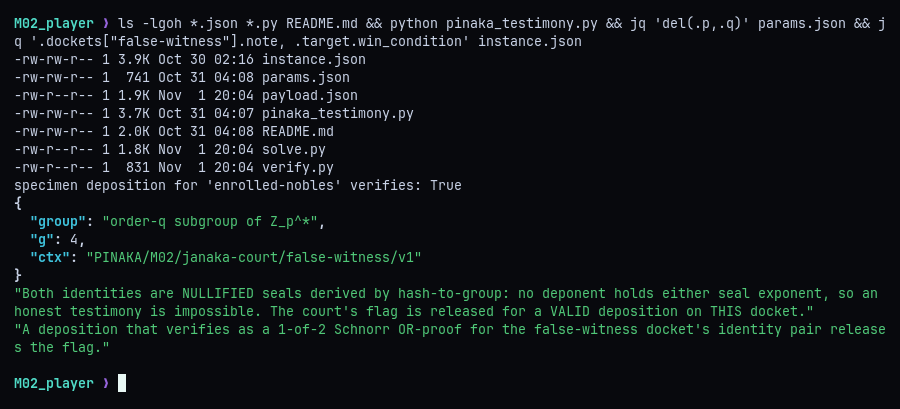
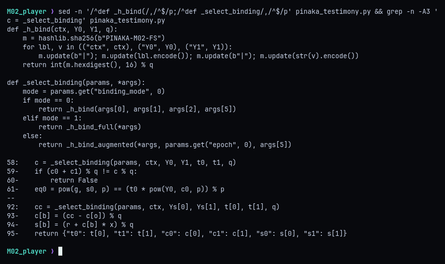
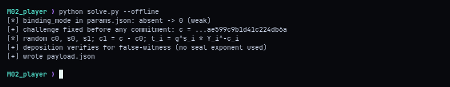
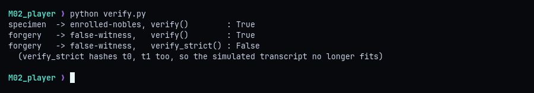
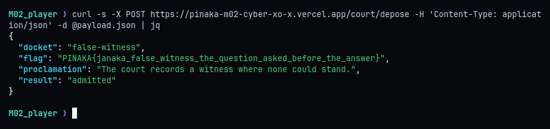

# M02 - Janaka's Court: The False Witness

**Category:** Crypto (Schnorr OR-proofs / Fiat-Shamir) | **Flag:** `PINAKA{janaka_false_witness_the_question_asked_before_the_answer}`

## TL;DR

The court accepts 1-of-2 Schnorr OR-proofs ("depositions"), and the target docket's two identities are hash-to-group points whose discrete logs nobody knows. The Fiat-Shamir challenge hashes only the context and the two public keys, never the commitments `t0, t1`, so it is fixed before anything is committed. That lets me simulate both branches at once: choose the challenges and responses first, then solve the verifier's equations for the commitments.

## Recon

The challenge ships `params.json`, `instance.json`, the court's own module `pinaka_testimony.py`, and a README. The module's self-test confirms the specimen deposition for the enrolled docket verifies, so the proof format is clear. The target docket is `false-witness`, and its note says outright that both identities are "nullified seals" with no known exponent, so an honest proof is impossible.



A deposition is `(t0, t1, c0, c1, s0, s1)`. The verifier accepts it for identities `(Y0, Y1)` when:

```
c0 + c1 = c (mod q)          where c is the Fiat-Shamir challenge
g^s0 = t0 * Y0^c0 (mod p)
g^s1 = t1 * Y1^c1 (mod p)
```

In an honest OR-proof the prover knows one secret `x_b`, simulates the other branch, and is forced to commit to both `t` values before learning `c`. That ordering is what makes the proof sound.

## What the hash actually binds

`_select_binding` picks the hash from `params["binding_mode"]`. The module includes a properly bound version (`_h_bind_full`, which hashes `t0` and `t1`), but `params.json` has no `binding_mode` key, so the verifier falls back to mode 0, `_h_bind`. That version hashes only `ctx`, `Y0` and `Y1`.



With `c` independent of the commitments, the order that gives the proof its soundness is gone. Every input to `c` is public and fixed, so I know `c` before choosing anything. The rest is algebra:

1. Pick `c0`, `s0`, `s1` at random.
2. Set `c1 = c - c0 (mod q)`, which satisfies the sum check.
3. Solve each branch equation for its commitment: `t_i = g^s_i * Y_i^(-c_i) (mod p)`.

Both branch equations then hold by construction and no secret exponent is involved. This is the "question asked before the answer" from the flag.

## Forging

`solve.py` reads the shipped files, computes `c`, simulates both branches with fresh random values, checks the result with the court's own `verify()`, and writes `payload.json`. With `--offline` it stops before submitting.



```python
c = _h_bind(ctx, Y0, Y1, q)
c0, s0, s1 = (secrets.randbelow(q) for _ in range(3))
c1 = (c - c0) % q
t0 = pow(g, s0, p) * pow(Y0, -c0, p) % p   # g^s0 = t0 * Y0^c0
t1 = pow(g, s1, p) * pow(Y1, -c1, p) % p   # g^s1 = t1 * Y1^c1
dep = {"t0": t0, "t1": t1, "c0": c0, "c1": c1, "s0": s0, "s1": s1}
assert verify(P, Y0, Y1, dep)
```

Because `c0`, `s0` and `s1` are random, every run produces a different valid forgery.

## Sanity check

`verify.py` runs three checks. The genuine specimen verifies for its own docket, and my forgery verifies for `false-witness` under the court's `verify()`. The same forgery fails `verify_strict()`, which uses the fully bound hash. That confirms the missing commitments in the hash are the whole bug.



## Flag

Posting `payload.json` to `/court/depose` gets the deposition admitted and returns the flag.



**Fix:** hash the full transcript, including the commitments: `c = H(ctx, Y0, Y1, t0, t1)`. That's exactly `_h_bind_full`, and setting `binding_mode: 1` would have closed the hole.

```
PINAKA{janaka_false_witness_the_question_asked_before_the_answer}
```
