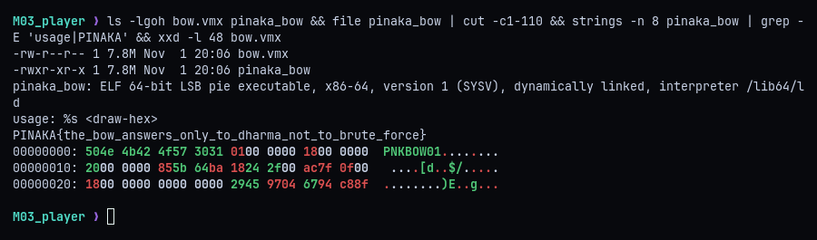
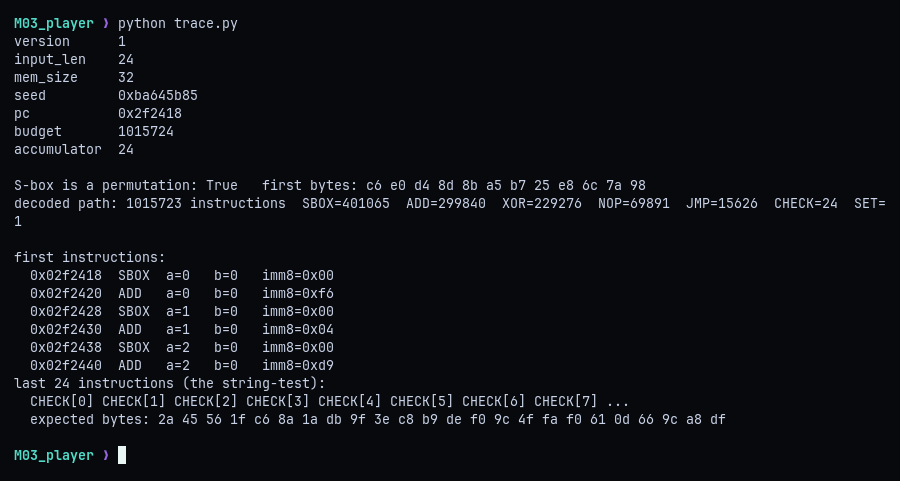
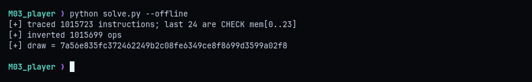
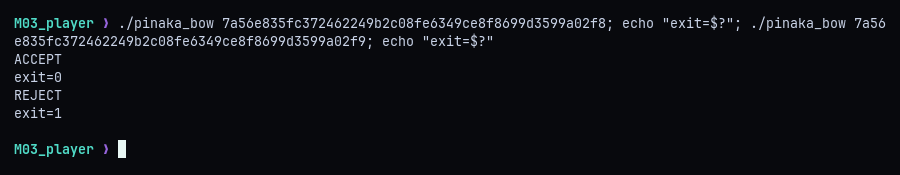
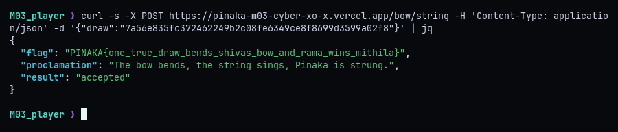

# M03 - Pinaka: The Impossible Bow

**Category:** Reverse Engineering (custom VM) | **Flag:** `PINAKA{one_true_draw_bends_shivas_bow_and_rama_wins_mithila}`

## Short version

`pinaka_bow` is a small native interpreter that runs a million-instruction `PNKBOW01` bytecode image against a 24-byte "draw" and prints ACCEPT or REJECT. The instruction decoding is keyed by a rolling state that depends only on the instruction bytes, never on VM memory, so the whole execution path can be traced statically without knowing the draw. The last 24 instructions pin the final memory, and every earlier memory operation is a bijection. Running the path backwards recovers the one accepted draw.

## Recon

The challenge gives two files: an 8 MB x86-64 ELF `pinaka_bow` (not stripped) and an 8 MB image `bow.vmx`. The binary takes the draw as 48 hex characters. Its strings include a `PINAKA{...}` flag, but that's a decoy, and the real flag only comes from the validator for an accepted draw.



The image starts with a 40-byte header after the `PNKBOW01` magic: version 1, a 24-byte input, 32 bytes of VM memory, a 32-bit decoder seed `0xba645b85`, a starting PC `0x2f2418`, an instruction budget of about one million, and the accumulator index 24.

## The VM

From the interpreter's dispatch loop:

- The seed drives a 32-bit xorshift stream. XORing its first 256 bytes with payload bytes `0x28..0x127` gives a 256-byte substitution table, which is a permutation.
- Each instruction is 8 bytes, masked by the current 32-bit state `s`: `op = b0 ^ s[0:8]`, `a = b1 ^ s[8:16]`, `b = b2 ^ s[16:24]`, `imm = u32(b4..b7) ^ s`.
- After each instruction, `s = op + s*0x01000193 - 0x61c8864f + a + b + low8((s>>24) ^ b3) + low8(imm)`.
- Opcode 7 jumps to `imm`, so the control flow is flattened and the stream can't be read linearly.

| Opcode | Effect |
|---|---|
| 0 | Halt; accept iff `mem[24] == 0` |
| 1 SBOX | `mem[a] = S[mem[a]]` |
| 2 ADD | `mem[a] += imm8` |
| 3 XOR | `mem[a] ^= mem[b]` |
| 4 NOP | no memory change |
| 5 SET | `mem[a] = imm8` |
| 6 CHECK | `mem[24] = mem[24] OR (mem[a] ^ imm8)` |
| 7 JMP | `pc = imm` |

The key observation is that neither the state update nor the jump target ever reads VM memory. The path is the same for every draw, so I can trace it once without running the binary. `trace.py` does that:



The path is 1,015,723 instructions long. Apart from a single SET, which writes the accumulator, every memory operation is an S-box lookup, a byte addition or a byte XOR, all reversible. The last 24 instructions are `CHECK mem[0]` through `CHECK mem[23]` in order.

## Running it backwards

The accumulator starts at zero and CHECK only ORs into it, so it stays zero exactly when every byte matches its CHECK immediate. That gives the complete final memory state. From there I walk the path in reverse, undoing each operation: the inverse S-box for SBOX, subtraction for ADD, and the same XOR for XOR (the source byte holds the same value at that point). NOP and JMP don't touch memory.



```python
t = vm.trace(blob, h)
checks, body = t[-24:], t[:-24]
mem = [imm for *_, imm in checks] + [0] * (h["mem_size"] - 24)
for _, op, a, b, imm in reversed(body):
    if op == 1:
        mem[a] = inv[mem[a]]
    elif op == 2:
        mem[a] = (mem[a] - imm) & 0xFF
    elif op == 3:
        mem[a] ^= mem[b]
    elif op == 5:
        assert a >= h["input_len"]       # only ever writes the accumulator
    elif op == 6:
        assert mem[a] == imm
draw = bytes(mem[:24]).hex()
```

The draw is `7a56e835fc372462249b2c08fe6349ce8f8699d3599a02f8`.

## Local check

The shipped checker accepts the recovered draw and rejects the same draw with its last bit flipped.



## Flag

The validator takes the draw at `POST /bow/string` and returns the flag. Running `python solve.py` without `--offline` submits it automatically.



```
PINAKA{one_true_draw_bends_shivas_bow_and_rama_wins_mithila}
```
