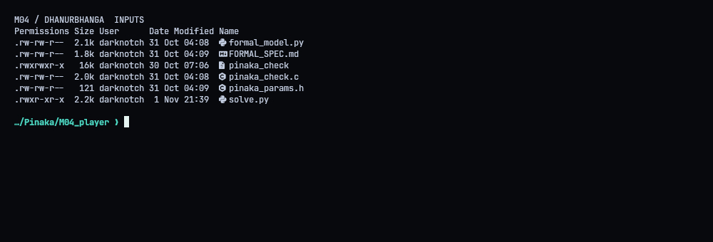
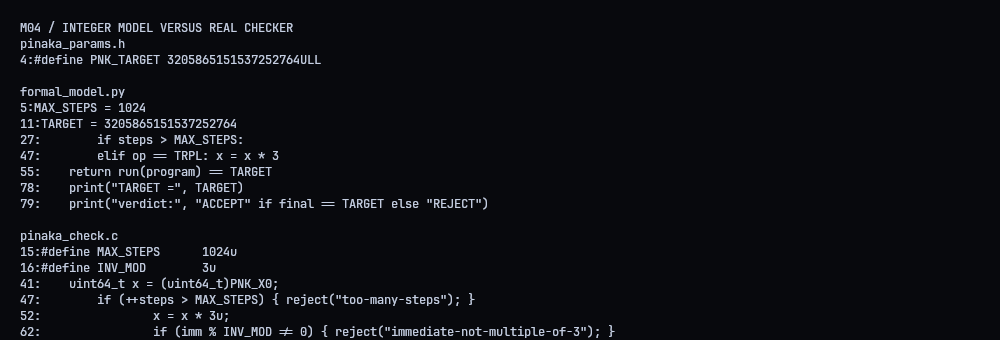
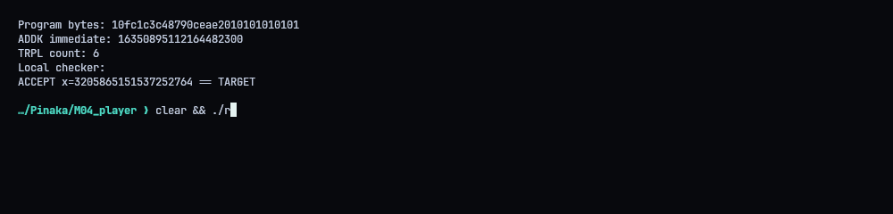
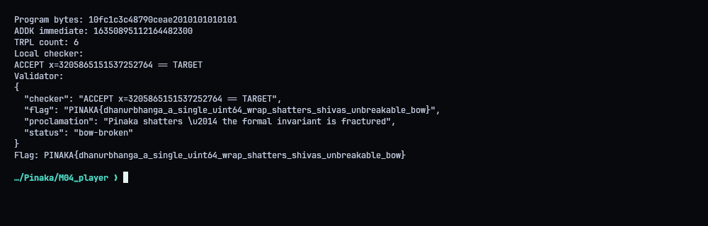
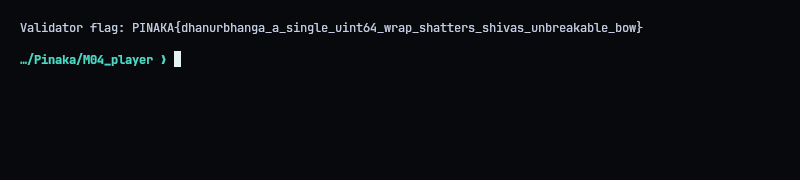

# M04 - Dhanurbhanga: The Fractured Invariant

**Flag:** `PINAKA{dhanurbhanga_a_single_uint64_wrap_shatters_shivas_unbreakable_bow}`
Validator: `https://pinaka-m04-cyber-xo-x.vercel.app/mithila/dhanurbhanga`

## The idea

We get two versions of the same machine: a Python "formal model" and the compiled C checker. The model uses Python's unbounded integers. The C code uses `uint64_t` and wraps. Every immediate has to be a multiple of 3, so starting from `X0 = 0` the model can only ever produce multiples of 3, and the target isn't one. That's the "proof" the bow can't be broken. It only holds without overflow, though. In the real checker, multiplying by 3 wraps mod `2^64`, and then the target is reachable.



## Building the program

I work backwards through six `TRPL` (multiply by 3) instructions in the 64-bit ring:

`ADDK = TARGET * inverse(3^6 mod 2^64) mod 2^64 = 16350895112164482300`

That value happens to be divisible by 3, so it's a legal immediate. The program is: start at 0, `ADDK` that value, then `TRPL` six times, with each multiply wrapping.



## Checking it

Program bytes: `10fc1c3c48790ceae2010101010101` (`ADDK` + little-endian immediate + six `TRPL` opcodes). The provided checker accepts it with final register `3205865151537252764`.



`./repro.sh` derives the program, checks it locally and submits the hex. The validator answered `status: bow-broken`.




## Solver (`solve.py`)

```python
#!/usr/bin/env python3
"""Build the uint64-wrap program, check it locally, and submit to Mithila."""
import base64
import json
import os
import subprocess
import urllib.request
from pathlib import Path

ROOT = Path(__file__).resolve().parent
X0 = 0
TARGET = 3205865151537252764
MASK = (1 << 64) - 1
TRIPLES = 6
DEFAULT_VALIDATOR = "https://pinaka-m04-cyber-xo-x.vercel.app"


def solve_program():
    # Invert six TRPL steps in Z/(2^64), then ADDK from X0=0.
    immediate = ((TARGET - X0) * pow(pow(3, TRIPLES, 1 << 64), -1, 1 << 64)) & MASK
    if immediate % 3:
        raise ValueError("derived ADDK immediate violates the divisible-by-3 rule")
    return bytes([0x10]) + immediate.to_bytes(8, "little") + bytes([0x01]) * TRIPLES


def run_local(program):
    program_path = ROOT / "solution.bin"
    program_path.write_bytes(program)
    result = subprocess.run(
        [str(ROOT / "pinaka_check"), str(program_path)],
        check=False, capture_output=True, text=True,
    )
    print("Local checker:")
    print(result.stdout.strip())
    if result.returncode != 0 or "ACCEPT" not in result.stdout:
        raise RuntimeError("compiled checker rejected the derived program")


def main():
    program = solve_program()
    print("Program bytes:", program.hex())
    print("ADDK immediate:", int.from_bytes(program[1:9], "little"))
    print("TRPL count:", TRIPLES)
    run_local(program)
    if "--no-submit" in os.sys.argv:
        return
    base = os.environ.get("PINAKA_M04_URL", DEFAULT_VALIDATOR).rstrip("/")
    request = urllib.request.Request(
        base + "/mithila/dhanurbhanga",
        data=json.dumps({"program": program.hex()}, separators=(",", ":")).encode("utf-8"),
        headers={"Content-Type": "application/json"},
        method="POST",
    )
    with urllib.request.urlopen(request, timeout=30) as response:
        result = json.loads(response.read())
    print("Validator:")
    print(json.dumps(result, indent=2, sort_keys=True))
    flag = result.get("flag")
    if not flag:
        raise RuntimeError("validator response did not include a flag")
    print("Flag:", flag)


if __name__ == "__main__":
    main()
```
