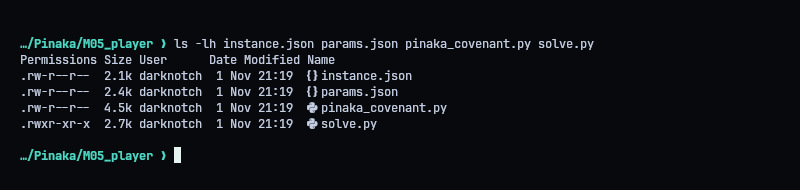
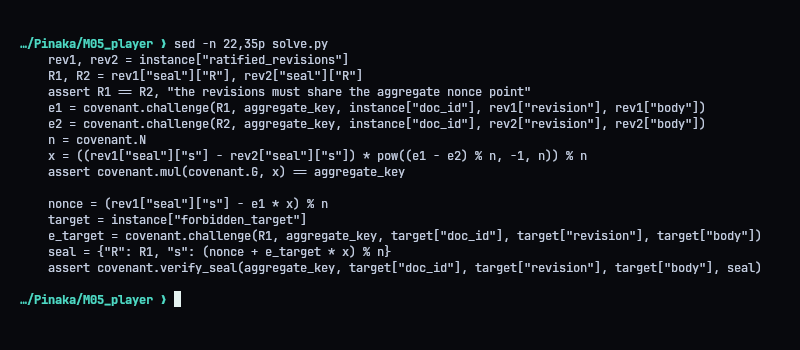
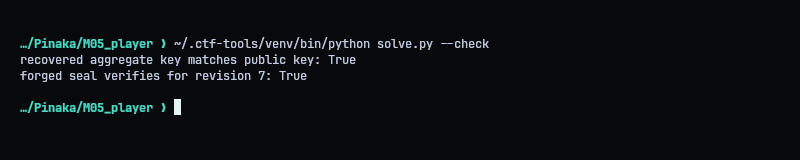
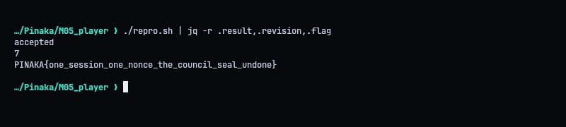
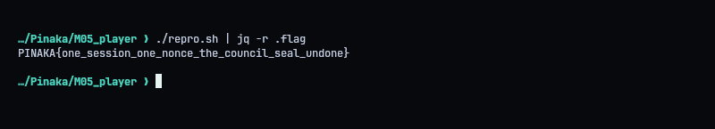

# M05 - Vaidehi: The Sealed Covenant

**Category:** Crypto | **Flag:** `PINAKA{one_session_one_nonce_the_council_seal_undone}`

## Summary

Classic Schnorr nonce reuse. The registry publishes two valid seals for different revisions, and both have the same `R`. Different revisions give different challenges, so subtracting the two signature equations cancels the nonce and gives the aggregate private key. With the key I signed revision 7, the one the council refused.

## Recon

We get the public parameters, two ratified revisions and the protocol module. The revision number and body differ between the two seals, but `R` is identical. That's the whole challenge.



## Recovering the key

Each seal satisfies `s = k + e*x (mod n)`. Same `R` means same `k`, so:

`x = (s1 - s2) * (e1 - e2)^-1 (mod n)`

Before using `x`, I check that it really matches the published aggregate public key.



## Forging revision 7

With `x` known, `k` falls out of either seal. I compute the challenge `e7` for revision 7 and sign it: `s7 = k + e7*x (mod n)`. `solve.py` builds the request from the bundled JSON, runs the forged seal through the provided verifier, and only then submits it:

```console
python3 solve.py --check
python3 solve.py
```

```python
#!/usr/bin/env python3
"""Recover the reused Schnorr nonce, forge revision 7, and submit its seal."""
import argparse
import json
from pathlib import Path
import urllib.error
import urllib.request

import pinaka_covenant as covenant

HERE = Path(__file__).resolve().parent
TARGET = "https://pinaka-m05-cyber-xo-x.vercel.app/covenant/seal"


def forge():
    params = covenant.load_params()
    instance = covenant.load_instance()
    public_keys = [member["pubkey"] for member in params["council"]]
    aggregate_key, _ = covenant.key_agg(public_keys)
    assert list(aggregate_key) == params["aggregate_key"]

    rev1, rev2 = instance["ratified_revisions"]
    R1, R2 = rev1["seal"]["R"], rev2["seal"]["R"]
    assert R1 == R2, "the revisions must share the aggregate nonce point"
    e1 = covenant.challenge(R1, aggregate_key, instance["doc_id"], rev1["revision"], rev1["body"])
    e2 = covenant.challenge(R2, aggregate_key, instance["doc_id"], rev2["revision"], rev2["body"])
    n = covenant.N
    x = ((rev1["seal"]["s"] - rev2["seal"]["s"]) * pow((e1 - e2) % n, -1, n)) % n
    assert covenant.mul(covenant.G, x) == aggregate_key

    nonce = (rev1["seal"]["s"] - e1 * x) % n
    target = instance["forbidden_target"]
    e_target = covenant.challenge(R1, aggregate_key, target["doc_id"], target["revision"], target["body"])
    seal = {"R": R1, "s": (nonce + e_target * x) % n}
    assert covenant.verify_seal(aggregate_key, target["doc_id"], target["revision"], target["body"], seal)
    payload = {key: target[key] for key in ("doc_id", "revision", "body")}
    payload["seal"] = seal
    return payload


def main():
    parser = argparse.ArgumentParser()
    parser.add_argument("--check", action="store_true", help="forge and locally verify without submission")
    parser.add_argument("--output", action="store_true", help="print the submission JSON without sending it")
    args = parser.parse_args()
    payload = forge()
    if args.check:
        print(f"recovered aggregate key matches public key: True")
        print(f"forged seal verifies for revision {payload['revision']}: True")
        return
    if args.output:
        print(json.dumps(payload))
        return
    request = urllib.request.Request(
        TARGET,
        data=json.dumps(payload).encode(),
        headers={"Content-Type": "application/json"},
        method="POST",
    )
    try:
        with urllib.request.urlopen(request, timeout=30) as response:
            print(response.read().decode())
    except urllib.error.HTTPError as error:
        print(f"HTTP {error.code}: {error.read().decode(errors='replace')}")


if __name__ == "__main__":
    main()
```



## Result

The registry accepted the seal for revision 7 (`result: accepted`) and returned the flag.




```text
PINAKA{one_session_one_nonce_the_council_seal_undone}
```
