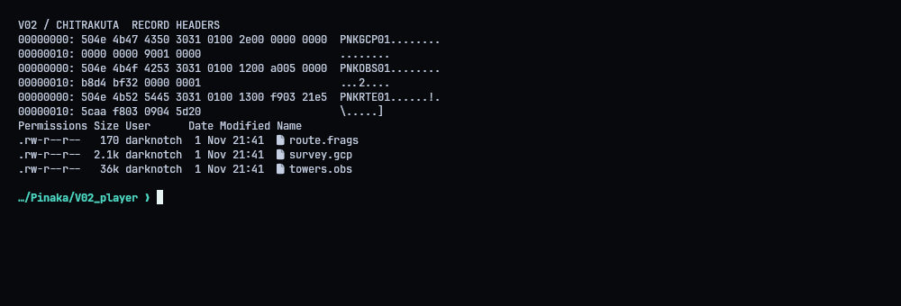
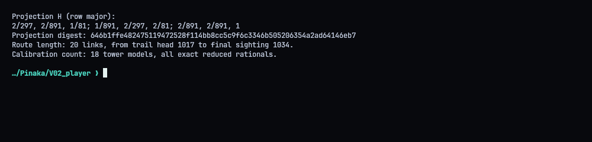
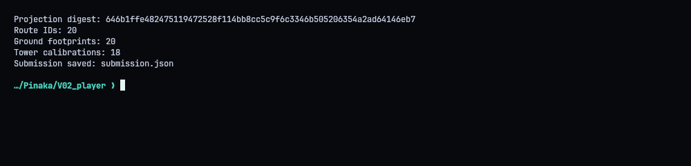
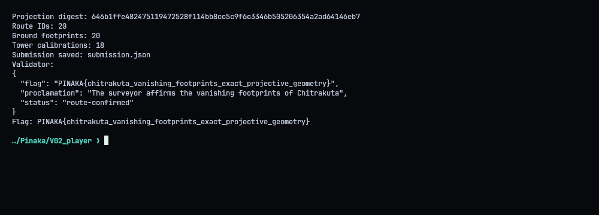
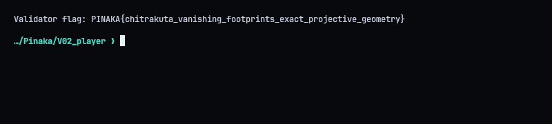

# V02 - Chitrakuta: The Vanishing Footprints

**Flag:** `PINAKA{chitrakuta_vanishing_footprints_exact_projective_geometry}`
Validator: `https://pinaka-v02-cyber-xo-x.vercel.app/chitrakuta/footprints`

## Overview

The archive has surveyed control points, bearings from observation towers, and pieces of a directed route. Solving it takes four steps:

1. recover the projective transform from the control points
2. throw away tower observations with bad CRCs
3. calibrate each tower from its landmark bearings and intersect the trail bearings
4. map the intersections back to ground coordinates and follow the route edges

## Formats

All the inputs are small binary files, each with its own header and integrity checks: chained control-point records, CRC-protected tower observations, and a directed succession chain.



## Geometry

Normalized, the transform comes out as nice fractions:

`H = [[2/297, 2/891, 1/81], [1/891, 2/297, 2/81], [2/891, 2/891, 1]]`

The validator wants a digest of it: SHA-256 over the reduced entries in row-major order, written as `index:numerator/denominator` and joined with `;`:

`646b1ffe482475119472528f114bb8cc5c9f6c3346b505206354a2ad64146eb7`

I did everything in exact rationals, not floats. The 18 tower calibrations are in `solve.py`. Intersecting the calibrated bearings gives exact plate points, and the inverse transform turns them into integer ground coordinates, which is a good sign the calibration is right.



## Route

The chain starts at trail head 1017 and runs for 20 IDs to 1034:

`1017 -> 1011 -> 1005 -> 1023 -> 1006 -> 1015 -> 1013 -> 1007 -> 1029 -> 1030 -> 1016 -> 1033 -> 1028 -> 1027 -> 1019 -> 1025 -> 1012 -> 1010 -> 1021 -> 1034`



The script packs the footprints, all 18 calibrations and the digest into `submission.json`. `./repro.sh` submits it, and the validator answered `status: route-confirmed`.




## Solver (`solve.py`)

```python
#!/usr/bin/env python3
"""Prepare the exact rational Chitrakuta submission and send it to the validator."""
import json
import os
import sys
import urllib.request
from fractions import Fraction
from pathlib import Path

ROOT = Path(__file__).resolve().parent
BASE = os.environ.get("PINAKA_V02_URL", "https://pinaka-v02-cyber-xo-x.vercel.app").rstrip("/")
FLAG_PREFIX = "PINAKA{"
ROUTE = [1017, 1011, 1005, 1023, 1006, 1015, 1013, 1007, 1029, 1030,
         1016, 1033, 1028, 1027, 1019, 1025, 1012, 1010, 1021, 1034]
GROUND = {
    1017: (39, 61), 1011: (378, 296), 1005: (369, 220), 1023: (288, 161),
    1006: (287, 140), 1015: (130, 367), 1013: (321, 234), 1007: (316, 160),
    1029: (250, 272), 1030: (358, 348), 1016: (378, 202), 1033: (62, 186),
    1028: (333, 79), 1027: (269, 320), 1019: (342, 191), 1025: (117, 144),
    1012: (28, 158), 1010: (79, 132), 1021: (210, 107), 1034: (190, 238),
}
# Each row stores the reduced rationals f, c, cos(theta), sin(theta), ox, oy.
CALIBRATION = [
    ["60", "8", "15/17", "8/17", "-90/17", "-48/17"],
    ["90", "14", "7/25", "24/25", "-42/25", "-144/25"],
    ["108", "-20", "4/5", "-3/5", "-24/5", "18/5"],
    ["90", "-16", "8/17", "-15/17", "-48/17", "90/17"],
    ["132", "-6", "9/41", "40/41", "-54/41", "-240/41"],
    ["120", "-28", "-28/53", "45/53", "168/53", "-270/53"],
    ["120", "25", "9/41", "-40/41", "-54/41", "240/41"],
    ["120", "19", "24/25", "7/25", "-144/25", "-42/25"],
    ["60", "-20", "-24/25", "7/25", "144/25", "-42/25"],
    ["132", "-26", "12/13", "5/13", "-72/13", "-30/13"],
    ["96", "14", "-5/13", "12/13", "30/13", "-72/13"],
    ["80", "-2", "-4/5", "3/5", "24/5", "-18/5"],
    ["144", "26", "-9/41", "40/41", "54/41", "-240/41"],
    ["132", "28", "-9/41", "-40/41", "54/41", "240/41"],
    ["144", "8", "28/53", "45/53", "-168/53", "-270/53"],
    ["60", "26", "-7/25", "-24/25", "42/25", "144/25"],
    ["60", "1", "-7/25", "24/25", "42/25", "-144/25"],
    ["108", "-11", "-3/5", "4/5", "18/5", "-24/5"],
]
H = [Fraction(2, 297), Fraction(2, 891), Fraction(1, 81),
     Fraction(1, 891), Fraction(2, 297), Fraction(2, 81),
     Fraction(2, 891), Fraction(2, 891), Fraction(1, 1)]
EXPECTED_PROJECTION_DIGEST = "646b1ffe482475119472528f114bb8cc5c9f6c3346b505206354a2ad64146eb7"


def rational_fields(value):
    f = Fraction(value)
    return [f.numerator, f.denominator]


def make_submission():
    if len(ROUTE) != 20 or set(ROUTE) != set(GROUND) or len(CALIBRATION) != 18:
        raise ValueError("solution tables are incomplete")
    digest_input = ";".join(f"{i}:{v.numerator}/{v.denominator}" for i, v in enumerate(H))
    from hashlib import sha256
    projection_digest = sha256(digest_input.encode("ascii")).hexdigest()
    if projection_digest != EXPECTED_PROJECTION_DIGEST:
        raise ValueError("projective matrix digest did not match")
    calibration = {}
    for tower, row in enumerate(CALIBRATION):
        values = []
        for value in row:
            values.extend(rational_fields(value))
        calibration[str(tower)] = values
    footprints = {
        str(sighting): [x, 1, y, 1]
        for sighting in ROUTE
        for x, y in [GROUND[sighting]]
    }
    return {
        "route": ROUTE,
        "footprints": footprints,
        "projection_digest": projection_digest,
        "calibration": calibration,
    }


def main():
    payload = make_submission()
    (ROOT / "submission.json").write_text(json.dumps(payload, indent=2) + "\n")
    print("Projection digest:", payload["projection_digest"])
    print("Route IDs:", len(payload["route"]))
    print("Ground footprints:", len(payload["footprints"]))
    print("Tower calibrations:", len(payload["calibration"]))
    print("Submission saved: submission.json")
    if "--no-submit" in sys.argv:
        return
    request = urllib.request.Request(
        BASE + "/chitrakuta/footprints",
        data=json.dumps(payload, separators=(",", ":")).encode("utf-8"),
        headers={"Content-Type": "application/json"},
        method="POST",
    )
    with urllib.request.urlopen(request, timeout=45) as response:
        result = json.loads(response.read())
    print("Validator:")
    print(json.dumps(result, indent=2, sort_keys=True))
    flag = result.get("flag")
    if not flag or not flag.startswith(FLAG_PREFIX):
        raise RuntimeError("validator response did not include a flag")
    print("Flag:", flag)


if __name__ == "__main__":
    main()
```
