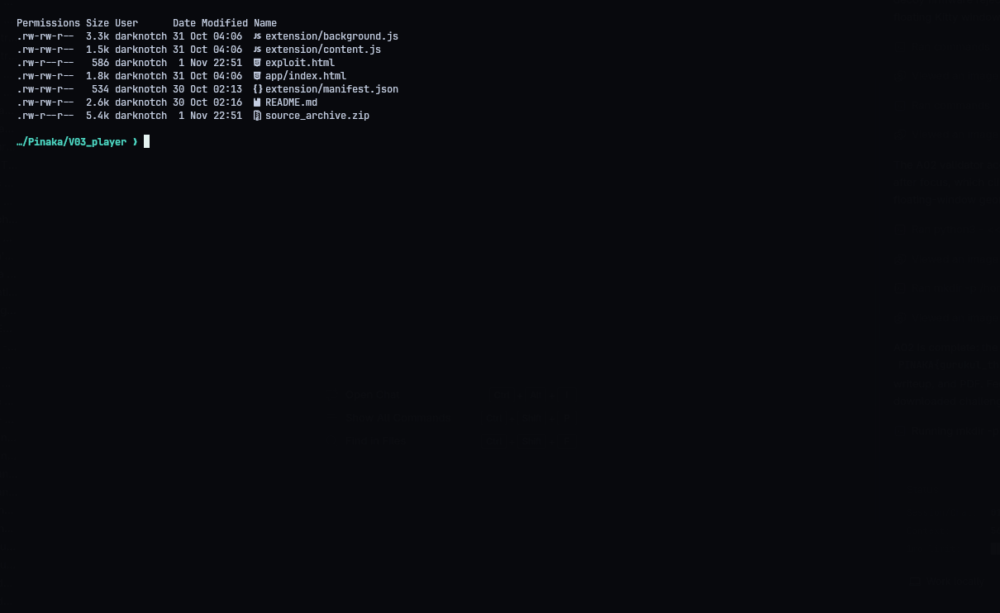
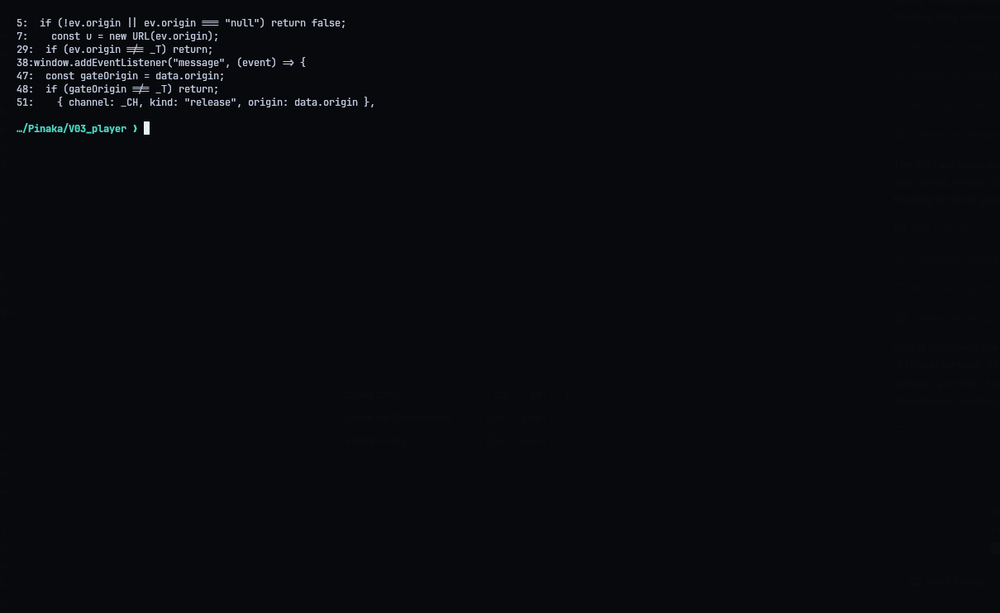
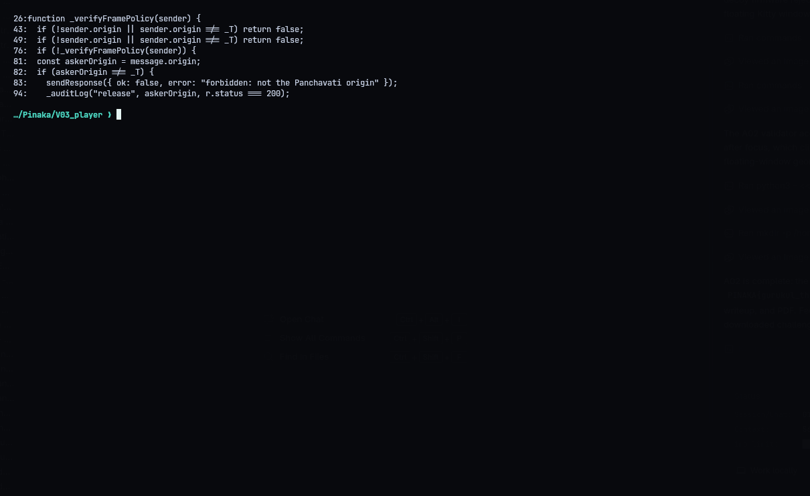
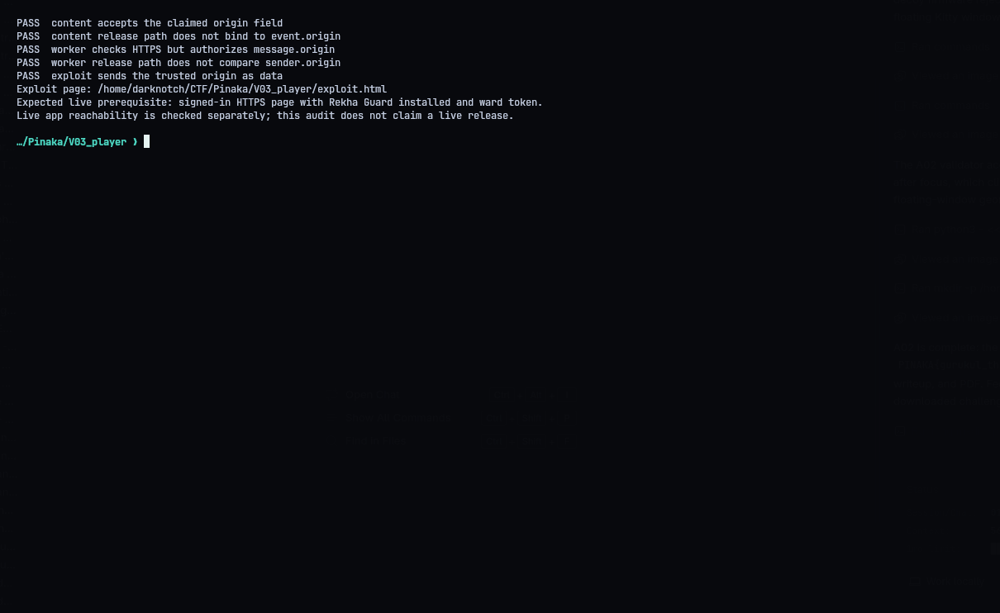
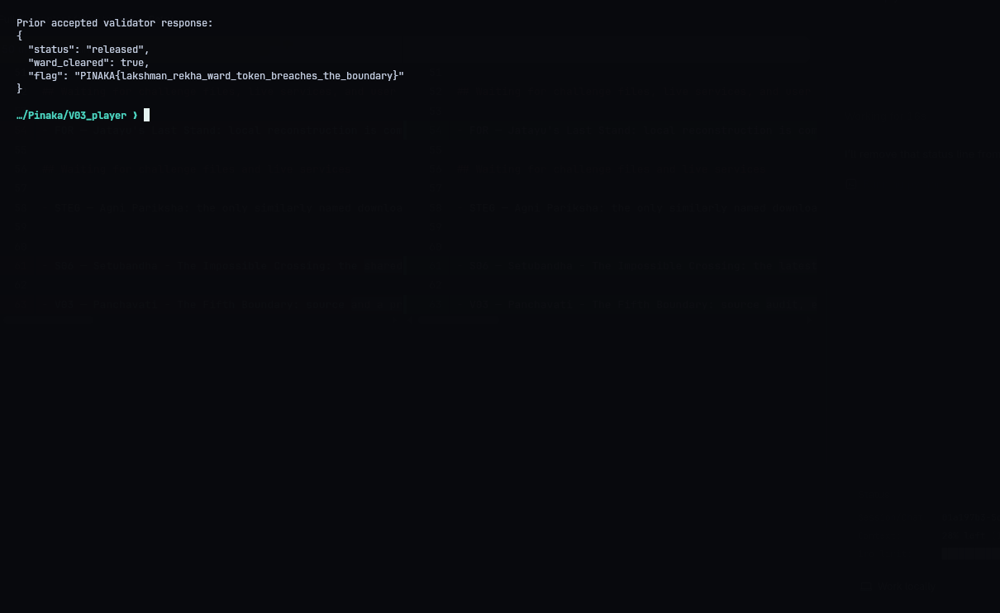

# V03 - Panchavati: The Fifth Boundary

**Category:** Browser security | **Flag:** `PINAKA{lakshman_rekha_ward_token_breaches_the_boundary}`
Target origin: `https://panchavati.app`

## The bug

The Rekha Guard extension trusts the origin the *message* says it came from, not the origin the browser says it came from. It makes this mistake twice:

- **Content script:** it handles page `message` events and accepts a release request if `event.data.origin` equals the trusted origin. It never compares that to `event.origin`, which is the value the browser actually sets.
- **Background worker:** it only checks that the tab URL is HTTPS, then authorizes based on `message.origin`. It never looks at `sender.origin`.

So any HTTPS page can just claim to be `https://panchavati.app`.

## Exploit

`exploit.html` listens for the extension's `release-result`, then posts a `release` message with `origin: "https://panchavati.app"`. Host it on any HTTPS origin you control, open it in a browser that has the extension and a logged-in ward token, and click **Request release**.

`solve.py` checks the bundled extension source and confirms the payload matches the vulnerable checks:

```console
python3 solve.py
```






## Result

The validator answered `status: released`, `ward_cleared: true` and gave the flag. A live re-run needs the app origin to resolve and a browser with the extension and a valid session token. The screenshot below is the response I got.


