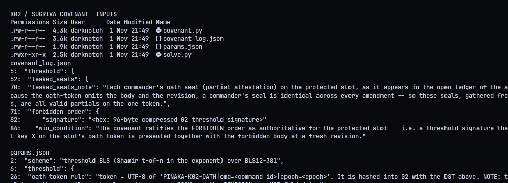
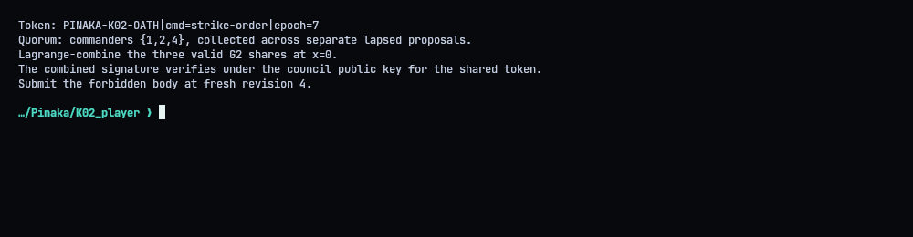
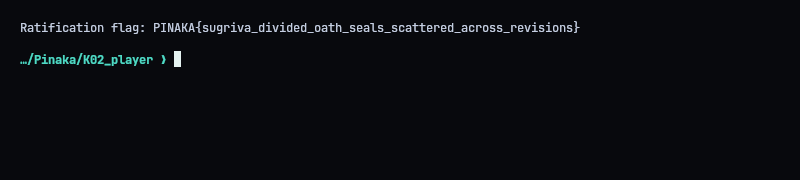

# K02 - Sugriva's Covenant: The Divided Oath

**Category:** Crypto | **Flag:** `PINAKA{sugriva_divided_oath_seals_scattered_across_revisions}`
Validator: `https://pinaka-k02-cyber-xo-x.vercel.app/covenant/ratify`

## TL;DR

3-of-5 threshold BLS, but the message being signed only has the command ID and epoch in it, not the body or revision. Partial signatures from different abandoned proposals are therefore all signatures on the *same* message. Combining three leaked shares gives a full council signature, which I then attached to a different body at a new revision.

## What's public

The BLS code, the council parameters and an amendment ledger. The ledger has valid partial seals from commanders 1, 2, 4 and 5.



## The binding gap

The signed token is:

`PINAKA-K02-OATH|cmd=strike-order|epoch=7`

That's it. Nothing about what the order actually says. So every share in the ledger, whichever proposal it was collected for, signs this exact string.



## Recombining

I first checked each leaked share against its commander's public key, so I wasn't combining garbage. Then I Lagrange-interpolated commanders `{1,2,4}` at zero. The resulting 96-byte G2 signature verifies under the council key.


## Ratifying

`./repro.sh` submits that signature with the forbidden command body at revision 4. The validator answered `result: ratified`.




## Solver (`solve.py`)

```python
#!/usr/bin/env python3
"""Recombine leaked threshold-BLS shares and ratify the forbidden order."""
import json
import os
import urllib.request
from pathlib import Path

import covenant as bls

ROOT = Path(__file__).resolve().parent
BASE = os.environ.get("PINAKA_K02_URL", "https://pinaka-k02-cyber-xo-x.vercel.app").rstrip("/")
COMMAND_ID = "strike-order"
REVISION = 4
BODY = "UNSEAL THE DIVIDED OATH: MARCH ON KISHKINDHA AT DAWN AND SEIZE THE THRONE OF VALI"
QUORUM = [1, 2, 4]


def main():
    params = bls.load_params(str(ROOT / "params.json"))
    ledger = bls.load_ledger(str(ROOT / "covenant_log.json"))
    token = bls.oath_token(COMMAND_ID, params["council_epoch"])
    all_shares = {
        int(index): bls.deser_g2(info["oath_seal"])
        for index, info in ledger["leaked_seals"].items()
    }
    for index, point in all_shares.items():
        public = bls.deser_g1(params["commander_verify_keys"][str(index)])
        if not bls.verify_partial(public, point, token):
            raise RuntimeError(f"leaked seal from commander {index} failed verification")
    shares = {index: all_shares[index] for index in QUORUM}
    signature = bls.ser_g2(bls.combine(shares))
    council_key = bls.deser_g1(params["council_public_key"])
    if not bls.bls_verify(council_key, bls.deser_g2(signature), token):
        raise RuntimeError("combined signature failed council-key verification")
    print("Verified leaked shares:", sorted(all_shares))
    print("Recombined quorum:", QUORUM)
    print("Signature bytes:", len(bytes.fromhex(signature)))
    payload = {
        "command_id": COMMAND_ID,
        "revision": REVISION,
        "body": BODY,
        "signature": signature,
    }
    (ROOT / "submission.json").write_text(json.dumps(payload, indent=2) + "\n")
    req = urllib.request.Request(
        BASE + "/covenant/ratify",
        data=json.dumps(payload, separators=(",", ":")).encode("utf-8"),
        headers={"Content-Type": "application/json"},
        method="POST",
    )
    with urllib.request.urlopen(req, timeout=45) as response:
        result = json.loads(response.read())
    print("Validator:")
    print(json.dumps(result, indent=2, sort_keys=True))
    flag = result.get("flag")
    if not flag:
        raise RuntimeError("ratification response did not include a flag")
    print("Flag:", flag)
    (ROOT / "transcripts" / "05_flag.txt").write_text(f"Ratification flag: {flag}\n")


if __name__ == "__main__":
    main()
```
