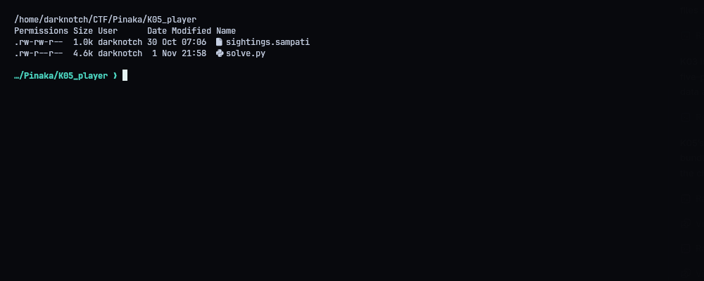
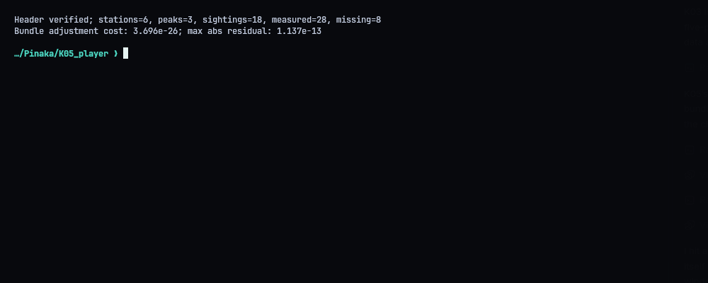
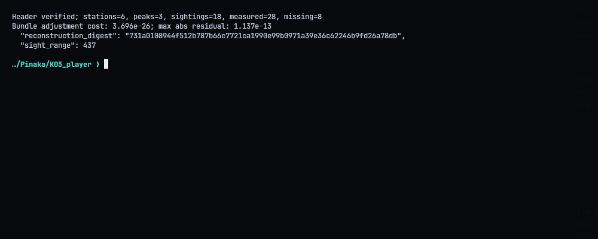
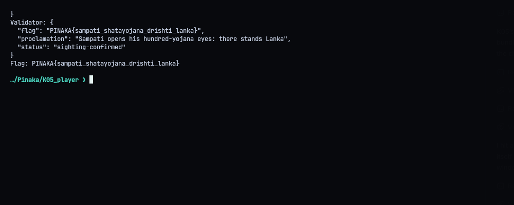
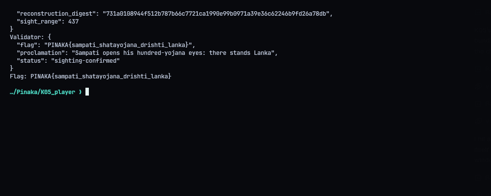

# K05 - Sampati: The Hundred-Yojana Sight

**Flag:** `PINAKA{sampati_shatayojana_drishti_lanka}`
Validator: `https://pinaka-k05-cyber-xo-x.vercel.app/lanka/sighting`

## The problem

`sightings.sampati` records six perches (known positions) looking at three peaks (unknown positions). There should be 36 image coordinates, but only 28 were measured and 8 are missing. The camera model isn't given either. The job is to recover the peaks and the lens, then fill in the missing 8.

## File format

- header: `PNKSAMP1`, version, record counts, nominal focal length and principal point, CRC32
- station records (102 bytes each): `u16` ID, 3 doubles for position, 9 doubles for a row-major rotation, CRC32
- sightings (variable length): station ID, peak ID, a 2-bit mask saying which of `u`/`v` is present, one double per present coordinate, CRC32

Every CRC checks out and there are no trailing bytes. That gives 6 stations, 18 sightings, 28 measured values and 8 missing ones.

## Fitting the model

For peak `L`, station position `C` and world-to-eye rotation `R`, the point in camera space is `P = R @ (L - C)`. After the perspective divide, a shared radial term `D = 1 + k1*r^2 + k2*r^4` is applied, plus a constant calibration offset on both image axes. The unknowns are the 9 peak coordinates plus 4 lens/offset parameters, 13 in total.

I seeded each peak with a plain SVD triangulation (no distortion), then ran nonlinear least squares over all 13 unknowns against every measured `u` and `v`. I used 30 fixed restarts and kept the best one. The fit is basically exact: cost `3.696e-26`, worst residual about `1.14e-13` px.

- peaks: `[-22,452,68]`, `[-26,412,27]`, `[1,437,50]`
- radial coefficients (micro-units): `[129756,-46241]`
- calibration offset (milli-pixels): `[-5925,6986]`
- shore-origin centroid range: `437`

Then I project the 8 missing coordinates through the model, round them to milli-pixels, sort, and build the SHA-256 digest from the canonical strings described in `README.md`.

## Result

The validator answered `sighting-confirmed`:

```text
PINAKA{sampati_shatayojana_drishti_lanka}
```







## Solver

Needs the packages in `requirements.txt`. `./repro.sh` parses, fits and writes `submission.json`. Add `--submit` to send it.

```python
#!/usr/bin/env python3
"""Decode Sampati's CRC-protected sighting log, fit its camera model and submit."""
from __future__ import annotations
import hashlib, json, os, struct, sys, urllib.request, zlib
from pathlib import Path
import numpy as np
from scipy.optimize import least_squares

ROOT = Path(__file__).resolve().parent
URL = os.environ.get('PINAKA_K05_URL', 'https://pinaka-k05-cyber-xo-x.vercel.app').rstrip('/') + '/lanka/sighting'


def checked_record(data: bytes, off: int, n: int):
    body = data[off:off+n]
    got, = struct.unpack_from('<I', data, off+n)
    want = zlib.crc32(body) & 0xffffffff
    if got != want:
        raise ValueError(f'CRC mismatch at {off}: got {got:08x}, expected {want:08x}')
    return body


def parse(path):
    b = Path(path).read_bytes()
    if b[:8] != b'PNKSAMP1': raise ValueError('bad magic')
    version, ns, npk = struct.unpack_from('<HHH', b, 8)
    f, cx, cy = struct.unpack_from('<3d', b, 14)
    nobs, = struct.unpack_from('<I', b, 38)
    checked_record(b, 0, 42)
    if version != 1: raise ValueError(f'unsupported version {version}')
    st = {}; o = 46
    for _ in range(ns):
        raw = checked_record(b, o, 98)
        vals = struct.unpack('<H12d', raw)
        st[vals[0]] = (np.array(vals[1:4]), np.array(vals[4:13]).reshape(3,3))
        o += 102
    obs=[]; miss=[]
    for _ in range(nobs):
        s,p,flags = struct.unpack_from('<HHB', b, o)
        n = flags.bit_count()
        raw = checked_record(b, o, 5 + 8*n)
        coords=iter(struct.unpack_from(f'<{n}d', raw, 5))
        for ax in (0,1):
            if flags & (1<<ax): obs.append((s,p,ax,next(coords)))
            else: miss.append((s,p,ax))
        o += 5 + 8*n + 4
    if o != len(b): raise ValueError(f'{len(b)-o} trailing bytes')
    return f,cx,cy,st,obs,miss,ns,npk,nobs


def main():
    input_path = next((arg for arg in sys.argv[1:] if not arg.startswith('--')), ROOT/'sightings.sampati')
    data = parse(input_path)
    f,cx,cy,st,obs,miss,ns,npk,nobs=data
    print(f'Header verified; stations={ns}, peaks={npk}, sightings={nobs}, measured={len(obs)}, missing={len(miss)}')
    def proj(L,s,k1,k2,dx,dy):
        C,R=st[s]; P=R@(L-C); x,y=P[0]/P[2],P[1]/P[2]; r2=x*x+y*y; D=1+k1*r2+k2*r2*r2
        return f*D*x+cx+dx, f*D*y+cy+dy
    def residual(q):
        L=q[:3*npk].reshape(npk,3); k1,k2,dx,dy=q[3*npk:]
        return [proj(L[p],s,k1,k2,dx,dy)[ax]-v for s,p,ax,v in obs]
    init=[]
    for p in range(npk):
        A=[]
        for s,pp,ax,v in obs:
            if pp != p: continue
            C,R=st[s]; row=f*R[ax]-v*R[2]; A.append(np.r_[row,-row@C])
        h=np.linalg.svd(np.array(A),full_matrices=False)[2][-1]
        init.extend(h[:3]/h[3])
    # Restart from the DLT triangulation and retain the lowest residual bundle fit.
    best=None; rng=np.random.default_rng(20261101)
    for trial in range(30):
        q0=np.array(init+[0.,0.,0.,0.])
        if trial: q0[:3*npk] += rng.normal(0, 5, 3*npk)
        r=least_squares(residual,q0,xtol=1e-14,ftol=1e-14,gtol=1e-14,max_nfev=10000)
        if best is None or r.cost<best.cost: best=r
    q=best.x; L=q[:3*npk].reshape(npk,3)
    peaks=[[int(round(v)) for v in row] for row in L]
    K=[int(round(q[3*npk]*1e6)),int(round(q[3*npk+1]*1e6))]
    cal=[int(round(q[3*npk+2]*1e3)),int(round(q[3*npk+3]*1e3))]
    completed=sorted([[s,p,ax,int(round(proj(L[p],s,*q[3*npk:])[ax]*1e3))] for s,p,ax in miss])
    parts=[f'P{i}:{x},{y},{z}' for i,(x,y,z) in enumerate(peaks)]+[f'K:{K[0]},{K[1]}',f'C:{cal[0]},{cal[1]}']+[f'M:{s},{p},{a},{v}' for s,p,a,v in completed]
    digest=hashlib.sha256(';'.join(parts).encode()).hexdigest()
    sight_range=int(round(np.linalg.norm(np.mean(np.array(peaks,float),axis=0))))
    body=dict(peaks=peaks,distortion=K,calibration=cal,completed=completed,reconstruction_digest=digest,sight_range=sight_range)
    print(f'Bundle adjustment cost: {best.cost:.4g}; max abs residual: {np.max(np.abs(residual(q))):.4g}')
    print('Submission:'); print(json.dumps(body,indent=2))
    (ROOT/'submission.json').write_text(json.dumps(body,indent=2)+'\n')
    if '--submit' in sys.argv:
        req=urllib.request.Request(URL,data=json.dumps(body,separators=(',',':')).encode(),headers={'Content-Type':'application/json'},method='POST')
        with urllib.request.urlopen(req,timeout=45) as r: result=json.loads(r.read())
        print('Validator:',json.dumps(result,indent=2))
        (ROOT/'transcripts').mkdir(exist_ok=True)
        (ROOT/'transcripts'/'05_validator.txt').write_text(json.dumps(result,indent=2)+'\n')
        if result.get('flag'): print('Flag:',result['flag'])

if __name__=='__main__': main()
```
