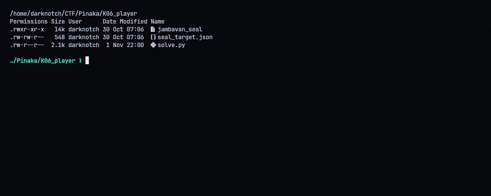
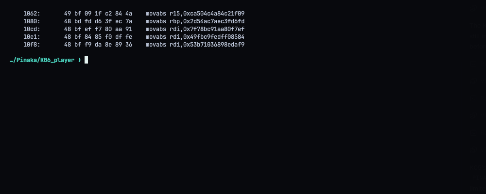
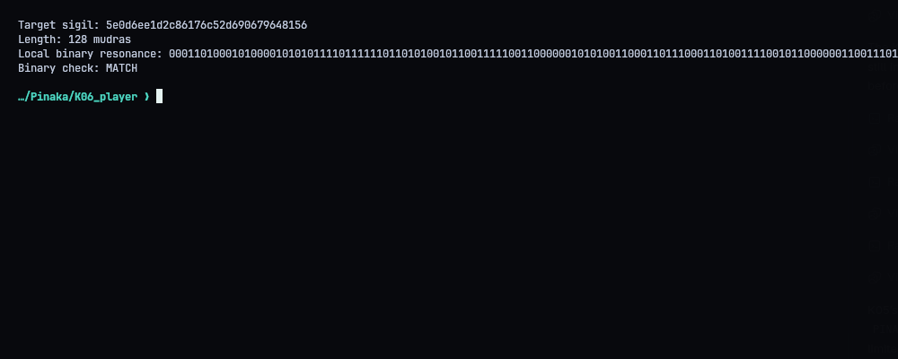
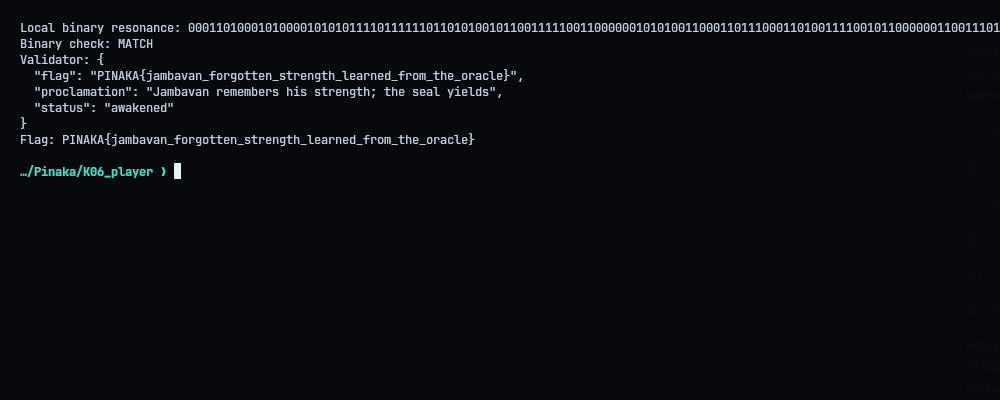

# K06 - Jambavan: The Forgotten Strength

**Category:** Reverse Engineering | **Flag:** `PINAKA{jambavan_forgotten_strength_learned_from_the_oracle}`
Validator: `https://pinaka-k06-cyber-xo-x.vercel.app/seal/awaken`

## The challenge

`jambavan_seal` is a stripped x86-64 binary that feeds a stream of `0`/`1` "mudras" into a 128-bit state. `seal_target.json` gives the state we need to end up in. We need a chant (a bit string) that drives the state to that target.

## Reversing it

Even though the binary is stripped, the constants are sitting right there as immediates. The state is split across `r12` (low half) and `rbp` (high half). Each cycle:

1. feedback = parity(state & feedback_mask)
2. the input bit is XORed with the feedback, and the result is shifted in at bit 127 (the state shifts right)
3. the output bit = parity(new state & readout_mask)

Constants:

- initial state: `2d54ac7aec3fd6fdb43f4db6aefb5271`
- feedback mask: `7f78bc91aa80f7efca504c4a84c21f09`
- readout mask: `53b71036898edaf949fbc9fedff08584`
- target: `5e0d6ee1d2c86176c52d690679648156`

## Steering

This is an LFSR where we control what gets injected. The bit that goes in is `fb XOR b`. If I want bit `d` to go in, I just pick `b = fb XOR d`. After 128 cycles the whole original state has been shifted out, so feeding the target's bits from LSB to MSB leaves the state at exactly the target.

Before submitting, `solve.py` simulates all 128 steps, runs the real binary with the chant, and checks that the binary's 128 output bits match the simulation.

## Result

The validator answered `awakened`:

```text
PINAKA{jambavan_forgotten_strength_learned_from_the_oracle}
```







## Solver

`python3 solve.py` writes `chant.txt` and verifies it against the binary. `--submit` also sends it.

```python
#!/usr/bin/env python3
"""Synthesize and submit the 128-bit chant for Jambavan's memory seal."""
from __future__ import annotations
import json, os, subprocess, sys, urllib.request
from pathlib import Path

ROOT=Path(__file__).resolve().parent
TARGET=int(json.loads((ROOT/'seal_target.json').read_text())['awakened_sigil'],16)
MASK64=(1<<64)-1
F_LO,F_HI=0xca504c4a84c21f09,0x7f78bc91aa80f7ef
R_LO,R_HI=0x49fbc9fedff08584,0x53b71036898edaf9
INIT_LO,INIT_HI=0xb43f4db6aefb5271,0x2d54ac7aec3fd6fd
URL=os.environ.get('PINAKA_K06_URL','https://pinaka-k06-cyber-xo-x.vercel.app').rstrip('/')

def parity(v:int)->int:return v.bit_count()&1

def synthesize(target:int=TARGET):
    lo,hi=INIT_LO,INIT_HI
    chant=[]; output=[]
    for i in range(128):
        fb=parity(lo&F_LO)^parity(hi&F_HI)
        bit=(target>>i)&1
        chant.append(str(fb^bit))
        lo=((lo>>1)|(hi<<63))&MASK64
        hi=((hi>>1)|(bit<<63))&MASK64
        output.append(str(parity(lo&R_LO)^parity(hi&R_HI)))
    return ''.join(chant),''.join(output)

def main():
    chant,expected=synthesize()
    (ROOT/'chant.txt').write_text(chant+'\n')
    print('Target sigil:',f'{TARGET:032x}')
    print('Synthesized chant:',chant)
    print('Length:',len(chant),'mudras')
    local=subprocess.run([str(ROOT/'jambavan_seal')],input=chant+'\n',text=True,capture_output=True,check=True)
    observed=local.stdout.strip()
    if observed!=expected: raise RuntimeError('local binary readout disagrees with simulator')
    print('Local binary resonance:',observed)
    print('Binary check: MATCH')
    if '--submit' not in sys.argv: return
    body=json.dumps({'chant':chant},separators=(',',':')).encode()
    req=urllib.request.Request(URL+'/seal/awaken',data=body,headers={'Content-Type':'application/json'},method='POST')
    with urllib.request.urlopen(req,timeout=45) as r: result=json.loads(r.read())
    print('Validator:',json.dumps(result,indent=2))
    (ROOT/'transcripts').mkdir(exist_ok=True)
    (ROOT/'transcripts'/'04_validator.txt').write_text(json.dumps(result,indent=2)+'\n')
    if result.get('flag'): print('Flag:',result['flag'])

if __name__=='__main__':main()
```
