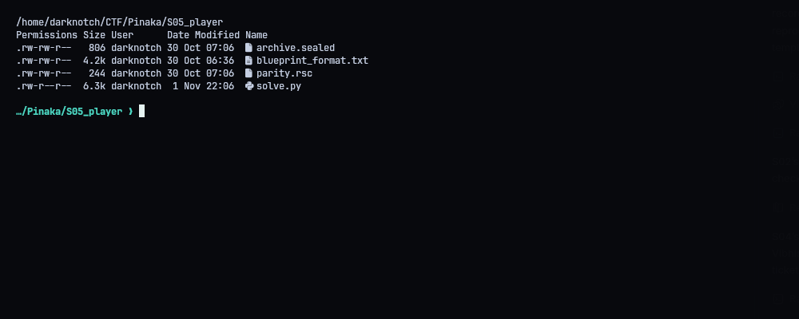
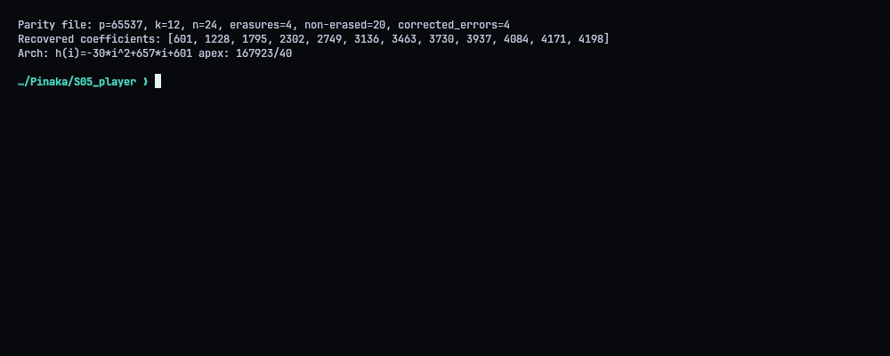
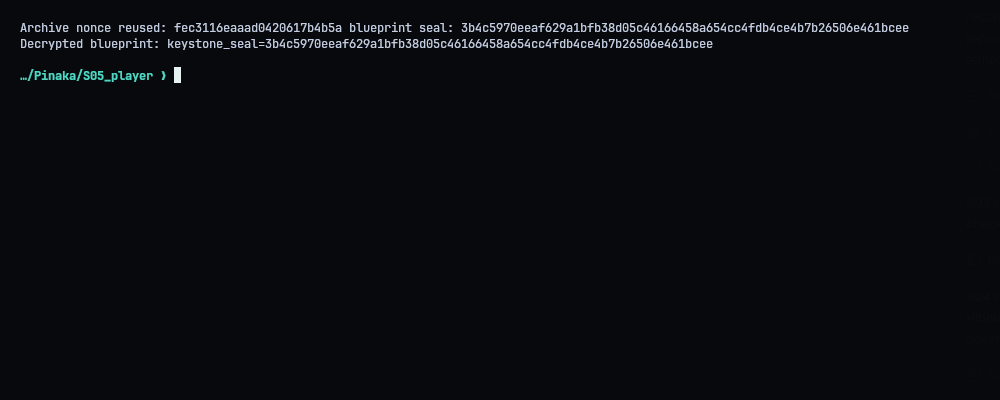
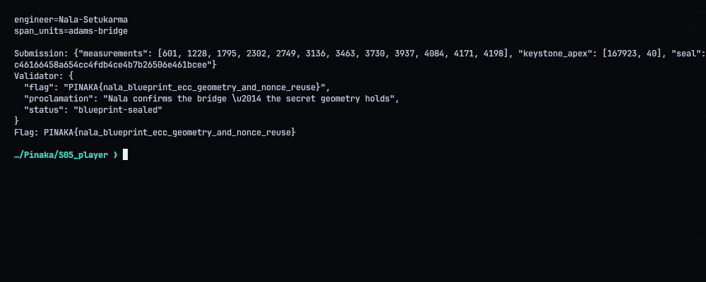
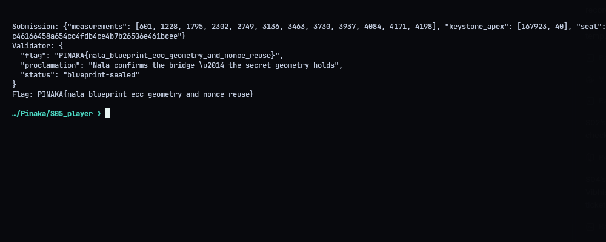

# S05 - Nala's Blueprint: The Secret Geometry

**Category:** Crypto | **Flag:** `PINAKA{nala_blueprint_ecc_geometry_and_nonce_reuse}`
Validator: `https://pinaka-s05-cyber-xo-x.vercel.app/setu/keystone`

## Overview

Two parts. First, a Reed-Solomon protected list of pier heights. Fixing it gives the arch's parabola, and from that the full contents of a "manifest" record. Second, the manifest and the secret blueprint were encrypted with the same nonce. Known plaintext plus nonce reuse means the blueprint decrypts for free.

## Error correction

`parity.rsc` is an RS code over `GF(65537)`, message length 12, 24 symbols stored, with a CRC around it. 4 symbols are erased. I used Berlekamp-Welch on the 20 remaining points with a degree-4 error locator, and polynomial division gives the coefficients:

```text
[601, 1228, 1795, 2302, 2749, 3136, 3463, 3730, 3937, 4084, 4171, 4198]
```

4 of the non-erased values were wrong, and those get corrected. The heights then fit `h(i) = -30i^2 + 657i + 601` exactly, with the vertex at `C - B^2/(4A) = 167923/40`.

## Nonce reuse

According to the archive parser, `setu/manifest-v1` and `setu/blueprint-v1` use the same nonce. The manifest is fully determined by the corrected heights and the apex fraction, so I rebuilt all 512 bytes of it. XORing that with the manifest ciphertext gives the keystream, and XORing the keystream with the blueprint ciphertext gives:

```text
keystone_seal=3b4c5970eeaf629a1bfb38d05c46166458a654cc4fdb4ce4b7b26506e461bcee
SETU-BLUEPRINT-v1
engineer=Nala-Setukarma
span_units=adams-bridge
```

Both records have authentication tags, but that doesn't help here. The tags stop tampering, not decryption under a reused keystream.

## Result

The validator answered `blueprint-sealed`:

```text
PINAKA{nala_blueprint_ecc_geometry_and_nonce_reuse}
```







## Solver

`python3 solve.py` does all of the above and writes `submission.json`. `--submit` sends it.

```python
#!/usr/bin/env python3
"""Correct Nala's RS codeword, reconstruct the arch, and decrypt reused-nonce records."""
from __future__ import annotations
import hashlib, json, os, struct, sys, urllib.request, zlib
from fractions import Fraction
from pathlib import Path
ROOT=Path(__file__).resolve().parent
URL=os.environ.get('PINAKA_S05_URL','https://pinaka-s05-cyber-xo-x.vercel.app').rstrip('/')+'/setu/keystone'

def parse_rsc(path):
    b=Path(path).read_bytes()
    if b[:8]!=b'PNKSETU1': raise ValueError('bad parity magic')
    p,k,n,erasures=struct.unpack_from('<4I',b,8)
    expected=24+9*n
    if len(b)!=expected+4: raise ValueError(f'unexpected parity file length {len(b)}')
    if struct.unpack_from('<I',b,expected)[0] != zlib.crc32(b[:expected])&0xffffffff: raise ValueError('parity CRC mismatch')
    records=[];o=24
    for _ in range(n):
        x,y,e=struct.unpack_from('<IIB',b,o); records.append((x,y,bool(e)));o+=9
    if sum(e for _,_,e in records)!=erasures: raise ValueError('erasure count mismatch')
    return p,k,n,erasures,records

def solve_linear(A,b,p):
    m=[list(row)+[rhs] for row,rhs in zip(A,b)]; rows=len(m); cols=len(m[0])-1; r=0; pivots=[]
    for c in range(cols):
        pivot=next((i for i in range(r,rows) if m[i][c]%p),None)
        if pivot is None: continue
        m[r],m[pivot]=m[pivot],m[r]; inv=pow(m[r][c],-1,p);m[r]=[(v*inv)%p for v in m[r]]
        for i in range(rows):
            if i!=r and m[i][c]:
                f=m[i][c];m[i]=[(m[i][j]-f*m[r][j])%p for j in range(cols+1)]
        pivots.append(c);r+=1
    if r<cols: raise ValueError('Berlekamp-Welch system is rank-deficient')
    return [m[pivots.index(c)][cols] for c in range(cols)]

def trim(a):
    while len(a)>1 and a[-1]==0:a.pop()
    return a

def poly_div(q,e,p):
    q=q[:]; out=[0]*max(1,(len(q)-len(e)+1))
    while len(q)>=len(e):
        d=len(q)-len(e); c=q[-1]*pow(e[-1],-1,p)%p;out[d]=c
        for j,v in enumerate(e):q[d+j]=(q[d+j]-c*v)%p
        trim(q)
    if any(q):raise ValueError('error locator division had nonzero remainder')
    return trim(out)

def bw_decode(p,k,records,e):
    pts=[(x,y) for x,y,er in records if not er]
    ne=len(pts)-k
    if ne<0:raise ValueError('not enough points')
    # Unknowns Q[0..k+e-1], E[0..e-1]; E is monic of degree e.
    cols=k+2*e;A=[];rhs=[]
    for x,y in pts:
        powers=[pow(x,j,p) for j in range(cols+1)]
        A.append(powers[:k+e]+[(-y*powers[j])%p for j in range(e)])
        rhs.append((y*powers[e])%p)
    sol=solve_linear(A,rhs,p)
    q=sol[:k+e]; E=sol[k+e:]+[1]
    return poly_div(q,E,p),pts,E

def parse_archive(path):
    b=Path(path).read_bytes()
    if b[:8]!=b'PNKSEAL1':raise ValueError('bad sealed archive magic')
    count,=struct.unpack_from('<I',b,8);o=12; rec=[]
    for _ in range(count):
        alen,=struct.unpack_from('<H',b,o);o+=2;ad=b[o:o+alen].decode('ascii');o+=alen
        nlen=b[o];o+=1;nonce=b[o:o+nlen];o+=nlen
        clen,=struct.unpack_from('<I',b,o);o+=4;ct=b[o:o+clen];o+=clen
        tlen=b[o];o+=1;tag=b[o:o+tlen];o+=tlen
        rec.append({'ad':ad,'nonce':nonce,'ct':ct,'tag':tag})
    if o!=len(b):raise ValueError('trailing archive bytes')
    return rec

def manifest(measurements,apex):
    lines=[f'keystone_apex={apex.numerator}/{apex.denominator}',f'piers={len(measurements)}']
    lines += [f'h{i:02d}={h}' for i,h in enumerate(measurements)]
    lines.append('SETU-MANIFEST-v1')
    raw='\n'.join(lines).encode('ascii')
    if len(raw)>512:raise ValueError('manifest exceeds 512 bytes')
    return raw+b'.'*(512-len(raw))

def xor(a,b):return bytes(x^y for x,y in zip(a,b))
def main():
    p,k,n,erasures,records=parse_rsc(ROOT/'parity.rsc')
    heights,pts,E=bw_decode(p,k,records,erasures)
    heights=[v if v<=p//2 else v-p for v in heights]
    if len(heights)!=k:raise ValueError('wrong message polynomial degree')
    # Verify the recovered coefficient polynomial against all intact symbols.
    bad=[(x,y) for x,y,er in records if not er and sum(c*pow(x,i,p) for i,c in enumerate(heights))%p!=y]
    if len(bad)>4: raise ValueError(f'too many corrupt non-erased symbols: {len(bad)}')
    if len(heights)<3:raise ValueError('need at least three piers')
    A=Fraction(heights[2]-2*heights[1]+heights[0],2)
    B=Fraction(heights[1]-heights[0])-A; C=Fraction(heights[0])
    apex=C-B*B/(4*A)
    if any(Fraction(h)!=A*i*i+B*i+C for i,h in enumerate(heights)):raise ValueError('pier heights are not exactly parabolic')
    rec=parse_archive(ROOT/'archive.sealed')
    by_ad={r['ad']:r for r in rec}
    m=by_ad['setu/manifest-v1']; bp=by_ad['setu/blueprint-v1']
    if m['nonce']!=bp['nonce']:raise ValueError('records do not reuse the same nonce')
    known=manifest(heights,apex)
    if len(m['ct'])!=len(known):raise ValueError('manifest ciphertext length mismatch')
    stream=xor(m['ct'],known); plain=xor(bp['ct'],stream[:len(bp['ct'])]).decode('ascii')
    seal=next((line.split('=',1)[1] for line in plain.splitlines() if line.startswith('keystone_seal=')),None)
    if not seal:raise ValueError('decrypted blueprint did not contain keystone_seal')
    body={'measurements':heights,'keystone_apex':[apex.numerator,apex.denominator],'seal':seal}
    print(f'Parity file: p={p}, k={k}, n={n}, erasures={erasures}, non-erased={len(pts)}, corrected_errors={len(bad)}')
    print('Recovered coefficients:',heights)
    print('Arch:',f'h(i)={A}*i^2+{B}*i+{C}','apex:',f'{apex.numerator}/{apex.denominator}')
    print('Archive nonce reused:',m['nonce'].hex(),'blueprint seal:',seal)
    print('Decrypted blueprint:',plain.rstrip('.'))
    print('Submission:',json.dumps(body))
    (ROOT/'submission.json').write_text(json.dumps(body,indent=2)+'\n')
    (ROOT/'transcripts').mkdir(exist_ok=True)
    (ROOT/'transcripts'/'03_blueprint.txt').write_text(plain.rstrip('.')+'\n')
    if '--submit' in sys.argv:
        req=urllib.request.Request(URL,data=json.dumps(body,separators=(',',':')).encode(),headers={'Content-Type':'application/json'},method='POST')
        with urllib.request.urlopen(req,timeout=45) as r:result=json.loads(r.read())
        print('Validator:',json.dumps(result,indent=2))
        (ROOT/'transcripts'/'04_validator.txt').write_text(json.dumps(result,indent=2)+'\n')
        if result.get('flag'):print('Flag:',result['flag'])
if __name__=='__main__':main()
```
