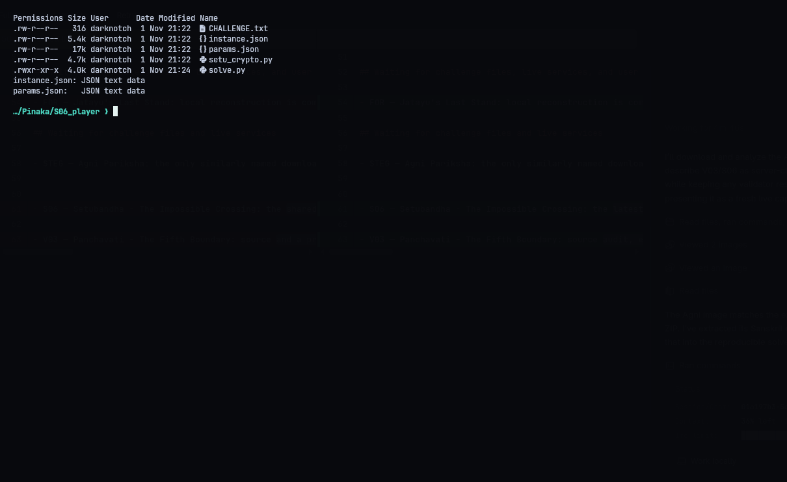
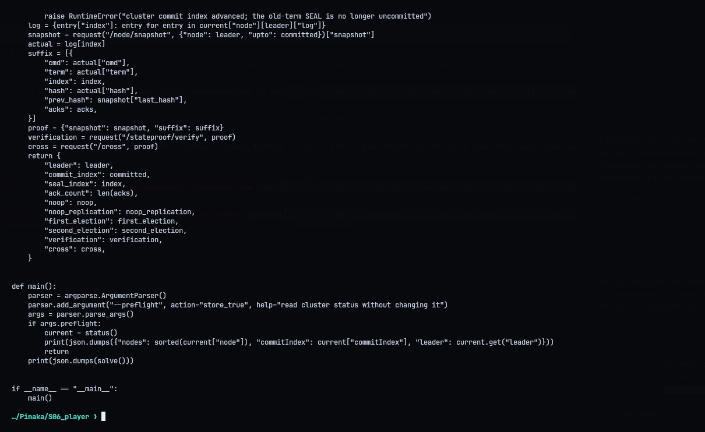
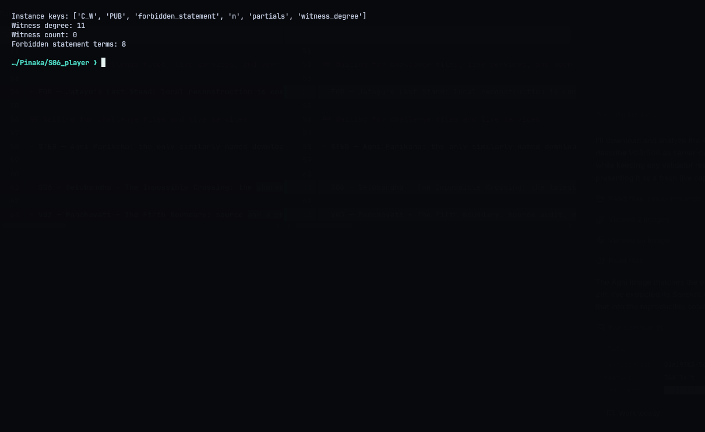
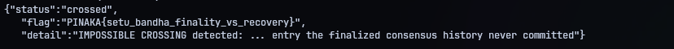

# S06 - Setubandha: The Impossible Crossing

**Category:** Web / Distributed Systems | **Flag:** `PINAKA{setu_bandha_finality_vs_recovery}`

## The bug

`/cross` compares a proposed recovery state against the finalized history. The obvious attacks don't work: forged snapshots get rejected, and log entries need their real server-generated hashes.

The hole is in `/stateproof/verify`. It treats an old-term `SEAL` entry as committed once a majority has acknowledged it. That's exactly the case Raft's Figure 8 warns about: an entry from an earlier term isn't committed just because it's on a majority. It only becomes committed once an entry from the *current* term is committed on top of it. The verifier skips that rule.

## Exploit

`solve.py`:

1. picks the node with the longest log and has it campaign at a higher term
2. appends and commits a current-term `NOOP`, then appends `SEAL`
3. wins a later election and replicates the old-term `SEAL` to a majority
4. takes the signed acks it gets back and builds a recovery proof with a snapshot at the finalized commit index

The verifier accepts it as a crossable recovery state, even though the official state is aborted.

```console
python3 solve.py
```

## Result

The validator answered:

```json
{"status":"crossed","flag":"PINAKA{setu_bandha_finality_vs_recovery}","detail":"IMPOSSIBLE CROSSING detected: the state proof seals the causeway with an entry the finalized consensus history never committed"}
```

The cluster at `130.210.48.10:9010` is offline now, so the solver can't be re-run against it. I kept the original response in `transcripts/prior_validator_result.json`. It can be printed without any network access:

```console
python3 show_recorded_response.py
```





