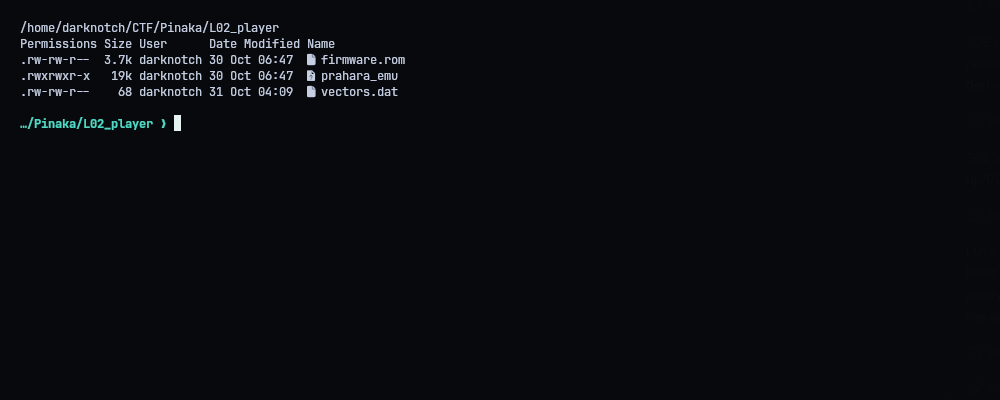
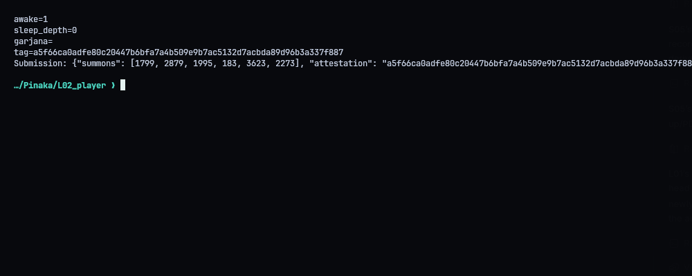
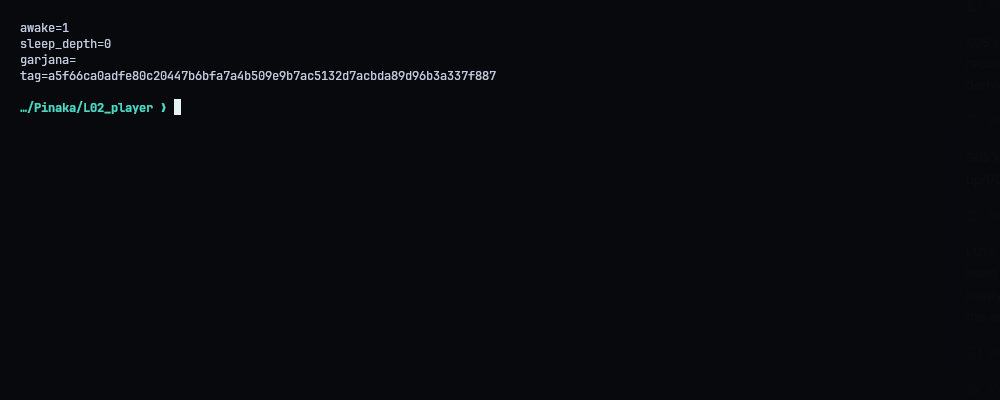
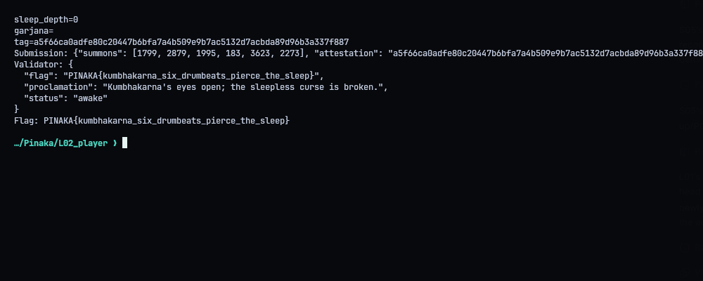
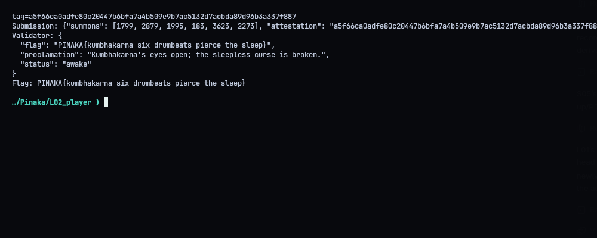

# L02 - Kumbhakarna: The Sleepless Curse

**Category:** Reverse Engineering | **Flag:** `PINAKA{kumbhakarna_six_drumbeats_pierce_the_sleep}`
Validator: `http://130.210.48.10:9013/lanka/awaken`

## The challenge

The PRAHARA firmware reads six input words (the "summons") and compares each one against a drum state at six fixed timer interrupts. Each correct word is a strike that lowers `sleep_depth` by 30. Starting from 180, six strikes wake him up. The gate also wants an attestation tag, which only comes from an actual run of the emulator.

## The machine

- 12-bit words, 4 KiB little-endian ROM
- stack-based VM with 256 words of RAM, arithmetic mod 4093
- a period-13 drum timer, and a co-processor (DUNDUBHI) that combines each input with a per-position offset and multiplier

The firmware copies six targets out of ROM, starts the timer and feeds each summons word through DUNDUBHI. The IRQ updates the drum:

```
lcg  = (lcg^2 + 0x3fd) mod 0xffd
drum = (drum + lcg)    mod 0xffd
```

The execution path up to each check doesn't depend on the input, so the drum value at each of the six checks is fixed. That means each word can be solved on its own from its target equation.

Summons: `[1799, 2879, 1995, 183, 3623, 2273]`

The emulator then reports `awake=1`, `sleep_depth=0` and the attestation tag `a5f66ca0adfe80c20447b6bfa7a4b509e9b7ac5132d7acbda89d96b3a337f887`.

`firmware_debug.rom`, `dundubhi_cfg.bin` and `vectors.dat` are decoys. Only `firmware.rom` matters.

## Result

The gate answered `awake`:

```text
PINAKA{kumbhakarna_six_drumbeats_pierce_the_sleep}
```







## Solver

Runs the summons through the bundled `prahara_emu` and `firmware.rom`, checks the awake/depth fields, takes the tag, and with `--submit` sends both.

```python
#!/usr/bin/env python3
"""Run the recovered PRAHARA summons on the bundled emulator and submit its attestation."""
from __future__ import annotations
import json, os, re, subprocess, sys, urllib.request
from pathlib import Path
ROOT=Path(__file__).resolve().parent
BASE=os.environ.get('PINAKA_L02_URL','http://130.210.48.10:9013').rstrip('/')
# Recovered by reversing the firmware's six independent drum-check equations.
SUMMONS=[1799,2879,1995,183,3623,2273]

def main():
    proc=subprocess.run([str(ROOT/'prahara_emu'),str(ROOT/'firmware.rom'),*map(str,SUMMONS)],capture_output=True,text=True,check=True)
    print(proc.stdout,end='')
    fields=dict(re.findall(r'^(awake|sleep_depth|garjana|tag)=(.*)$',proc.stdout,re.M))
    if fields.get('awake')!='1' or fields.get('sleep_depth')!='0':raise RuntimeError('PRAHARA did not awaken')
    if not re.fullmatch(r'[0-9a-f]{64}',fields.get('tag','')):raise RuntimeError('emulator emitted an invalid tag')
    body={'summons':SUMMONS,'attestation':fields['tag']}
    print('Submission:',json.dumps(body))
    (ROOT/'submission.json').write_text(json.dumps(body,indent=2)+'\n')
    if '--submit' not in sys.argv:return
    req=urllib.request.Request(BASE+'/lanka/awaken',data=json.dumps(body,separators=(',',':')).encode(),headers={'Content-Type':'application/json'},method='POST')
    with urllib.request.urlopen(req,timeout=30) as r:result=json.loads(r.read())
    print('Validator:',json.dumps(result,indent=2))
    (ROOT/'transcripts').mkdir(exist_ok=True)
    (ROOT/'transcripts'/'04_validator.txt').write_text(json.dumps(result,indent=2)+'\n')
    if result.get('flag'):print('Flag:',result['flag'])
if __name__=='__main__':main()
```
