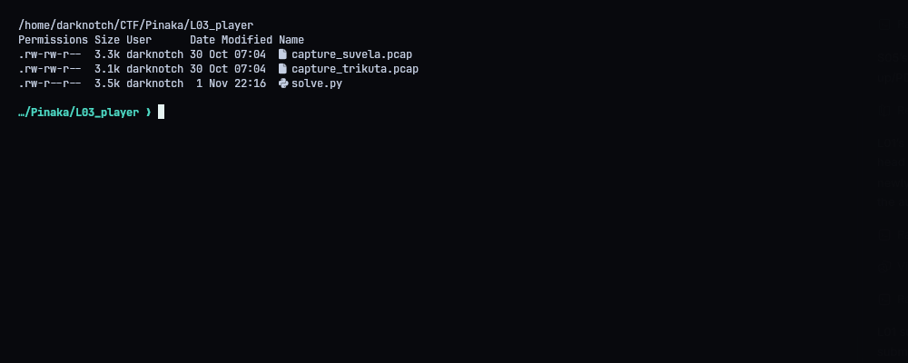
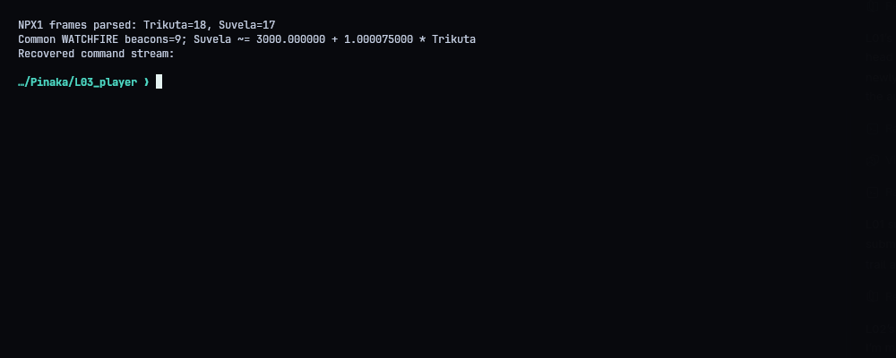
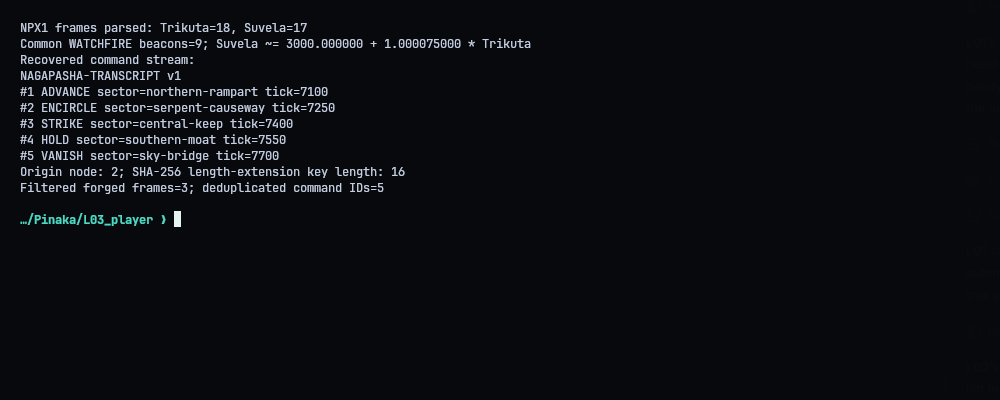
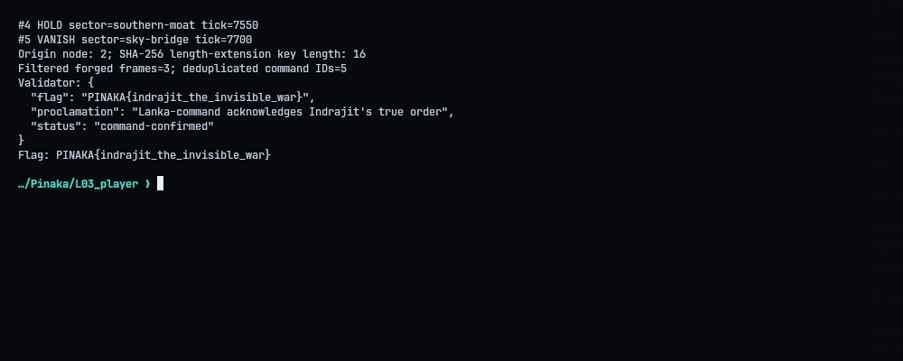
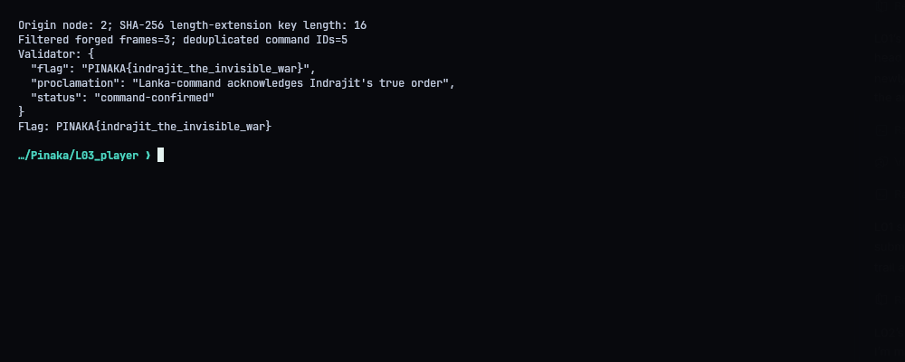

# L03 - Indrajit: The Invisible War

**Category:** Network Forensics | **Flag:** `PINAKA{indrajit_the_invisible_war}`
Validator: `https://pinaka-l03-cyber-xo-x.vercel.app/war/command`

## Overview

Two packet captures (Trikuta and Suvela) using a custom protocol, NPX1. Mixed in with the real orders are replays, retransmissions and forged orders. The goal is the five genuine commands, in order.

## Aligning the clocks

Both captures contain the same nine WATCHFIRE beacons, which is enough to fit one clock against the other:

`Suvela ~= 3000 + 1.000075 * Trikuta`

After converting Suvela times to Trikuta time, the five real orders line up chronologically.

## Filtering

- Duplicates: order #2 was replayed, so I keep one copy. The type-05 retransmission of #3 is dropped.
- Forgeries: three type-03 frames from node 2 have longer OM payloads than normal. The SHA-256 padding inside them encodes a message length of 320 bits (40 bytes). The visible covered message is 24 bytes (9-byte prefix + 15-byte order), so there's a 16-byte key in front. These were made with length extension, so I dropped them.

## Transcript

```text
NAGAPASHA-TRANSCRIPT v1
#1 ADVANCE sector=northern-rampart tick=7100
#2 ENCIRCLE sector=serpent-causeway tick=7250
#3 STRIKE sector=central-keep tick=7400
#4 HOLD sector=southern-moat tick=7550
#5 VANISH sector=sky-bridge tick=7700
```

The real source is node 2. The validator answered `command-confirmed`:

```text
PINAKA{indrajit_the_invisible_war}
```







## Solver

`python3 solve.py` parses both captures and writes `submission.json`. `--submit` sends it.

```python
#!/usr/bin/env python3
"""Parse both NAGAPASHA captures, apply the recovered command reconstruction, submit."""
from __future__ import annotations
import json, os, struct, sys, urllib.request
from pathlib import Path
ROOT=Path(__file__).resolve().parent
URL=os.environ.get('PINAKA_L03_URL','https://pinaka-l03-cyber-xo-x.vercel.app').rstrip('/')+'/war/command'
ACTIONS={1:'ADVANCE',2:'HOLD',3:'STRIKE',5:'VANISH',7:'ENCIRCLE'}
SECTORS={11:'northern-rampart',13:'sky-bridge',14:'southern-moat',15:'central-keep',16:'serpent-causeway'}

def pcap(path):
    b=Path(path).read_bytes(); magic=b[:4]
    endian={'\xd4\xc3\xb2\xa1'.encode('latin1'):'<','\xa1\xb2\xc3\xd4'.encode('latin1'):'>'}.get(magic)
    if not endian:raise ValueError('unsupported pcap magic')
    off=24;out=[]
    while off+16<=len(b):
        sec,usec,caplen,orig=struct.unpack_from(endian+'IIII',b,off);off+=16
        pkt=b[off:off+caplen];off+=caplen
        if len(pkt)<34:continue
        etype=struct.unpack_from('!H',pkt,12)[0]; l2=14
        if etype==0x8100:
            etype=struct.unpack_from('!H',pkt,16)[0];l2=18
        if etype!=0x0800:continue
        ip=pkt[l2:]
        ihl=(ip[0]&15)*4
        if len(ip)<ihl+20 or ip[9]!=6:continue
        tcp=ip[ihl:]; thl=(tcp[12]>>4)*4
        data=tcp[thl:]
        if not data.startswith(b'NPX1'):continue
        if len(data)<30:continue
        plen,=struct.unpack_from('<H',data,28)
        if len(data)<30+plen+32:continue
        typ,ver,src,dst,link,flags=struct.unpack_from('<6B',data,4)
        seq,=struct.unpack_from('<I',data,12);clock,=struct.unpack_from('<Q',data,16)
        msgid,=struct.unpack_from('<H',data,24)
        payload=data[30:30+plen]
        out.append({'time':sec+usec/1e6,'type':typ,'version':ver,'src':src,'dst':dst,'seq':seq,'clock':clock,'msgid':msgid,'payload':payload,'mac':data[30+plen:30+plen+32]})
    return out

def fit_clock(t,s):
    if len(t)!=len(s) or len(t)<2: raise ValueError('not enough shared beacons for clock correlation')
    tx=sum(x for x,_ in t)/len(t); sy=sum(y for _,y in s)/len(s)
    slope=sum((x-tx)*(y-sy) for x,y in zip([a for a,_ in t],[b for _,b in s]))/sum((x-tx)**2 for x,_ in t)
    return slope,sy-slope*tx

def main():
    t=pcap(ROOT/'capture_trikuta.pcap'); s=pcap(ROOT/'capture_suvela.pcap')
    if not t or not s:raise RuntimeError('no NPX1 frames found in one or both captures')
    print(f'NPX1 frames parsed: Trikuta={len(t)}, Suvela={len(s)}')
    bt={f['msgid']:f for f in t if f['type']==6 and f['payload'].startswith(b'WATCHFIRE')}
    bs={f['msgid']:f for f in s if f['type']==6 and f['payload'].startswith(b'WATCHFIRE')}
    common=sorted(set(bt)&set(bs))
    slope,offset=fit_clock([(bt[i]['time'],bs[i]['time']) for i in common],[(bt[i]['time'],bs[i]['time']) for i in common])
    print(f'Common WATCHFIRE beacons={len(common)}; Suvela ~= {offset:.6f} + {slope:.9f} * Trikuta')
    # A true order is an exact 15-byte OM on the authentic source, type 03.
    # Longer type-03 payloads contain SHA-256 length-extension forgeries; type 05
    # and duplicate order indices are retransmission/replay noise.
    commands={}
    for cap,monitor in ((t,'T'),(s,'S')):
        for f in cap:
            p=f['payload']
            if f['type']!=3 or f['src']!=2 or not p.startswith(b'OM') or len(p)!=15:continue
            action=p[2]; sector=struct.unpack_from('<H',p,3)[0]
            tick=struct.unpack_from('<Q',p,5)[0];idx=struct.unpack_from('<H',p,13)[0]
            if action not in ACTIONS or sector not in SECTORS:continue
            event=(action,sector,tick)
            if idx in commands and commands[idx][0]!=event:raise ValueError('conflicting command replay')
            # Trikuta time is the reference. Convert Suvela's offset/scaled clock.
            clock=f['time'] if monitor=='T' else (f['time']-offset)/slope
            if idx not in commands or clock<commands[idx][1]: commands[idx]=(event,clock,monitor)
    ordered=sorted(commands.items(),key=lambda item:item[1][1])
    expected=[1,2,3,4,5]
    if [idx for idx,_ in ordered]!=expected:raise ValueError(f'unexpected genuine command indices {[i for i,_ in ordered]}')
    # The length-extension frames carry the SHA-256 bit count for key+covered message.
    forged=[f['payload'] for cap in (t,s) for f in cap if f['type']==3 and f['src']==2 and len(f['payload'])>15 and f['payload'][15]==0x80]
    key_lengths=[]
    for p in forged:
        marker=p.rfind(b'OM')
        if marker<39:continue
        bit_count=int.from_bytes(p[marker-8:marker],'big')
        original_covered_len=9+15 # documented transport header prefix + genuine OM payload
        key_lengths.append(bit_count//8-original_covered_len)
    if not key_lengths or len(set(key_lengths))!=1:raise ValueError('could not infer unique key length from extension padding')
    key_length=key_lengths[0]
    if key_length!=16:raise ValueError(f'unexpected inferred key length {key_length}')
    lines=['NAGAPASHA-TRANSCRIPT v1']
    for pos,(_, (event,clock,monitor)) in enumerate(ordered,1):
        action,sector,tick=event
        lines.append(f'#{pos} {ACTIONS[action]} sector={SECTORS[sector]} tick={tick}')
    transcript='\n'.join(lines)
    body={'command_transcript':transcript,'origin_node':2,'key_length':key_length}
    print('Recovered command stream:')
    print(transcript)
    print('Origin node: 2; SHA-256 length-extension key length:',key_length)
    print(f'Filtered forged frames={len(forged)}; deduplicated command IDs={len(commands)}')
    (ROOT/'transcripts').mkdir(exist_ok=True)
    (ROOT/'transcripts'/'03_command_transcript.txt').write_text(transcript+'\n')
    (ROOT/'submission.json').write_text(json.dumps(body,indent=2)+'\n')
    if '--submit' in sys.argv:
        req=urllib.request.Request(URL,data=json.dumps(body,separators=(',',':')).encode(),headers={'Content-Type':'application/json'},method='POST')
        with urllib.request.urlopen(req,timeout=40) as r:result=json.loads(r.read())
        print('Validator:',json.dumps(result,indent=2))
        (ROOT/'transcripts'/'04_validator.txt').write_text(json.dumps(result,indent=2)+'\n')
        if result.get('flag'):print('Flag:',result['flag'])
if __name__=='__main__':main()
```
