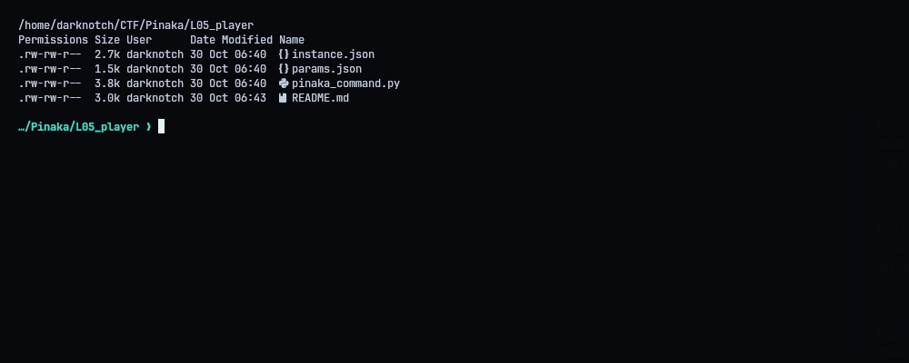
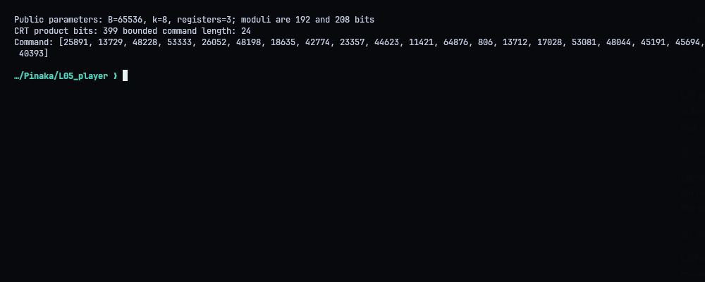
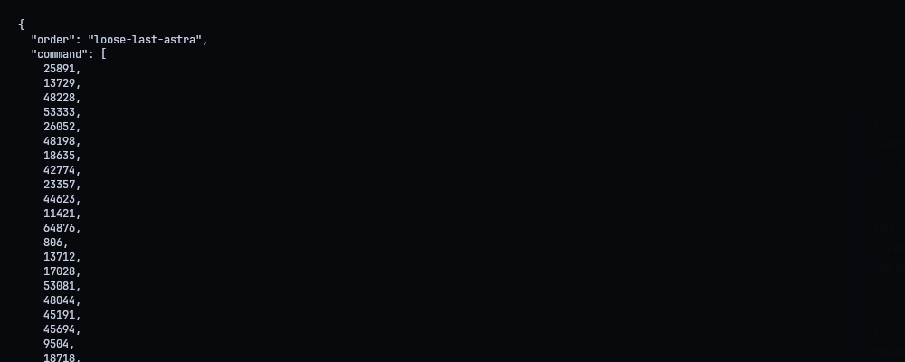
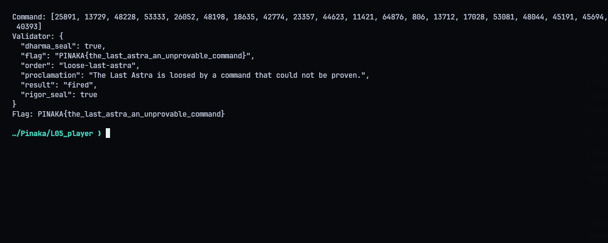
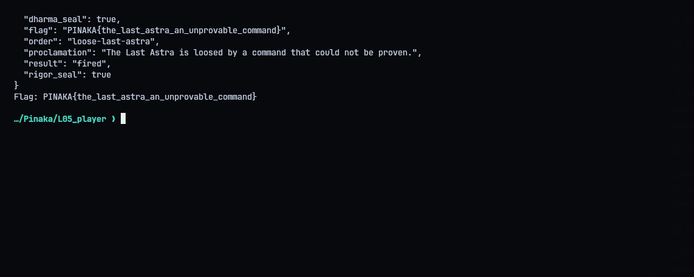

# L05 - The Last Astra: An Unprovable Command

**Category:** Crypto | **Flag:** `PINAKA{the_last_astra_an_unprovable_command}`

## The bug

The command desk checks the gadget's output with two seals, Dharma (mod `p`) and Rigor (mod `p2`). Neither one checks that the target syndrome is inside the gadget's integer range. So a command can match the forbidden syndrome mod both moduli without being a real integer opening.

## Details

Each register holds an integer in `[0, B^k)` as `k` base-`B` words. Here `B = 65536` and `k = 8`, so the range is `[0, 2^128)`.

Each seal compares only mod its own modulus. Together, that's just equality mod `N = p * p2`. For each forbidden syndrome component `t_i`:

`r_i = t_i mod N`

`r_i` is below `B^k`, so its 8 base-`B` digits are a valid register value. It differs from `t_i` by a multiple of `N`, so both seals pass.

I did this for all three registers, checked both congruences locally and submitted the 24 words. The validator returned `dharma_seal: true`, `rigor_seal: true`, `fired`:

```text
PINAKA{the_last_astra_an_unprovable_command}
```







## Solver

Fetches the public parameters and registry, builds the command and writes `submission.json`. `--submit` sends it.

```python
#!/usr/bin/env python3
"""Exploit the L05 dual-modulus range omission with a CRT-equivalent opening."""
from __future__ import annotations
import json,os,urllib.request,sys
from pathlib import Path
ROOT=Path(__file__).resolve().parent
BASE=os.environ.get('PINAKA_L05_URL','https://pinaka-l05-cyber-xo-x.vercel.app').rstrip('/')
def get(path):
    with urllib.request.urlopen(BASE+path,timeout=25) as r:return json.loads(r.read())
def main():
    params=get('/astra/params');registry=get('/astra/registry')
    g=params['gadget'];B,k=g['B'],g['k'];p=params['seals']['dharma_seal']['modulus_p'];p2=params['seals']['rigor_seal']['modulus_p2']
    order='loose-last-astra';t=[int(x) for x in registry['orders'][order]['syndrome']]
    N=p*p2;command=[]
    for target in t:
        r=target%N
        if r>=B**k:raise ValueError('CRT representative outside gadget range')
        for _ in range(k):command.append(r%B);r//=B
    if len(command)!=g['n'] or any(not 0<=x<B for x in command):raise ValueError('invalid bounded command')
    for i,target in enumerate(t):
        opened=sum(command[i*k+j]*B**j for j in range(k))
        if (opened-target)%p or (opened-target)%p2:raise ValueError('constructed word fails a seal')
    body={'order':order,'command':command}
    print(f'Public parameters: B={B}, k={k}, registers={g["m"]}; moduli are {p.bit_length()} and {p2.bit_length()} bits')
    print('CRT product bits:',N.bit_length(),'bounded command length:',len(command))
    print('Command:',json.dumps(command))
    (ROOT/'submission.json').write_text(json.dumps(body,indent=2)+'\n')
    if '--submit' in sys.argv:
        req=urllib.request.Request(BASE+'/astra/command',data=json.dumps(body,separators=(',',':')).encode(),headers={'Content-Type':'application/json'},method='POST')
        with urllib.request.urlopen(req,timeout=40) as r:result=json.loads(r.read())
        print('Validator:',json.dumps(result,indent=2))
        (ROOT/'transcripts').mkdir(exist_ok=True)
        (ROOT/'transcripts'/'04_validator.txt').write_text(json.dumps(result,indent=2)+'\n')
        if result.get('flag'):print('Flag:',result['flag'])
if __name__=='__main__':main()
```
