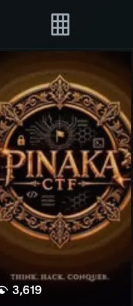
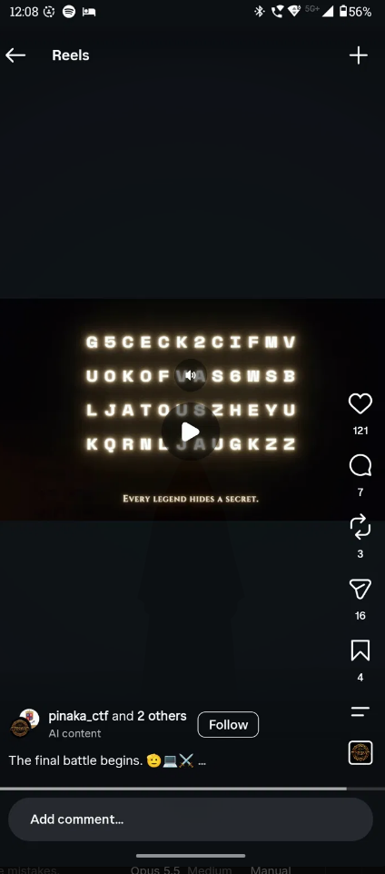

# OSINT - Ravana's Ten Heads: Final Battle

**Category:** OSINT / Encoding | **Flag:** `PinakaCTF{B4535_R_C0V3R3D}`

## The challenge

> "Before the journey begins, take a moment to explore what lies beyond the obvious... Your next clue might be waiting where the posts, stories, updates, and hints unfold."

"Posts, stories, updates" is social media talk. I checked pinakactf.com first (the HTML, the JS bundle, robots/sitemap/security.txt, the images) and found nothing hidden there, but its JSON-LD `sameAs` block lists the official socials: Instagram @pinaka_ctf, LinkedIn and Discord. Instagram was the obvious one to try.

## Finding the reel

On @pinaka_ctf I went to the Reels tab. Only three reels were up: the PINAKA CTF logo, an "AKA" teaser and a team photo, so I went through all of them.



The one with the code has the caption "The final battle begins.", which matches the challenge name. At the end of the reel, four rows of glowing text appear above the line "EVERY LEGEND HIDES A SECRET.":

```
G5CECK2CIFMV
UOKOFVAS6WSB
LJATOUSZHEYU
KQRNLJAUGKZZ
```



`G5CECK2CIFMVUOKOFVAS6WSBLJATOUSZHEYUKQRNLJAUGKZZ`

## Decoding

The string only uses A-Z and 2-7, which is the Base32 alphabet. 48 characters is 240 bits, or exactly 30 bytes, so no `=` padding is needed. From there it's three layers, and each one's output tells you what the next one is:

| Step | Output | Why the next step |
|---|---|---|
| Base32 | `7DA+BAYZ9N-A/ZAZA7RY91EB-ZAC+9` | uppercase, digits and `+ - /` is the Base45 alphabet |
| Base45 | `QjQ1MzVfUl9DMFYzUjNE` | looks like Base64 |
| Base64 | `B4535_R_C0V3R3D` | done |

`B4535_R_C0V3R3D` reads as "bases are covered", a pun on the chain of bases.

The same chain in CyberChef: From Base32, then From Base45, then From Base64. Or in Python:

```console
pip install base45
python3 -c "import base64,base45;s='G5CECK2CIFMVUOKOFVAS6WSBLJATOUSZHEYUKQRNLJAUGKZZ';print(base64.b64decode(base45.b45decode(base64.b32decode(s).decode())))"
```

## Notes

- The glow makes some letters look alike (M/W/N). The chain decoding cleanly all the way through is what confirms the transcription.
- The 010101 / 101001 binary on the profile picture decodes to noise. It's just decoration.
- The Sanskrit verse wasn't needed for the solve.

## Flag

`PinakaCTF{B4535_R_C0V3R3D}`
