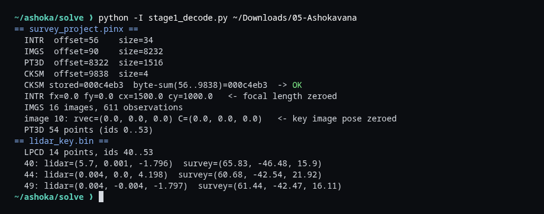
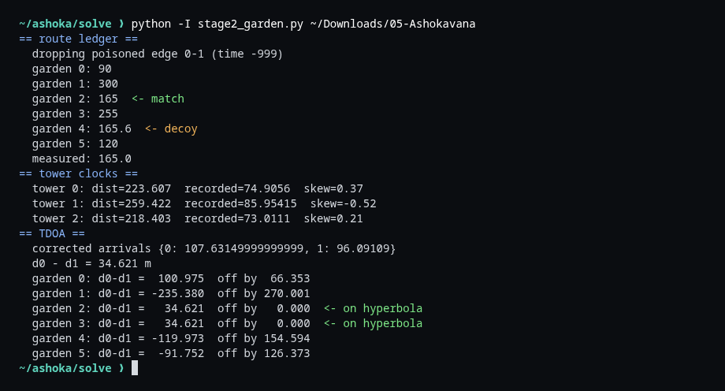
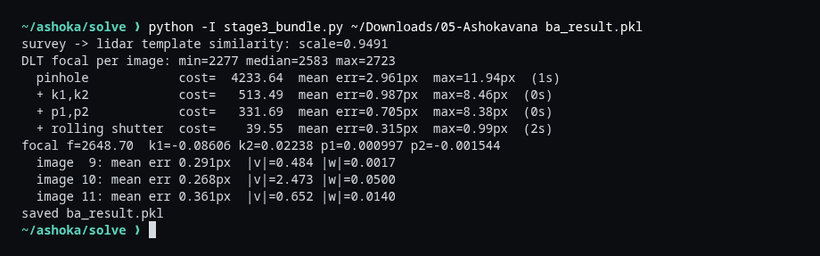
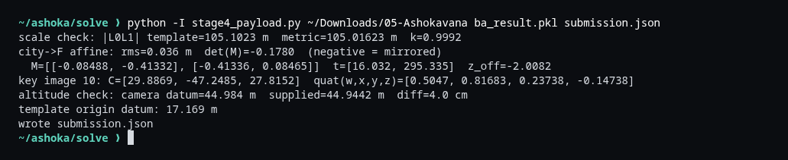
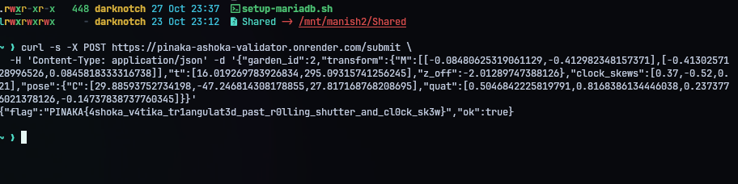
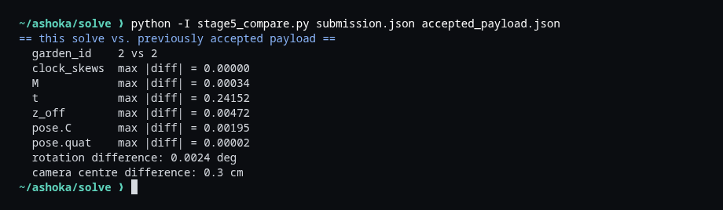

# OSINT - Ashoka Vatika

**Category:** OSINT / Geospatial | **Flag:** `PINAKA{4shoka_v4tika_tr1angulat3d_past_r0lling_shutter_and_cl0ck_sk3w}`

## The challenge

> Sita waits in the Ashoka grove, hidden somewhere within Lanka's vast gardens. Only fragments of the place survive: a glimpse, a measurement, a shadow. Triangulate the veiled sanctuary and name where she is held.

The zip has six files: a photogrammetry project (`survey_project.pinx`), a small lidar scan (`lidar_key.bin`), a city map with 40 landmarks and 6 candidate gardens, a caravan route ledger, watchtower flare logs and a sensor calibration record. The validator wants five things: which garden it is, the transform from city coordinates to the reconstructed frame, each watchtower's clock skew, and the position and orientation of the key camera (image 10).

No single file gives the answer. The route ledger and the towers pick the garden, and the photos plus lidar give the geometry.

## 1. Decoding the survey

`survey_project.pinx` starts with `PINX` and a directory of 4 sections. Each entry is a 4-byte tag, a little-endian offset and a big-endian size, so the format deliberately mixes byte orders.

- `INTR`: `fx, fy, cx, cy` as doubles. **Both focal lengths are zero**, so the focal length has to be recovered. The principal point is `(1500, 1000)`.
- `IMGS`: 16 images. Each has an ID, a rotation vector (`R_cam<-world`, OpenCV style), a camera centre `C`, and its observations as `(point id, u, v)` with float32 pixels. That's 611 observations in total. **Image 10, the key image, has an all-zero pose.**
- `PT3D`: 54 points, IDs 0-53.
- `CKSM`: a plain byte sum of everything from offset 56 to the checksum, and it matches.

`lidar_key.bin` (`LPCD`) holds 14 points with IDs 40-53, the same IDs as the last 14 survey points. They're small numbers around the origin with z pointing up (point 44 is 4.2 m above the others), so this is a metric template of one object. The survey has the same points, but in its own slightly scaled and rotated frame.



## 2. Picking the garden

**Route ledger.** Edge `0-1` has a travel time of `-999`, which is clearly poisoned, so I dropped it. Running Dijkstra from the city gate (node 0) on what's left gives each garden's travel time. The measured time is 165.0, which is exactly garden 2. Garden 4 is at 165.6, close enough to be a deliberate decoy.

**Watchtowers.** Each tower timestamps on its own clock. The gate flare is fired at `t = 0` from the city gate at `(0, 0)`, and the relay speed is 3.0, so each tower's skew is

`skew_i = recorded_i - distance(gate, tower_i) / 3`

which gives `[0.37, -0.52, 0.21]`. After correcting the garden flare's arrival times, towers 0 and 1 give a range difference of `d0 - d1 = 34.621 m`. That's a hyperbola, and it passes exactly through **two** candidates, gardens 2 and 3. The route ledger already ruled out 3, so it's **garden 2**.



## 3. Bundle adjustment

This is the main part.

1. **Put everything in the lidar frame.** I fit a similarity transform (Umeyama) from the survey's points 40-53 to the lidar points. The scale comes out at 0.949, so the survey frame isn't metric but the lidar is. Then I moved all the survey points and camera poses into the lidar frame.
2. **Initialize the cameras.** For every image, including the zeroed image 10, I ran a DLT on its observations. That gives a rough pose and a focal length each time. The focal lengths come out between 2277 and 2723, with a median of 2583.
3. **Adjust everything jointly** with `scipy.optimize.least_squares`. That covers one shared focal length, radial (`k1, k2`) and tangential (`p1, p2`) distortion, all 16 poses and the 40 landmark points. The 14 template points stay fixed at their lidar coordinates, so the scale and frame are anchored. The principal point stays at `(1500, 1000)`.
4. **Add rolling shutter.** The calibration file says the shutter is electronic with a full-frame readout window. Each row is exposed at a slightly different time `tau = row / 2000 - 0.5`, so each camera also gets a linear velocity `v` and an angular velocity `w`, and the pose for a given row is `R(tau) = exp(tau*w) R`, `C(tau) = C + tau*v`.

Adding each piece in turn shows that each one is needed:

| Model | Cost | Mean error |
|---|---:|---:|
| pinhole | 4233.6 | 2.96 px |
| + `k1, k2` | 513.5 | 0.99 px |
| + `p1, p2` | 331.7 | 0.71 px |
| + rolling shutter | **39.55** | **0.315 px** |

The final model has `f = 2648.7`, `k1 = -0.0861`, `k2 = 0.0224`, `p1 = 0.0010`, `p2 = -0.0015`. Image 10 had by far the most motion during readout (`|v| ~ 2.5`), which is why the earlier fits without rolling shutter couldn't place it well.



## 4. City transform and key pose

**Scale check.** The adjusted distance between landmarks 0 and 1 is 105.102 m. The city model's benchmark says 105.016 m, so `k = 0.9992`, and the lidar frame really is metric.

**Frame F.** Origin at landmark 0, `+x` toward landmark 1 (horizontally), `z` up. I fit an affine map from the city's landmark xy to F's xy using all 40 landmarks, plus a constant z offset:

```text
M     = [[-0.08488, -0.41332],
         [-0.41336,  0.08465]]
t     = [16.032, 295.335]
z_off = -2.0082
```

The horizontal fit has 0.036 m RMS. `det(M)` is negative, which means the city map is mirrored relative to the reconstructed world. That's a real property of the data, not a bad fit.

**Key pose.** This is image 10's adjusted pose at mid-readout (`tau = 0`) in the lidar/template frame. The quaternion is taken directly from its rotation vector, so it's camera-from-world, in `w, x, y, z` order:

```text
C    = [29.8869, -47.2485, 27.8152]
quat = [0.50470, 0.81683, 0.23738, -0.14738]
```

As a sanity check, the camera's height above the datum comes out at 44.984 m, against the 44.944 m given in the calibration file, so it's within 4 cm. The template origin sits at 17.17 m, right next to garden 2's base elevation of 17.15 m.



## 5. Result

I redid the whole solve from scratch for this writeup. During the CTF I had submitted a payload and the validator answered `ok: true` with the flag:



The hosted validator has since been taken down, so I compared the new payload field by field against the one that was accepted:

| Field | Max difference |
|---|---:|
| garden, clock skews | identical |
| `M` | 0.0003 |
| `t` | 0.24 |
| `z_off` | 0.005 |
| camera centre | 0.3 cm |
| rotation | 0.0024 deg |

The only noticeable difference is in `t`, which is expected. `t` is where the city origin lands in frame F, and the origin is several hundred city units away from the landmarks, so a 0.0003 change in `M` gets multiplied up. The pose, which is the hardest part, matches to a few millimetres.



## Reproducing

Everything is in `solve/`. It needs numpy and scipy.

```console
cd solve
./run_all.sh ~/Downloads/05-Ashokavana
```

`ashoka_io.py` reads the two binary files, `ba.py` holds the camera model and the bundle adjustment, and `stage1_decode.py` through `stage5_compare.py` are the steps above. The output of each stage is saved in `solve/transcripts/`, and the final payload in `solve/submission.json`.
