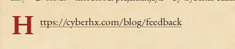
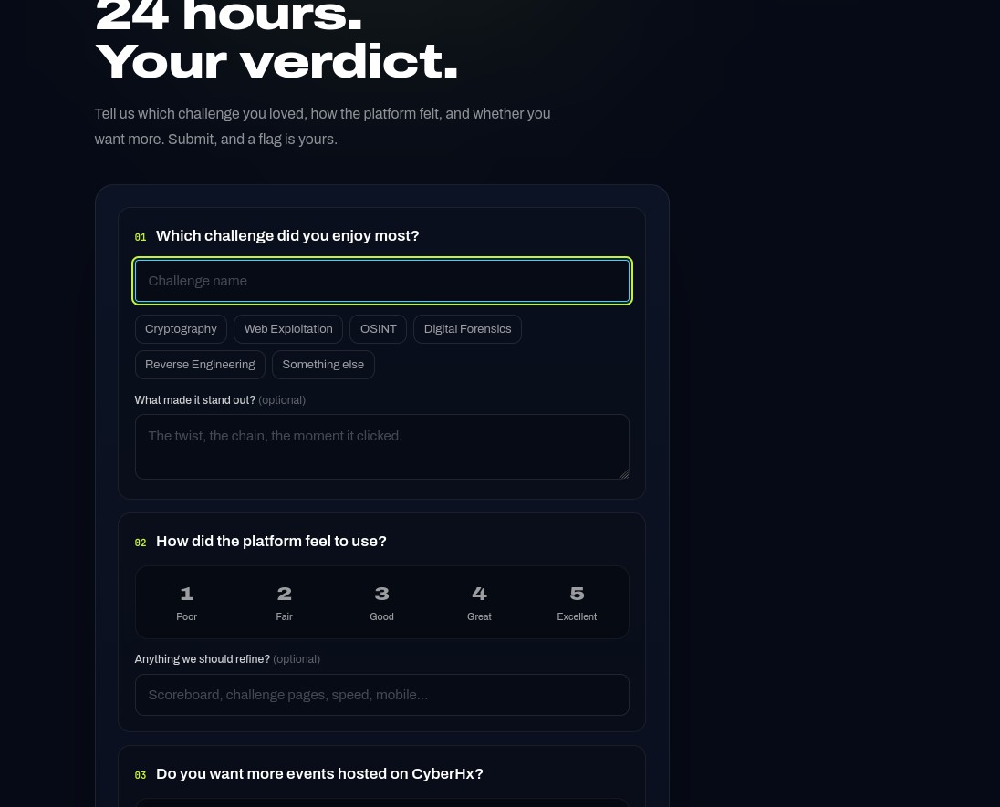
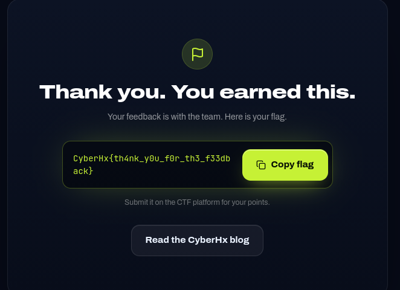

# Feedback guys

| | |
|---|---|
| **Flag** | `CyberHx{th4nk_y0u_f0r_th3_f33dback}` |
| **Category** | Web (Easy), 50 pts |

## 1. The challenge

The challenge pointed to the CyberHx feedback page:



```
https://cyberhx.com/blog/feedback
```

## 2. The form

The page title is **"24 hours. Your verdict."** and it says: *"Submit, and a flag is yours."*



It has three sections:

1. **Which challenge did you enjoy most?** A challenge name and a category (Cryptography / Web Exploitation / OSINT / Digital Forensics / Reverse Engineering / Something else), plus an optional "what made it stand out".
2. **How did the platform feel to use?** A 1–5 rating (Poor → Excellent), plus optional suggestions.
3. **Do you want more events hosted on CyberHx?**

## 3. Solve

1. Opened `https://cyberhx.com/blog/feedback`.
2. Entered a favourite challenge and picked its category.
3. Rated the platform and answered the "more events" question.
4. Submitted. The page changed to **"Thank you. You earned this."** and showed the flag:



```
CyberHx{th4nk_y0u_f0r_th3_f33dback}
```

5. Copied the flag and submitted it on the CTF platform.

## 4. Notes

- No exploit needed. This is a points-for-feedback challenge, and the flag appears once the form is submitted.
