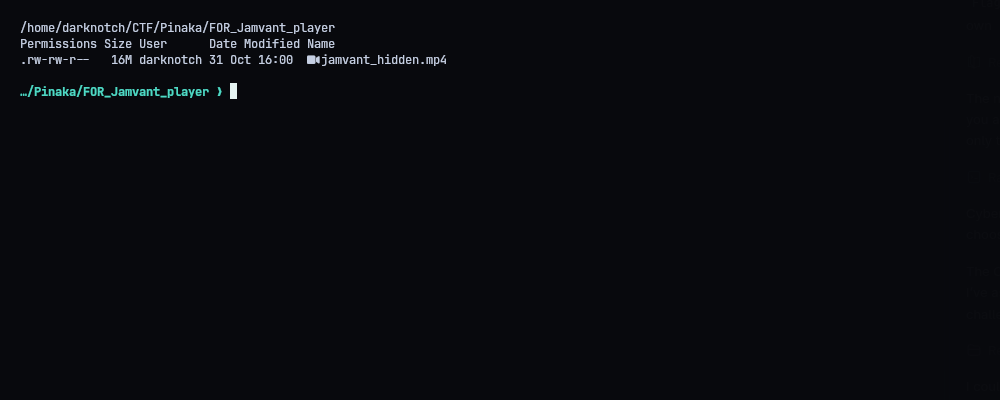
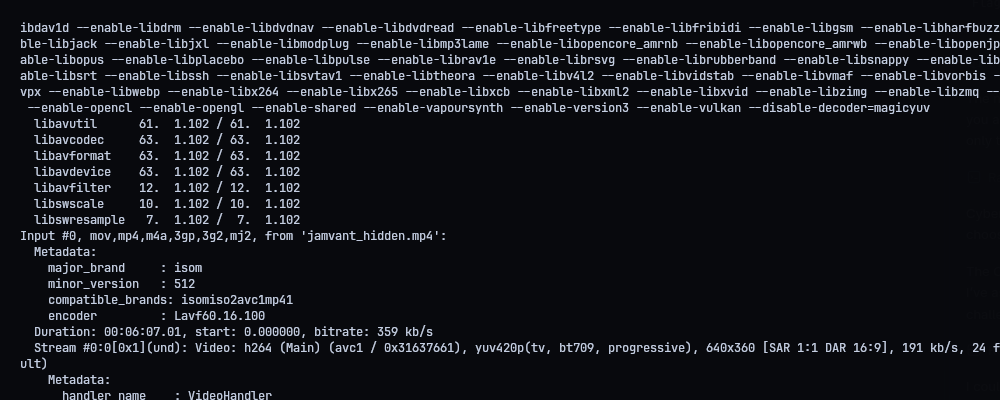
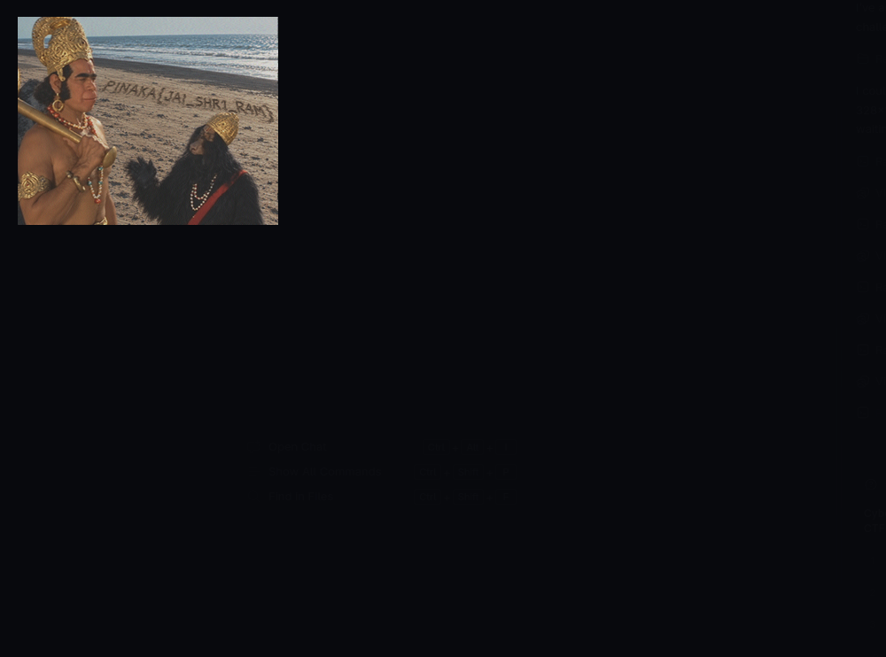
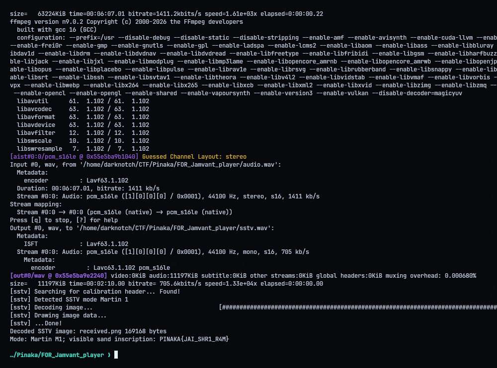

# FOR - Jamvant's Reminder

**Category:** Forensics | **Flag:** `PINAKA{JAI_SHR1_R4M}`

## Solve

The MP4's audio has an SSTV transmission mixed into it. The audio is 6:07 long, and the SSTV part starts around 2:25. Cropping 130 seconds from the 145-second mark gets the whole thing. The decoder picks it up as Martin M1 and gives a 320x256 image of Hanuman and Jamvant on the shore, with the flag written in the sand in the middle:

```text
PINAKA{JAI_SHR1_R4M}
```







## Reproduce

Needs FFmpeg and the decoder from `requirements.txt` (installed into `.venv`). `./repro.sh` extracts `audio.wav`, crops it to `sstv.wav` and writes `received.png`. It deletes the WAVs afterwards unless you pass `--keep-audio`.

```python
#!/usr/bin/env python3
"""Extract and decode the SSTV transmission embedded in Jamvant's video."""
from __future__ import annotations
import subprocess, sys
from pathlib import Path
ROOT=Path(__file__).resolve().parent
VIDEO=ROOT/'jamvant_hidden.mp4'
AUDIO=ROOT/'audio.wav'
SEGMENT=ROOT/'sstv.wav'
IMAGE=ROOT/'received.png'
FLAG='PINAKA{JAI_SHR1_R4M}'

def run(args):
    subprocess.run(args,cwd=ROOT,check=True)

def main():
    run(['ffmpeg','-y','-i',str(VIDEO),'-vn',str(AUDIO)])
    run(['ffmpeg','-y','-ss','145','-t','130','-i',str(AUDIO),'-ac','1',str(SEGMENT)])
    decoder=ROOT/'.venv/bin/sstv'
    run([str(decoder),'-d',str(SEGMENT),'-o',str(IMAGE)])
    if not IMAGE.is_file() or IMAGE.stat().st_size<1000:raise RuntimeError('SSTV decoder did not create a received image')
    print('Decoded SSTV image:',IMAGE.name,IMAGE.stat().st_size,'bytes')
    print('Mode: Martin M1; visible sand inscription:',FLAG)
    if '--keep-audio' not in sys.argv:
        AUDIO.unlink(missing_ok=True);SEGMENT.unlink(missing_ok=True)
if __name__=='__main__':main()
```
