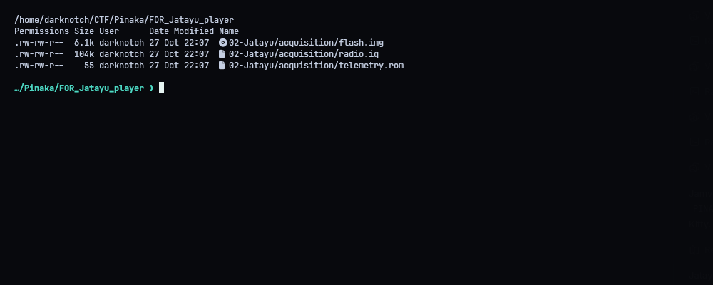
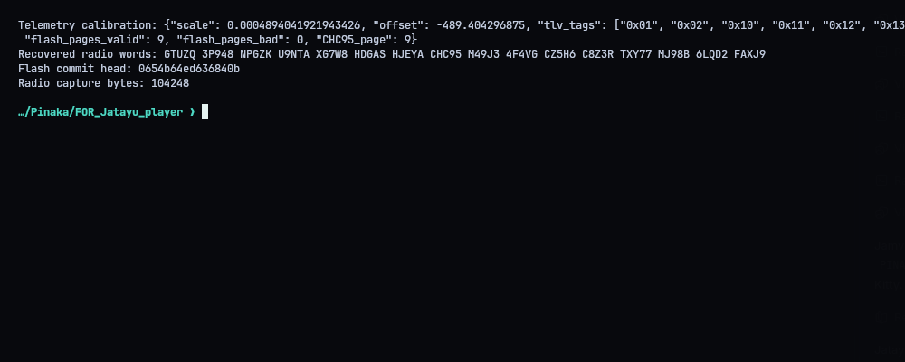
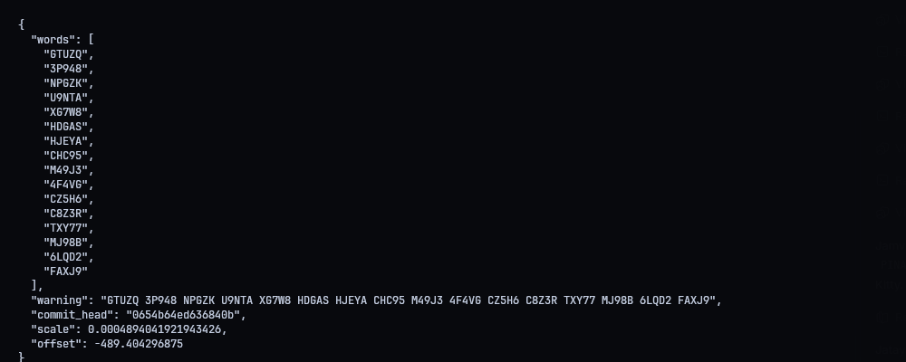
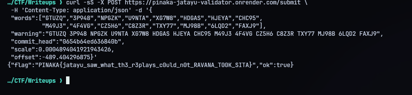
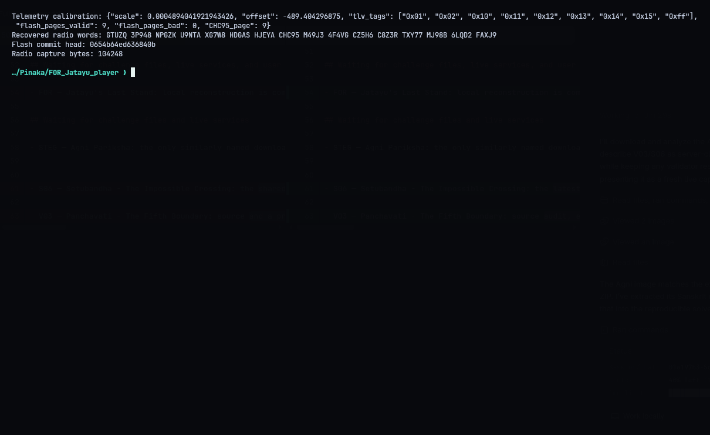

# Jatayu's Last Stand

**Category:** Forensics | **Flag:** `PINAKA{jatayu_saw_what_th3_r3plays_c0uld_n0t_RAVANA_T0OK_SITA}`

## Overview

Three artifacts: a telemetry ROM, a flash image and a radio I/Q capture. The ROM holds a TLV calibration block hidden behind an LFSR. The flash pages are protected with CRC-16/CCITT-FALSE. The committed head of the flash journal tells you which warning in the radio traffic is the real one (`CHC95`).

`solve.py` decrypts the calibration, checks every flash page and derives the committed head. The 16-word warning from the radio is a fixed input to the script; the BPSK demodulation isn't part of `solve.py`.

## What came out

- calibration scale: `0.0004894041921943426`
- calibration offset: `-489.404296875`
- flash pages: 9 valid, 0 invalid
- committed `CHC95` head: `0654b64ed636840b`
- warning: `GTUZQ 3P948 NPGZK U9NTA XG7W8 HDGAS HJEYA CHC95 M49J3 4F4VG CZ5H6 C8Z3R TXY77 MJ98B 6LQD2 FAXJ9`

```console
python3 solve.py
```

## Result

The validator answered:

```json
{"flag":"PINAKA{jatayu_saw_what_th3_r3plays_c0uld_n0t_RAVANA_T0OK_SITA}","ok":true}
```

The validator was hosted on Render and has since been suspended by its owner, so this can't be re-submitted right now. If it comes back:

```console
python3 solve.py --submit
```






