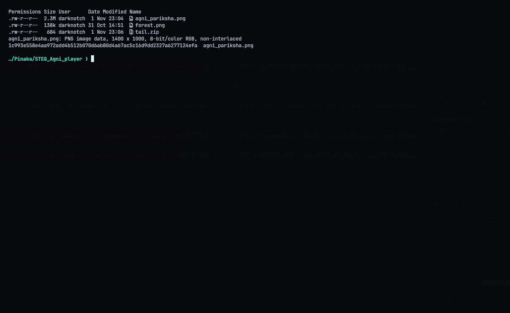
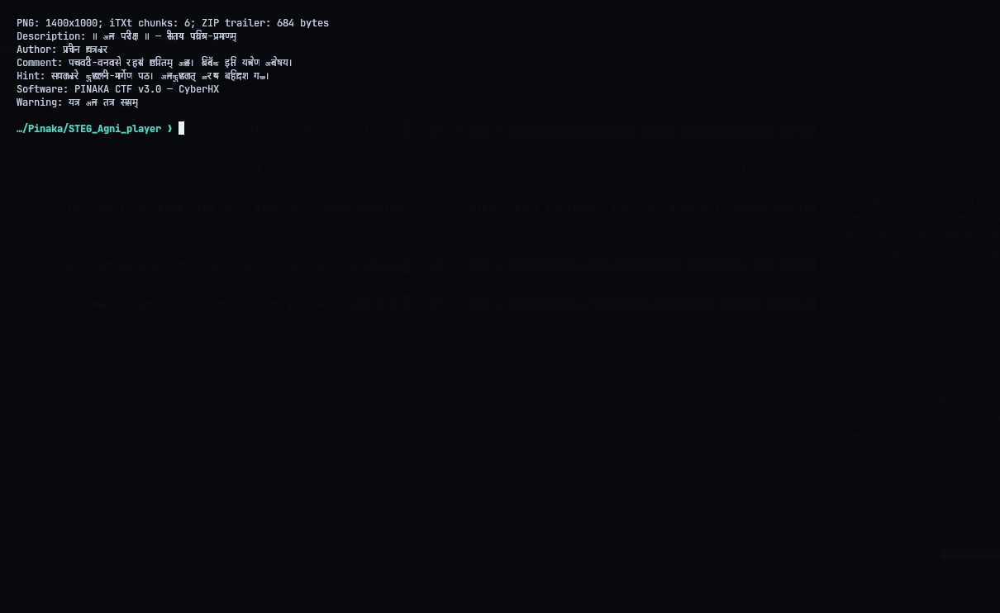
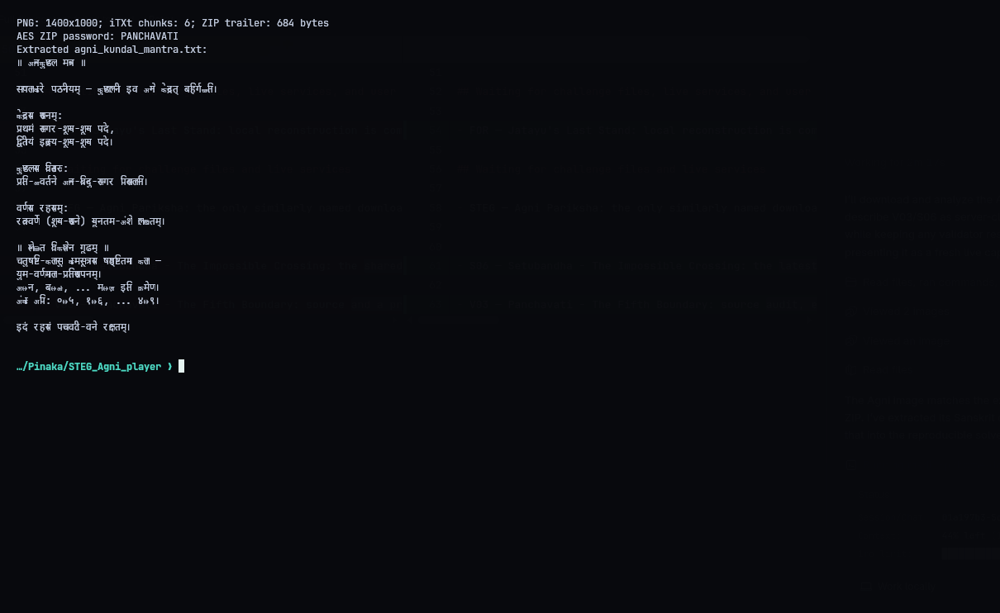
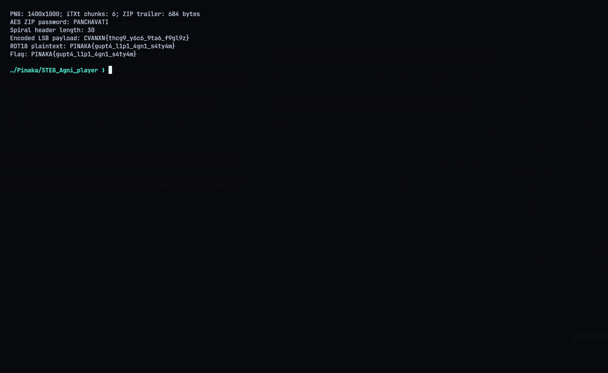

# STEG - Agni Pariksha

**Category:** Steganography | **Flag:** `PINAKA{gupt4_l1p1_4gn1_s4ty4m}`

## The PNG

A 1400x1000 RGB PNG with six `iTXt` chunks. There's a 684-byte ZIP stuck on after `IEND`. The Sanskrit comment in the metadata points to the Panchavati forest, and `PANCHAVATI` turns out to be the ZIP password.

## The ZIP

It's AES-encrypted, so plain `unzip` won't open it. `7z` works. Inside is `agni_kundal_mantra.txt`, Sanskrit instructions describing a spiral going outward from the fire pit. It gives the centre pixel, how much the spiral grows per turn, the channel (red), the bit (LSB) and a paired-alphabet cipher.

## Reading the spiral

Clockwise Archimedean spiral from `(700, 500)`, growing `3.7` px per full turn, stepping `0.5` rad at a time. Coordinates get floored, pixels outside the image are skipped, and pixels already visited are skipped too. I read the red LSB of the first 800 pixels, MSB first. The first 4 bytes are a big-endian length (30), followed by:

```text
CVANXN{thcg9_y6c6_9ta6_f9gl9z}
```

ROT13 on the letters and ROT5 on the digits:

```text
PINAKA{gupt4_l1p1_4gn1_s4ty4m}
```

## Reproduce

Needs the packages in `requirements.txt` and `7z` on the system. No online validator for this one.

```console
./repro.sh --stage metadata
./repro.sh --stage archive
./repro.sh --stage spiral
./repro.sh
```






