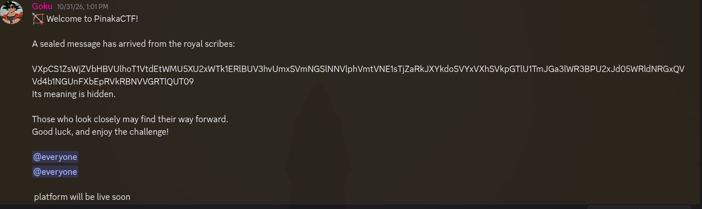
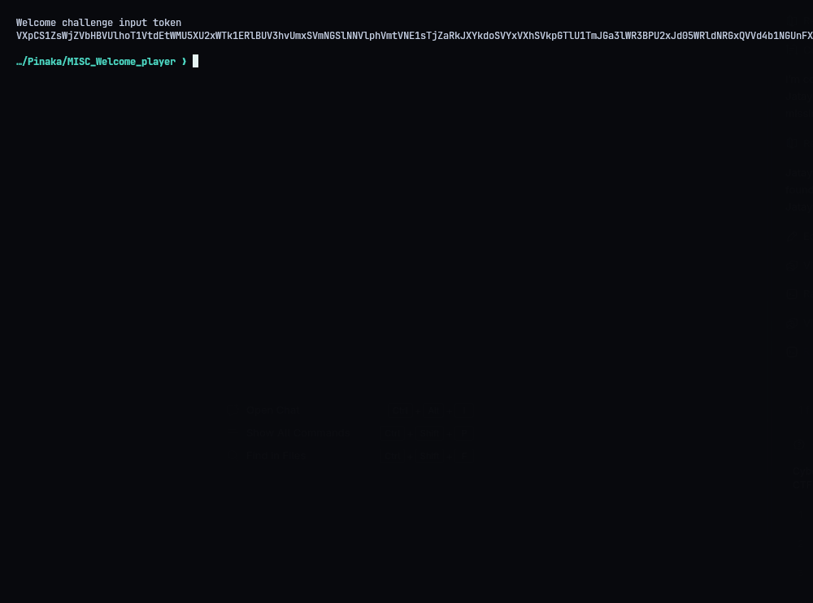
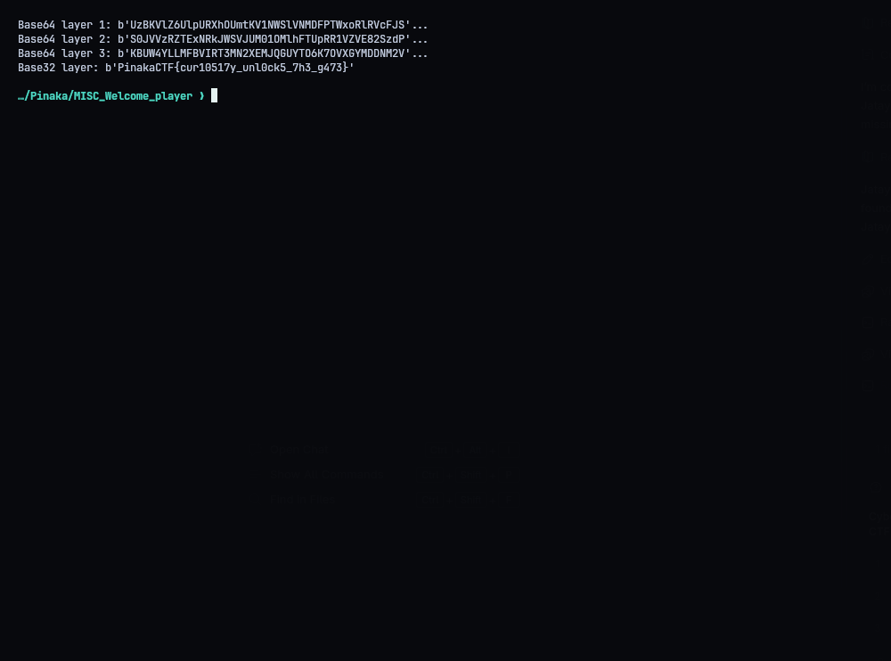
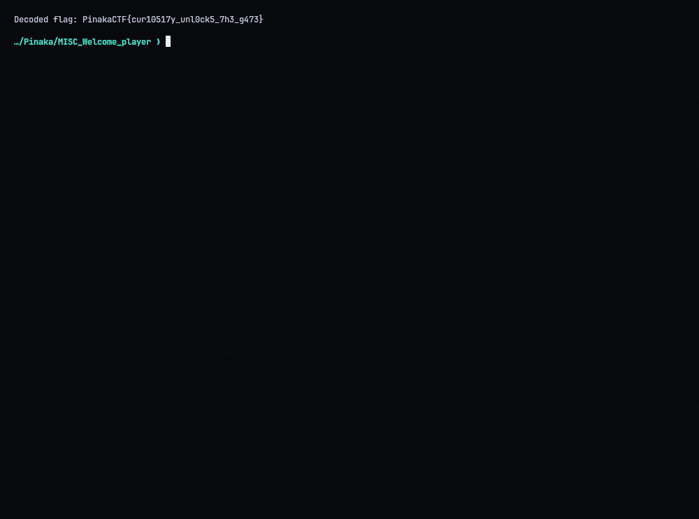

# MISC - Welcome to PINAKA

**Flag:** `PinakaCTF{cur10517y_unl0ck5_7h3_g473}`

The welcome message on Discord came with a "sealed message from the royal scribes" and the line "Its meaning is hidden. Those who look closely may find their way forward."



The string only uses the Base64 alphabet, and decoding it gives another Base64-looking string (starting `UzBK...`), so it's Base64 inside Base64. Peeling it:

| Step | Output |
|---|---|
| Base64 | `UzBKVlZ6UlpURXhOUmtKV1NWSlVNMDFPTWxoRlRVcFJSMVZa...` |
| Base64 | `S0JVVzRZTExNRkJWSVJUM01OMlhFTUpRR1VZVE82SzdPVlhH...` |
| Base64 | `KBUW4YLLMFBVIRT3MN2XEMJQGUYTO6K7OVXGYMDDNM2V6N3IGNPWONBXGN6Q====` |
| Base32 | `PinakaCTF{cur10517y_unl0ck5_7h3_g473}` |

After the third layer, the output is all uppercase letters and 2-7 with `====` padding, which means Base32. `solve.py` does the same four steps:

```console
python3 solve.py
Decoded flag: PinakaCTF{cur10517y_unl0ck5_7h3_g473}
```






