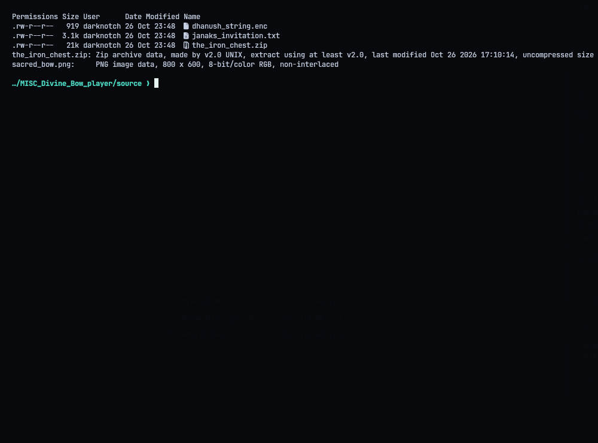
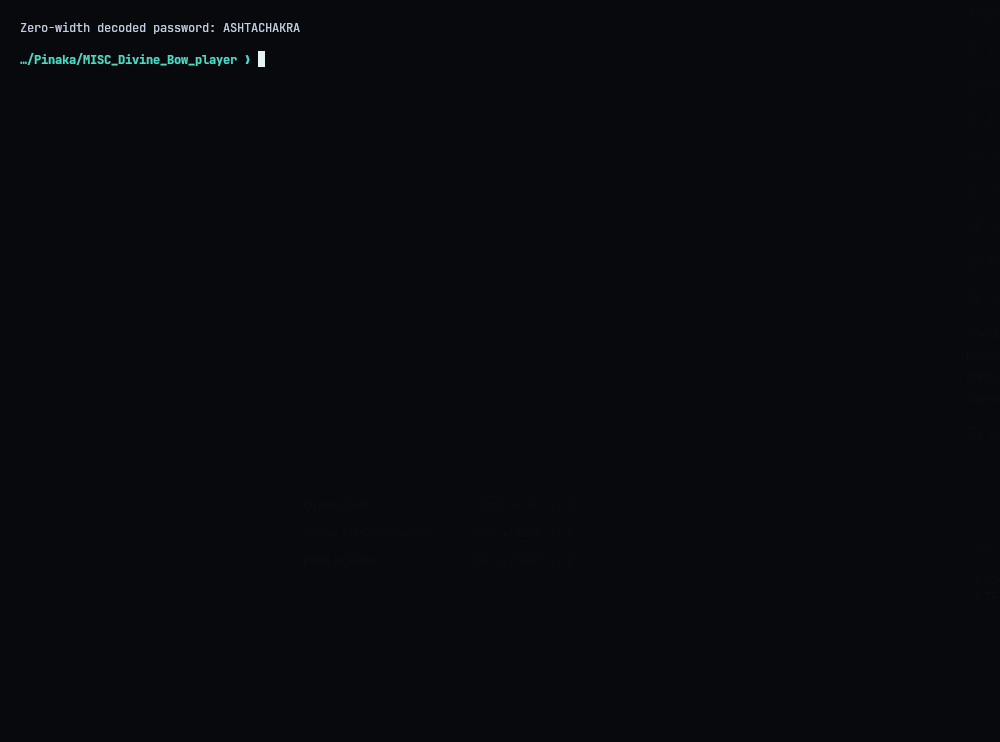
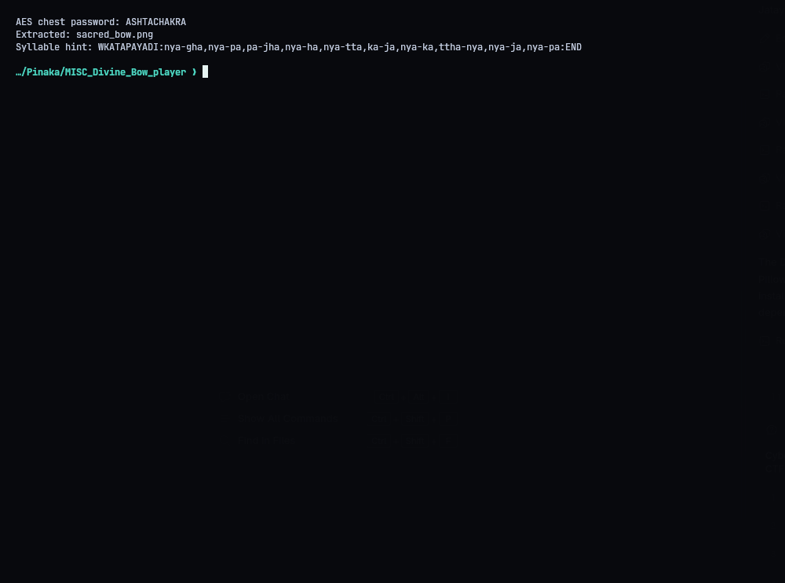
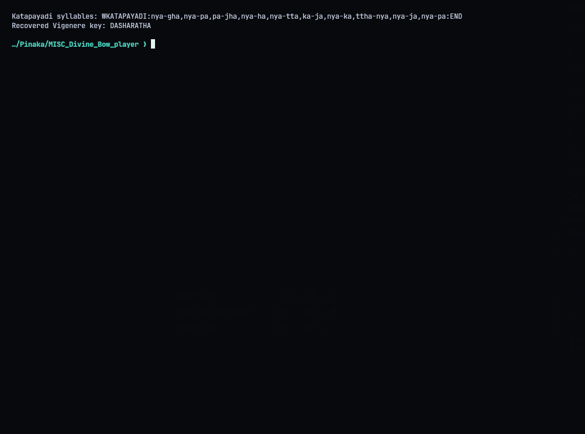
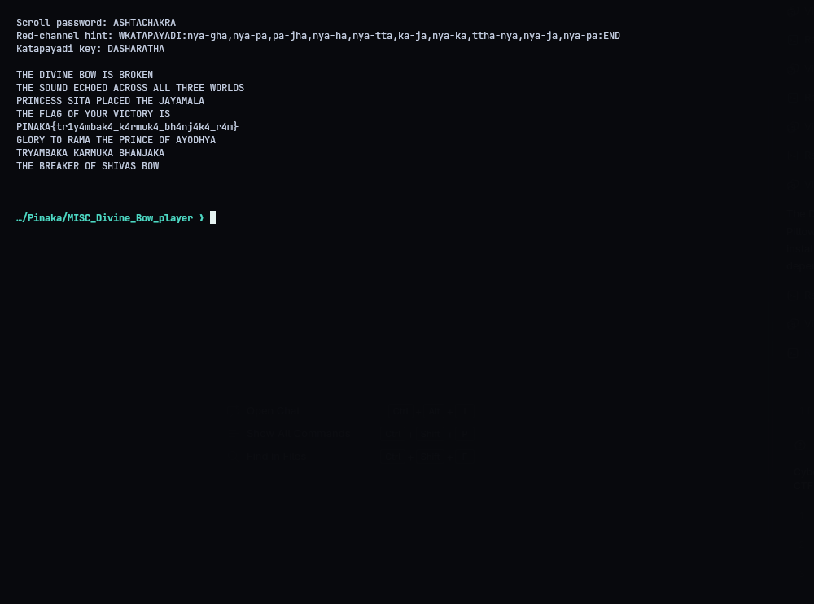

# MISC - The Divine Bow

**Flag:** `PINAKA{tr1y4mbak4_k4rmuk4_bh4nj4k4_r4m}`

Four layers:

1. The invitation text has zero-width characters in it (U+200B / U+200C). Read as bits and grouped into bytes, they spell `ASHTACHAKRA`, which is the password for the chest.
2. The chest is an AES ZIP, which 7-Zip opens with that password. Inside are an RGB image and a hint about mapping syllables.
3. The red-channel LSBs (MSB first) give Katapayadi syllables. Their digit pairs, read as A1Z26, spell `DASHARATHA`.
4. Vigenere with `DASHARATHA` gives the flag. The key applies to letters *and* digits, and the key index advances on both.

```console
python3 solve.py
Scroll password: ASHTACHAKRA
Katapayadi key: DASHARATHA
PINAKA{tr1y4mbak4_k4rmuk4_bh4nj4k4_r4m}
```






